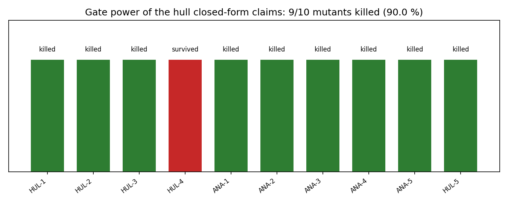

# Gate power of the hull generator's closed forms

**Date**: 2026-11-06 · **Scope**: `tensorcad/hull.py` (generator) + `tensorcad/hydrostatics_analytic.py` (analytic reference)
· **Harness**: `tools/hull_gate_power/mutate.py` (rerun it; this page is generated from its JSON by `report.py`)

## Why this audit

The 2026-11-04 claim-gate-power audit attacked five modules and closed at 14/14, but it
explicitly left the parametric hull generator uncovered: *"the generator's own closed forms
are shared constants -- a mutant of the exponent would have to be paired with the analytic
side to be meaningful"*. That pairing is what this page does. The generator and the
reference each carry their own copy of the closed form (the exponent, the `sqrt` vertical
profile, the `2/3` volume factor, the Beta integral). A defect that moves one copy and not
the other is exactly the class of regression a mesh-vs-reference comparison exists to catch --
if any test actually performs the comparison at a tolerance tighter than the defect.

## Method

* **One defect at a time.** Exact-string replacement (a non-unique pattern is refused), one
  pytest run per mutant, restore from original bytes with a SHA-256 check.
* **Clean-tree guard.** Aborts if `git diff -- tensorcad` is non-empty.
* **Targeted scope.** Generator mutants run `tests/test_hull.py` + `tests/test_analytic_hydrostatics.py`;
  analytic-side mutants run `tests/test_hydrostatics_analytic.py` + `tests/test_analytic_hydrostatics.py`
  + `tests/test_hull.py`, so a kill is attributable.

## Result

Gate power: **9/10 = 90.0 %**

| mutant | kind | file | documented claim it should protect | verdict |
|---|---|---|---|---|
| `HUL-1-taper-exponent` | model | `hull` | mesh volume 7.446554 m^3 at 41x13 vs analytic 7.512698 (-0.88 %): the sampled surface must be the surface the reference integrates | **KILLED** |
| `HUL-2-vertical-taper` | model | `hull` | the sqrt vertical profile (the 2/3 volume factor of B*L*T*I*2/3) | **KILLED** |
| `HUL-3-end-zeroing` | gate | `hull` | the end stations close on the centreline (math.sin(pi) is not exactly zero in floating point) | **KILLED** |
| `HUL-4-midship-split` | gate | `hull` | midship belongs to both halves; the tie must not bend the surface | **SURVIVED** |
| `ANA-1-volume-factor` | value | `ana` | displaced volume 7.512698 m^3 = B*L*T*I*2/3 | **KILLED** |
| `ANA-2-vcb` | value | `ana` | VCB = -0.4*T (0.6*T above the keel) | **KILLED** |
| `ANA-3-waterplane-half-percent` | tolerance | `ana` | waterplane area 14.061669 m^2 at 41x13; the fine grid is within half a percent on every quantity | **KILLED** |
| `ANA-4-taper-arg` | value | `ana` | taper_integral is a Beta integral: e=0 -> 1, e=1 -> 2/pi, e=2 -> 1/2 | **KILLED** |
| `ANA-5-volume-half-percent` | tolerance | `ana` | the documented -0.880 % volume grid error, pinned to 5e-5 | **KILLED** |
| `HUL-5-taper-integral-const` | value | `hull` | TAPER_INTEGRAL = int_0^1 sin(pi*x)^0.7 dx, cross-derived from the volume identity | **KILLED** |



### What survived, and why

* `HUL-4-midship-split` -- At midship ``sin(pi/2) = 1`` and ``1**p = 1`` for every exponent, and the default form has ``fore == aft``. The ``>=`` vs ``>`` choice is unobservable in the output: no test can kill this mutant, and it is not a defect. It is recorded as a structural no-op, not a gap.

### What the kills show

* `HUL-1-taper-exponent` -- 6 test(s) red. The generator's exponent is a parameter, but the analytic reference keeps its own copy of the closed form. A generator that samples ``sin^0.8`` while the reference integrates ``sin^0.7`` moves the mesh volume by ~48 % -- far outside every documented band.
* `HUL-2-vertical-taper` -- 7 test(s) red. The ``sqrt`` profile is what makes the vertical integral ``2/3``. A linear profile changes the volume factor to ``1/2`` (-25 %).
* `HUL-3-end-zeroing` -- 29 test(s) red. ``math.sin(math.pi)`` is ``1.22e-16``, not zero. Without the explicit zeroing the end stations carry a ``~1e-11 m`` half-breadth. The offsets test asserts the waterline closes at both ends *exactly*, so the slot is visible even though the volume change is below any tolerance.
* `ANA-1-volume-factor` -- 8 test(s) red. The reference volume is the thing the mesh is compared against. Halving the ``2/3`` factor moves the documented -0.88 % error to ~-26 %.
* `ANA-2-vcb` -- 6 test(s) red. ``VCB = -0.4*T`` is the z-weighted mean of ``zeta**(1/2)`` on ``[-T, 0]``. Shifting it to ``-0.5*T`` is a 25 % error in the centre of buoyancy.
* `ANA-3-waterplane-half-percent` -- 4 test(s) red. A 0.5 % shift of the reference waterplane sits inside the 1.5 % default-grid band but outside the 0.5 % fine-grid band -- the fine-grid test is what has the teeth.
* `ANA-4-taper-arg` -- 14 test(s) red. The Beta integral's first gamma argument is ``(e+1)/2``. Off by half an exponent, the textbook values (``e=1 -> 2/pi``, ``e=2 -> 1/2``) break immediately.
* `ANA-5-volume-half-percent` -- 5 test(s) red. The documented -0.880 % grid error is pinned to ``abs=5e-5``. A 0.5 % shift of the reference moves it to -1.375 %.
* `HUL-5-taper-integral-const` -- 13 test(s) red. ``TAPER_INTEGRAL`` in ``hull.py`` is cross-derived two independent ways: Simpson quadrature of ``sin^0.7`` and the gamma-function derivation in ``hydrostatics_analytic.py``. Halving the prefactor breaks both.

## Limitations

* **The mutant set is hand-picked, not exhaustive.** 10 mutants over two modules is a probe of the
  evidence style, not a coverage metric. A surviving mutant proves a gap; a killed mutant does not
  prove the absence of one.
* **`HUL-4` is a structural no-op**, not a missed defect: the midship tie is unobservable because
  `1**p == 1` for every `p`. It is listed so a future reader does not mistake it for debt.
* **`tolerance`-kind mutants measure the band, not correctness.** They show a documented number is
  pinned tighter than the injected shift; they say nothing about whether the number is right.
* **Not covered here**: the lofting/topology code of `generate_hull` (its claims are already pinned
  by the watertight/manifold/Euler gates audited on 2026-11-04), `mesh_conditioning.py` (35 s per
  run, a separate deliberate audit), and the `export.py`/`gate.py` thresholds.

## Reproduce

```bash
python3 tools/hull_gate_power/mutate.py --out runs_m4780_hull_gate_power.json   # resumable
python3 tools/hull_gate_power/report.py                                        # this page + figure
```
