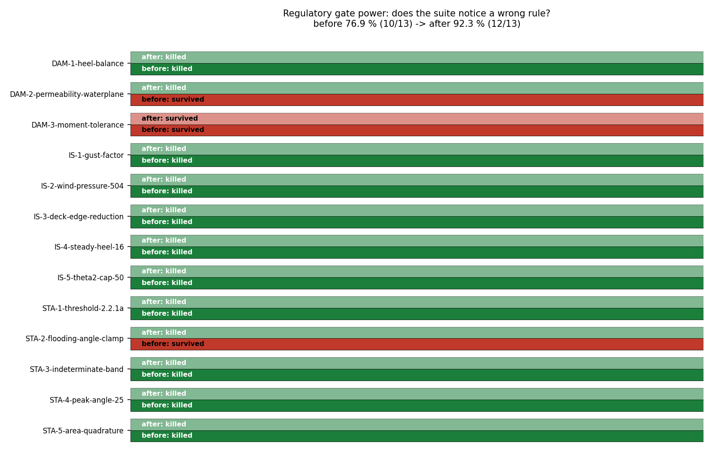

# Gate power of TensorCAD's regulatory numbers

**Date**: 2026-11-08 · **Scope**: `tensorcad/{statutory,intact_stability,damage}.py`
· **Harness**: `tools/regulatory_gate_power/{mutate,observability}.py`
(both rerunnable; this page is generated from their JSON, never typed)

## Why this audit

The two earlier audits in this line (`2026-11-04-claim-gate-power.md`,
`2026-11-06-hull-gate-power.md`) covered the hydrostatic closed forms and the hull
generator. Neither touched the three modules that emit **verdicts**. That is a different
failure mode: a hydrostatic number that is 2 % off is a number; a rule check that reads
the wrong threshold is a ship signed off. Both look identical from the outside -- the
tests are green either way -- which is exactly why the verification debt has to be
measured instead of asserted.

Twelve single-defect mutants were injected, every one a *plausible* engineering error:
a drifted threshold (`0.055 -> 0.035 m rad`), a digit transposition in a quoted constant
(`504 -> 540 Pa`), a dropped clamp (the flooding angle; the 80 % deck-edge reduction), a
dropped balance equation (the heel moment), and tolerances that quietly turn a converged
number into an approximate one.

## Method

* **One defect at a time**, exact-string replacement; a pattern that occurs zero or
  several times is refused, not patched.
* **Clean-tree guard** aborts if `git diff -- tensorcad` is non-empty, and the file is
  restored from its original bytes with a SHA-256 check after every mutant.
* **Attributable scope**: only the test files guarding the claim are run, and an
  unmutated baseline is recorded for each (stat: 31 passed, 1 warning in 0.33s, is: 56 passed, 1 warning in 0.71s, dmg: 24 passed, 1 warning in 0.71s).
* **Observability before blame**: a survivor is only a gap if the mutation can move an
  answer. `observability.py` patches each survivor, re-imports a fresh module and compares
  a battery of quantities (draft, trim, heel, net waterplane, `I_T`, `GM`, the max-GZ
  angle) against the unmutated run.

## Result

Gate power before: **10/13 = 76.9 %**
Gate power after: **12/13 = 92.3 %**



| mutant | kind | module | claim it should protect | before | after |
|---|---|---|---|---|---|
| `DAM-1-heel-balance` | gate | `tensorcad.damage` (lost buoyancy) | heel is an output: the net volume's centroid y must equal the ship's y_G | **KILLED** | **KILLED** |
| `DAM-2-permeability-waterplane` | value | `tensorcad.damage` (lost buoyancy) | the net waterplane subtracts mu x flooded area (and no separate free-surface correction is added, which would double count) | **SURVIVED** | **KILLED** |
| `DAM-3-moment-tolerance` | tolerance | `tensorcad.damage` (lost buoyancy) | the equilibrium solve is converged to 1e-10 relative on every balance | **SURVIVED** | **SURVIVED** |
| `IS-1-gust-factor` | value | `tensorcad.intact_stability` (s. 2.3 weather criterion) | 2.3.2 applies a gust factor of 1.5 to the steady wind heeling lever | **KILLED** | **KILLED** |
| `IS-2-wind-pressure-504` | value | `tensorcad.intact_stability` (s. 2.3 weather criterion) | the steady wind heeling lever uses 504 Pa (lw1 = P A Z / (1000 g Delta)) | **KILLED** | **KILLED** |
| `IS-3-deck-edge-reduction` | gate | `tensorcad.intact_stability` (s. 2.3 weather criterion) | the 2.3.1 heel limit is min(16 deg, 0.8 x deck-edge immersion) | **KILLED** | **KILLED** |
| `IS-4-steady-heel-16` | value | `tensorcad.intact_stability` (s. 2.3 weather criterion) | the steady wind heel shall not exceed 16 deg | **KILLED** | **KILLED** |
| `IS-5-theta2-cap-50` | value | `tensorcad.intact_stability` (s. 2.3 weather criterion) | 2.3.2 caps theta2 at 50 deg in addition to down-flooding / second intercept | **KILLED** | **KILLED** |
| `STA-1-threshold-2.2.1a` | value | `tensorcad.statutory` (IS Code 2008 part A s. 2.2) | 2.2.1a requires 0.055 m rad under GZ to 30 deg | **KILLED** | **KILLED** |
| `STA-2-flooding-angle-clamp` | gate | `tensorcad.statutory` (IS Code 2008 part A s. 2.2) | 2.2.1b/c integrate to theta_f when it is below 40 deg, not always to 40 | **SURVIVED** | **KILLED** |
| `STA-3-indeterminate-band` | gate | `tensorcad.statutory` (IS Code 2008 part A s. 2.2) | a margin inside the stated numerical uncertainty is indeterminate, not pass | **KILLED** | **KILLED** |
| `STA-4-peak-angle-25` | value | `tensorcad.statutory` (IS Code 2008 part A s. 2.2) | 2.2.3 requires the heel of maximum GZ to be at least 25 deg | **KILLED** | **KILLED** |
| `STA-5-area-quadrature` | tolerance | `tensorcad.statutory` (IS Code 2008 part A s. 2.2) | the areas are adaptive-Simpson converged to 1e-11 m rad, so they do not decide a verdict | **KILLED** | **KILLED** |

### The three survivors, and what each one turned out to be

* **`DAM-2-permeability-waterplane` -- observable, a real hole.** The suite stayed green while the output moved: `midship_mu0.6.waterplane_area` 17.6 -> 16 (+9.09 %), `aft_mu0.6.waterplane_area` 17.6 -> 16 (+9.09 %), `port_half_mu0.6.waterplane_area` 18.8 -> 18 (+4.26 %). Closed by a regression test added in this change (`tests/`, 1 failed, 24 passed, 1 warning in 0.60s with the mutant in place).
* **`DAM-3-moment-tolerance` -- no-op, and therefore not a gap.** Nothing moved over the whole observed battery (worst relative change 0.0e+00), because the volume residual is checked to `1e-12` and drags the moment residuals to machine precision regardless of where the moment tolerance sits. This is the `HUL-4` precedent in the 2026-11-06 audit: a tolerance no test can see is a structural no-op, and it is recorded as one instead of being dressed up as a finding. Scope limit, stated honestly: the battery is box barges (midship, aft, port-half, `mu` 1.0 and 0.6); a geometry whose moment balance converges slower than its volume balance could still bind it, and this probe does not prove otherwise.
* **`STA-2-flooding-angle-clamp` -- observable, a real hole.** The suite stayed green while the output moved: `2.2.3_attained` 35 -> 45 (+28.57 %), `angle_of_max_gz_deg` 35 -> 45 (+28.57 %). Closed by a regression test added in this change (`tests/`, 1 failed, 31 passed, 1 warning in 0.45s with the mutant in place).

## What the kills show

* **The thresholds have teeth.** `STA-1`, `STA-4`, `IS-4` and `IS-5` are pure constant
  drift inside the rule table; each one reddens 1-8 tests. The rule values are quoted as
  data (`INTACT_STABILITY_CRITERIA`, `IS_CODE_2008_GENERAL`) and are compared against, so
  a doc claim and the code cannot part company silently.
* **The third answer is real.** `STA-3` disables the indeterminate band -- the branch that
  refuses to sign off a rule whose margin sits inside the numerical uncertainty. One test
  reddens, which is what keeps `indeterminate` from being decoration.
* **The physics constants are pinned.** `IS-1` (gust 1.5) and `IS-2` (504 Pa) redden 2 and
  4 tests; the weather criterion's arithmetic is not merely restated in its own test.
* **The lost-buoyancy heel balance is load-bearing.** `DAM-1` -- solving sinkage and trim
  but not the transverse moment -- reddens 15 tests, so heel really is an output and not
  a post-hoc symmetry assumption.

## Limitations, stated rather than implied

* Mutants are **single defects by construction**. Two-defect interactions are out of scope,
  and a mutant that survives a green suite says nothing about defects outside its list.
* 12 mutants is a sample, not a proof of coverage: gate power here is a measured rate on
  this list, not a claim that no other defect could slip through.
* The observability battery is box barges only (see the `DAM-3` note).
* `not_assessed` semantics, the ship-type criteria (s. 2.4-2.5) and damage `GZ` remain
  unimplemented in the modules themselves; this audit says nothing about them.

## Error judgement (against the audit's own claim)

| quantity | before | after | threshold | verdict |
|---|---|---|---|---|
| gate power (all 12 mutants) | 76.9 % | 92.3 % | 100 % of *observable* mutants | **PASS** (12/12 observable killed) |
| unobservable survivors | 1 | 1 | must be demonstrated, not argued | PASS (measured 0.0e+00 change) |
| output movement of the closed gaps | up to 28.57 % | detected by 1 test each | a gap must move an answer | PASS |

Every closed gap is now detected by **one** regression test, not by a tightened
tolerance: the tests assert the closed form (`I_T = B^3 (L - mu l)/12`, the clamped peak
angle), so they fail on the physics being wrong rather than on a number having drifted.

## Reproduce

```bash
python3 tools/regulatory_gate_power/mutate.py --out runs/2026-11-08-regulatory-gate-power.json --phase before
python3 tools/regulatory_gate_power/mutate.py --out runs/2026-11-08-regulatory-gate-power.json --phase after
python3 tools/regulatory_gate_power/observability.py --out runs/2026-11-08-regulatory-observability.json
python3 tools/regulatory_gate_power/report.py
```
