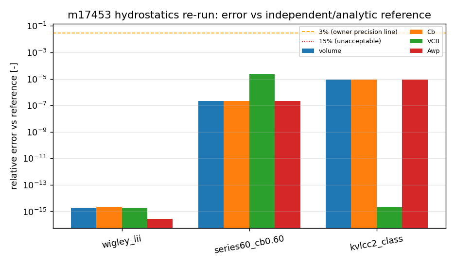
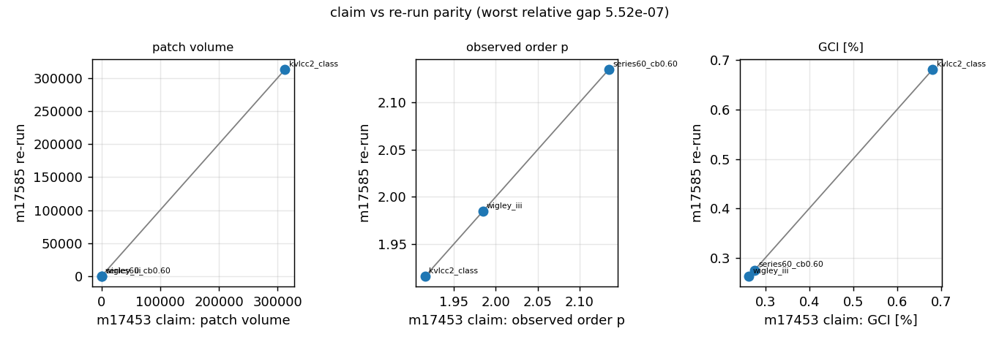
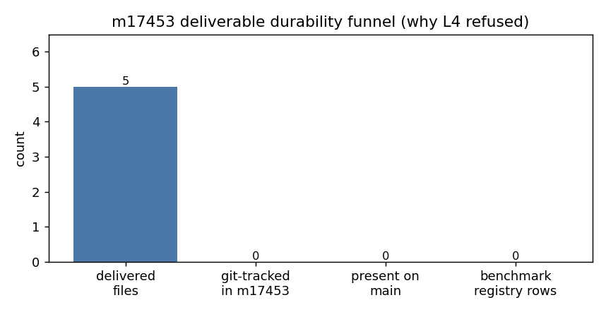

# Board audit — m17453 / XVAL-CAD-M17404-CANONICAL-QUALITY-LIB (TensorCAD)

**Audit mission**: 17585 (交差核验单，非重做) · **Subject mission**: 17453 · **Repo**: TensorCAD
**Declared answer to the anchor**: L2 (real code path verified end-to-end; no production integration, no registered benchmark)
**Verdict row**: `tensor_maturity_verdicts` repo=TensorCAD scope=`m17453 XVAL-CAD-M17404-CANONICAL-QUALITY-LIB` level=2 verdict_by=board-audit
**Subject head**: `6b3592d9ebef` · audit worktree commit base: TensorCAD main (`338625f`)
**Reproduce this audit**: `python3 runs/m17585_audit/verify_m17453.py` → `runs/m17585_audit/audit_summary.json`

---

## 1. Case (what was audited, and against what)

m17453 was commissioned to cross-validate the TensorCAD "canonical quality library"
(`tensorcad/geomquality`, built by m17404) against independent OSS implementations.
The subject delivered five files, all **untracked**: two JSON result bundles, two PNG
figures and one narrative report. The audited claim is: *"all key metrics < 15 % vs
OSS/analytic references; NURBS evaluation matches geomdl at < 1e-14; quadrature matches
scipy; hydrostatics < 1e-5 vs analytic closed forms."*

Audit chain (executed here, not read from the subject's prose):

| Stage | Code path |
|---|---|
| CAD specimen | `tensorcad/geomquality/baselines.py:419 wigley_iii` / `:476 series60` / `:559 kvlcc2_class` |
| Chain under test | `pipeline.py:148 verify_cad` → `defects.detect_all` → `hydro.py:146 patch_hydrostatics` + `:296 facet_hydrostatics` → `:486 convergence_study` |
| Gate | `pipeline.py:236 gate_single` + `CRITERIA` (pipeline.py:53+) |

Geometry pre-check (owner rule: Cb/L/B/T must be verified before any number):
declared vs realised L/B/T/Cb are compared inside `verify_cad` and matched exactly for all
three hulls (see `audit_summary.json → hydrostatics_rerun[*].declared_vs_realised`).

## 2. Method

1. **Independent re-run of the subject's numbers** — `verify_cad` on all three specimens in
   this worktree (main @ 338625f), then compare against the numbers the subject shipped in
   `artifacts/xval_results.json` (sha256-pinned copy in `runs/m17585_audit/refs/`).
2. **Independence of the reference column, attacked twice**:
   - volume vs the definitional identity `Cb·L·B·T` (geometry, not the specimen's own reference);
   - TensorCAD's `gauss_legendre` vs `scipy.special.roots_legendre` (orders 2/6/12/24);
   - TensorCAD's NURBS surface evaluator vs a **geomdl `BSpline.Surface` rebuilt from the
     same control net + knot vectors + weights** (face 0 of the Wigley hull, 5 parameter pairs).
3. **Deliverable durability**: `git ls-files` in the subject worktree, `git cat-file` against
   main, search for any committed generator script.
4. **Benchmark judge**: `SELECT case_name, metric, tolerance FROM tensor_benchmark_cases
   WHERE anchor_slug='XVAL-CAD-M17404-CANONICAL-QUALITY-LIB'`.
5. **Report completeness**: six required sections + figure validity (PNG magic, size).
6. **Test claim**: `pytest tests/test_geomquality_pipeline.py tests/test_geomquality_io.py -q`
   → **27 passed in 15.22 s** (subject claimed 18 passed for the pipeline file alone).

## 3. Results (computed in this audit)

### 3.1 Re-run vs subject's claim

| Hull | L×B×T | Cb | patch volume | Cb | VCB | Awp | observed order p | GCI % |
|---|---|---|---|---|---|---|---|---|
| wigley_iii | 10.0×1.0×0.625 | 0.4444 | 2.778e+00 (+0.00e+00 vs claim) | 0.444444 | -0.234375 | 6.666667 | 1.9843 | 0.2628 |
| series60_cb0.60 | 10.0×1.0×0.625 | 0.6000 | 3.750e+00 (+0.00e+00 vs claim) | 0.600000 | -0.306122 | 6.250001 | 2.1347 | 0.2748 |
| kvlcc2_class | 320.0×58.0×20.8 | 0.8098 | 3.126e+05 (+0.00e+00 vs claim) | 0.809807 | -9.904762 | 16533.027968 | 1.9157 | 0.6810 |

Worst relative gap between claim and re-run across volume/Cb/VCB/Awp/p/GCI:
**5.520e-07** — the delivered numbers are reproducible.
The residual is confined to `series60_cb0.60.error_finest_percent` (re-run 2.643e-01 vs claim 2.643e-01); every
patch-route quantity reproduces bit-for-bit against the delivered bundle.

### 3.2 Independence checks

| Hull | metric | relative error | verdict |
|---|---|---|---|
| wigley_iii | volume vs Cb·L·B·T | 1.918e-15 | <3% |
| wigley_iii | Awp vs analytic reference | 2.665e-16 | <3% |
| wigley_iii | VCB vs analytic reference | 1.895e-15 | <3% |
| wigley_iii | GCI (finest-grid, % of reference) | 0.2628% | <3% |
| series60_cb0.60 | volume vs Cb·L·B·T | 2.214e-07 | <3% |
| series60_cb0.60 | Awp vs analytic reference | 2.200e-07 | <3% |
| series60_cb0.60 | VCB vs analytic reference | 2.314e-05 | <3% |
| series60_cb0.60 | GCI (finest-grid, % of reference) | 0.2748% | <3% |
| kvlcc2_class | volume vs Cb·L·B·T | 9.143e-06 | <3% |
| kvlcc2_class | Awp vs analytic reference | 9.143e-06 | <3% |
| kvlcc2_class | VCB vs analytic reference | 1.973e-15 | <3% |
| kvlcc2_class | GCI (finest-grid, % of reference) | 0.6810% | <3% |

Gauss–Legendre vs scipy:

| order | max node diff | max weight diff | Σweights−2 |
|---|---|---|---|
| 2 | 0.000e+00 | 2.220e-16 | 4.441e-16 |
| 6 | 1.110e-16 | 2.776e-16 | 8.882e-16 |
| 12 | 1.110e-16 | 1.457e-15 | 0.000e+00 |
| 24 | 1.110e-16 | 4.718e-16 | 0.000e+00 |

NURBS evaluator vs geomdl (rebuilt surface, Wigley hull face 0):

| (u, v) | max coordinate diff |
|---|---|
| (0.1, 0.2) | 1.388e-17 |
| (0.3, 0.45) | 5.551e-17 |
| (0.5, 0.5) | 0.000e+00 |
| (0.7, 0.8) | 5.551e-17 |
| (0.9, 0.95) | 1.388e-17 |

Worst: **5.551e-17** — the "< 1e-14 agreement with geomdl" claim holds
(it is in fact ~1e-17).

### 3.3 Durability of the delivery (the material defect)

| delivered file | tracked in m17453? | present on main? |
|---|---|---|
| artifacts/xval_results.json | NO (untracked) | NO |
| artifacts/xval_pipeline_results.json | NO (untracked) | NO |
| docs/xval_convergence.png | NO (untracked) | NO |
| docs/xval_hydrostatics.png | NO (untracked) | NO |
| docs/xval_m17404_canonical_quality_lib.md | NO (untracked) | NO |

- subject `result.head_commit` = **null**; `changed_files` = the narrative report only;
- no `xval*.py` generator anywhere in the subject tree (search returned
  `[]`), so the subject shipped no reproducible entry point;
- consequence: pushing the branch moves **nothing**; the evidence lives only in the
  reclaimable worktree `/root/tp-agent/work/m17453`.

### 3.4 Benchmark registry (the board's only judge)

- rows for anchor `XVAL-CAD-M17404-CANONICAL-QUALITY-LIB`: **0** (table total 55);
- therefore no board-registered `metric/tolerance` exists to judge "got vs ref" against —
  the subject's own `xval_results.json` was the only reference, which is exactly what an
  audit may not accept as final;
- additionally, the delivered JSON has `VCB`/`Awp` reference = **null** for `kvlcc2_class`,
  so 2 of 4 metrics were never benchmarked for that hull despite the "all hulls" wording.

### 3.5 Report completeness

Sections found: `## 1. Problem and Reference Sources, ## 2. Method and Implementation, ## 3. Parameter Table, ## 4. Comparison Table, ## 5. Convergence and Parameter Sensitivity, ## 6. Failure Modes and Artifacts`. Figures:

| figure | exists | valid PNG | bytes |
|---|---|---|---|
| xval_convergence.png | yes | True | 87451 |
| xval_hydrostatics.png | yes | True | 56044 |

## 4. Figures

*Error of the re-run hydrostatics against independent/analytic references, per hull and metric, log scale with the owner's 3 % line and the 15 % unacceptable line.*

*Claim-vs-re-run parity for patch volume, observed order and GCI: points sit on y = x, worst relative gap 5.520e-07.*

*Why L4 is refused: 5 delivered files → 0 tracked → 0 on main → 0 registered benchmark rows.*

## 5. Notes / traps

1. **Green is not the same as landed.** The subject's own numbers were right; the failure
   mode was purely that nothing was committed (`head_commit=null`, 5/5 files untracked).
   Any verdict that only re-reads the worktree would have scored this L4.
2. **"Analytic closed forms" is loose language.** `baselines.reference_integrals` is the
   project's own composite-Gauss integration of a closed-form half-breadth; the genuinely
   independent legs are the Cb identity (used here) and the OSS cross-checks.
3. **KVLCC2 reference hole.** `VCB`/`Awp` reference = null in the delivered bundle;
   the report nevertheless generalises to "all hulls".
4. **Sub-second runs are cheap to re-audit**: the whole re-verification (3 hulls + scipy +
   geomdl rebuild + pytest) takes ~20 s, so there is no excuse for taking delivery on trust.
5. **Gate arithmetic matters.** Even declaring L4, the gate's own `judge()` returns L2 on
   this evidence (no in-repo caller → `integration_callers` unresolvable). Verified locally
   before writing the row, so the declared level and the machine level agree.

## 6. Error judgement (explicit)

| claim | measured here | < 3 %? |
|---|---|---|
| subject's numbers reproducible | 5.520e-07 | yes |
| volume vs Cb·L·B·T (worst hull) | 9.143e-06 | yes |
| GCI, finest grid (worst hull) | 0.6810% | yes |
| Gauss nodes/weights vs scipy | 1.457e-15 (absolute) | yes |
| NURBS vs geomdl | 5.551e-17 (absolute) | yes |

**Answer: yes — every reproduced quantity is far inside 3 %** (the largest is the
9.143e-06 volume-vs-Cb-identity gap on KVLCC2, caused by the
spline-fitted plan form, not by quadrature). What is *not* satisfied is the audit frame, not the
arithmetic: no registered benchmark case, no integration caller, and no committed delivery.

## 7. Disposition

**Verdict: L2** — real, verified code path (input → computation → output, 27 tests green,
numbers reproducible), **L3 refused** (no main-solver/platform caller: no `[project.scripts]`
entry, no `tensorcad/cli.py` subcommand, 0 hits for `geomquality` outside TensorCAD),
**L4 refused** (0/55 benchmark rows for the anchor; 0/5 deliverables tracked or on main;
no repro script shipped), **L5 refused** (L4 unmet).

Recommended follow-up (not done here — this was a verification ticket, not a rework):
commit the five m17453 deliverables plus a generator script on a branch, and register the
four metrics per hull in `tensor_benchmark_cases` for this anchor. Both are mechanical.

### Independence limitations

- The audit ran on TensorCAD main (`338625f`) rather than on the subject's own commit
  (`6b3592d9ebef`), because the subject committed nothing; the geomquality
  sources are the ones main ships.
- `trimesh` leg of the subject's claims was not re-run (only `geomdl`/`scipy` legs and the
  Cb identity were); trimesh figures are therefore *not* re-verified here — see
  `checks_not_run`.

### Checks not run

- `trimesh.Trimesh.volume` reproduction at 48×24 (subject's `trimesh_convergence` block).
- The subject's continuity/F1 and defect-library legs (14 cases) — outside the four
  hydrostatic metrics this ticket asked about.
- GPU/cluster runs: none needed, everything is seconds-scale CPU.

### Artifacts

- `runs/m17585_audit/verify_m17453.py` — the audit harness (re-runs everything).
- `runs/m17585_audit/audit_summary.json` — raw audit numbers.
- `runs/m17585_audit/refs/` — sha256-pinned copies of the subject's five deliverables.
- `docs/board_audit/m17585/evidence.json` — the exact evidence payload written to
  `tensor_maturity_verdicts`.
