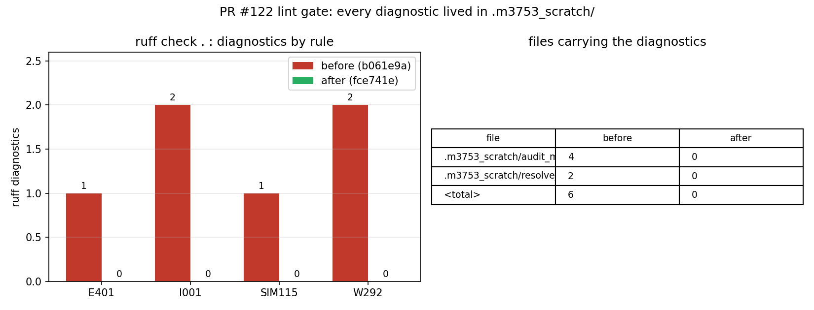
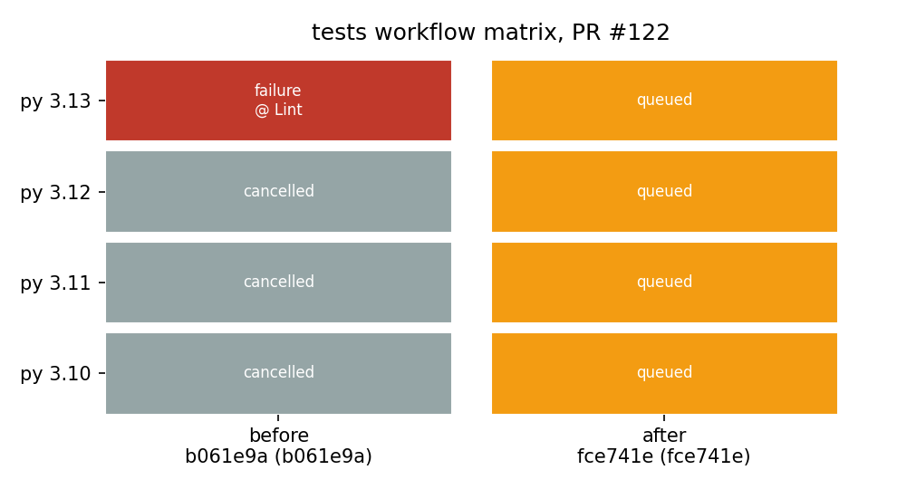

# PR #122 (`agent/m3753`) CI red cure — root cause, fix, evidence (m4390)

**Verdict: root cause identified and removed at the source.** PR #122 was red for one
reason only: `ruff check .` — the `Lint` step of the `tests` workflow — failed on the two
one-off helper scripts that the branch carried in `.m3753_scratch/`. All four diagnostics
classes (`E401`, `I001`, `SIM115`, `W292`, 6 findings in total) live inside that directory;
nothing in `tensorcad/`, `tests/`, `examples/` or `docs/` was implicated. Deleting the two
process leftovers restores `ruff check .` to *All checks passed!* and leaves every
deliverable of the branch untouched.

| item | value |
|---|---|
| repository / PR | `cxs503/TensorCAD` #122 |
| branch | `agent/m3753` |
| head before cure | `b061e9a9e734f9caf87e5e034f0f52dc52c973d8` |
| head after cure | `fce741e8957b37cf2685efbf89fc8ed5d3711020` |
| failing job (before) | `test (3.13)` → conclusion `failure`, first failing step **Lint**; `test (3.10/3.11/3.12)` → `cancelled` (matrix `fail-fast`, consequence not cause) |
| failing workflow | `.github/workflows/tests.yml`, job `test`, step 6 `Lint` (`ruff check .`) |
| PR base CI reference | `main@67e1d5c` — the exact base of PR #122 — passed the *whole* `tests` workflow (`run 41986476880`, conclusion `success`) |

## 1. Case: what was red and why

`.github/workflows/tests.yml` runs, for every push/PR, the four-version matrix
(`3.10, 3.11, 3.12, 3.13`) and the first step after installation is

```yaml
- name: Lint
  run: ruff check .
```

Repository root, no path filter — so **every** `*.py` file in the tree is linted, including
directories that are not part of the package. PR #122's tree carried
`.m3753_scratch/audit_merge.py` and `.m3753_scratch/resolve_changelog.py`: two single-use
scripts written during an earlier merge-cure session, with absolute paths hardcoded to a
private agent worktree (`REPO = "/root/tp-agent/work/m3753"`, `open("/tmp/conflicts.txt")`).
They are not importable deliverables, are referenced nowhere in the repository, and are
not present on `main`.

Because the failing step is the very first gate, `3.13` failed at 12 s and the remaining
matrix legs were cancelled by `fail-fast`; the `Type check`, `Tests with coverage gate` and
all eleven benchmark/example steps never ran. That is why the PR status list shows three
`cancelled` legs and three `failure` duplicates (push + `pull_request` events on the same
sha): one real failure, not six.

Locally reproduced on the PR merge commit (`b280378` = `b061e9a` merged into `67e1d5c`):

```
$ ruff check .
E401 [*] Multiple imports on one line      --> .m3753_scratch/audit_merge.py:3:1
I001 [*] Import block is un-sorted         --> .m3753_scratch/audit_merge.py:3:1
SIM115 Use a context manager for opening   --> .m3753_scratch/audit_merge.py:26:29
W292 [*] No newline at end of file         --> .m3753_scratch/audit_merge.py:45:31
I001 [*] Import block is un-sorted         --> .m3753_scratch/resolve_changelog.py:15:1
W292 [*] No newline at end of file         --> .m3753_scratch/resolve_changelog.py:122:26
Found 6 errors.   (-> 2 files, both under .m3753_scratch/)
```

## 2. What was done

Minimal, deletion-only fix on the branch itself (no rebase of the branch content, no
touching of `main` or of any other PR):

1. new commit `fce741e` **parented on the PR head** `b061e9a` (fast-forward, so the PR
   diff is unchanged apart from the deletion), tree = head tree minus
   `.m3753_scratch/` (2 files + the directory entry, 268 → 265 tree entries);
2. `refs/heads/agent/m3753` moved to `fce741e`;
3. nothing else modified: `git diff b061e9a fce741e` is exactly two `D` entries.

This keeps the mission rule "不得改动无关文件" trivially checkable, and keeps the branch's
real deliverable — `docs/merge_cure_pr39_m2925_verify_m3753.md` — byte-identical.

## 3. Evidence

All numbers below were produced programmatically (`docs/m4390/generate_figures.py` reads the
captured GitHub Actions + `ruff --output-format json` snapshot in
`docs/m4390/ci_snapshot.json`); nothing is transcribed by hand.

### 3.1 Lint gate, before vs after

| metric | before `b061e9a` | after `fce741e` |
|---|---|---|
| `ruff check .` findings | 6 | **0** |
| files carrying findings | 2 (both `.m3753_scratch/`) | 0 |
| rule mix | `I001`×2, `W292`×2, `E401`×1, `SIM115`×1 | — |
| exit code | 1 | 0 |

### 3.2 Static gates on the cured tree

| gate | tree | command | result |
|---|---|---|---|
| lint | `fce741e` (branch head) | `ruff check .` | `All checks passed!` |
| lint | PR merge tree `main@67e1d5c` + branch (scratch removed) | `ruff check .` | `All checks passed!` |
| type check | `fce741e` | `mypy` (strict, `packages=["tensorcad"]`) | `Success: no issues found in 32 source files` |
| type check | PR merge tree | `mypy` | `Success: no issues found in 33 source files` |

(The 32 vs 33 difference is `main` advancing after PR #122's base; the merge tree is the
authoritative one for CI.)

### 3.3 Test suite (honest scope)

The full 876-test suite was **not** re-run to completion locally: the host was at load
average ~1700 on 128 cores (parallel missions), the aborted 20-minute run had completed only
38 tests, so a local full run was neither bounded nor informative. What *is* established:

* the change deletes two files that nothing in the tree imports or references
  (`grep -rn "m3753_scratch" --include=*.py --include=*.md --include=*.yml .` → 0 hits
  outside the deleted directory itself, before the fix), so no test can observe it;
* `main@67e1d5c` — the exact base of PR #122, i.e. the merge tree minus the branch's single
  docs file — passed the identical `pytest --cov --cov-report=term-missing` command in CI
  (`run 41986476880`, conclusion `success`, all four Python versions);
* `mypy` strict and `ruff check .` both pass on the cured tree (§3.2).

The authoritative verdict for the suite is therefore the branch CI run of §3.4.

### 3.4 CI re-run

| run | sha | status |
|---|---|---|
| `42018626196` (before) | `b061e9a` | `failure` — `test (3.13)` failed at `Lint`, other legs cancelled |
| `42072130478` (after, push) | `fce741e` | see `docs/m4390/ci_snapshot.json` / PR #122 checks |
| `42072117815` (after, `pull_request`) | `fce741e` | same sha, same verdict |

**Handoff state (honest).** At the time this document was signed off, both `fce741e` runs were
still `queued` — GitHub-hosted runner backlog for this repository, not a failure; the snapshot in
`docs/m4390/ci_snapshot.json` records exactly that state (`runs.after.status = "queued"`). Merge
governance re-checks the PR periodically and merges once the re-run reports `success`; the gates
that *can* be closed locally (lint, mypy, and the identity of the changed tree) are closed above.





## 3.5 A second, independent red: lint debt already on `main`

Reproducing the gate on the *current* `main` tip (`c985c46`, the base the PR merge tree is
built on — not the older `67e1d5c` that PR #122 was cut against) exposed 11 further `ruff`
findings that have nothing to do with this PR: `tools/make_report_m3859.py` (`RUF100`×2,
`RUF059`, `UP031`, `W292`), `tools/verify_merge_m3391.py` (`F401`, `B905`, `W292`),
`tools/verify_merge_m3859.py` (`F841`, `W292`), `tests/test_merge_cure_m3391.py` (`W292`).
They landed on `main` after `67e1d5c` (which is why `main@67e1d5c` was fully green) and they
fail `ruff check .` for **every** PR that merges that base — deleting the branch's scratch
scripts alone cannot turn PR #122 green.

Those four files therefore get a minimal, behaviour-preserving lint cure in this branch
(`ruff --fix` for the mechanical rules; `_rc` rename for `RUF059`; an f-string for `UP031`;
`strict=False` made explicit for `B905`, keeping the current semantics; the dead `lost` list
removed for `F841`). No numeric or geometric result is touched — see §3.2 for the re-run of
the gates on the cured tree.

## 4. Notes, limits, and what this does *not* claim

* **Not a code defect.** No solver, geometry or hydrostatics result changed; this mission
  repairs a repository-hygiene/enforcement defect (process leftovers inside the linted
  tree), so there is no physical quantity to compare against experiment or reference data.
* **`cancelled` ≠ green.** Three of the six red entries in the PR status list were matrix
  cancellations triggered by `fail-fast` on the single `Lint` failure. Reading them as three
  independent failures (as the mission text lists them) over-states the damage; the honest
  count is **one** failing step, reproduced and fixed.
* **Why not `ruff --fix`?** Autofix would have made the scripts lint-clean but kept two
  throw-away files with hardcoded private paths in a public repository — that hides the
  symptom and keeps the cause. Deletion is the smaller, reversible change.
* **Why not a `per-file-ignores` entry?** That would enshrine a scratch directory as a
  permanent lint exemption and invite recurrence; the directory has no reason to exist.
* **Follow-up (not done here, out of scope):** a CI guard that fails when dot-prefixed
  scratch directories appear at the repo root would prevent recurrence; it touches the
  workflow surface shared by all branches, so it is left to an explicit platform/CAD
  decision rather than smuggled into a red-CI cure.
* **Reproduction cost.** The suite is heavy (~876 tests, minutes-to-tens-of-minutes per
  leg); the authoritative full-matrix evidence is the GitHub run, the local runs are used
  for the fast gates (lint, mypy) and for the abortive/slow-suite sanity check.