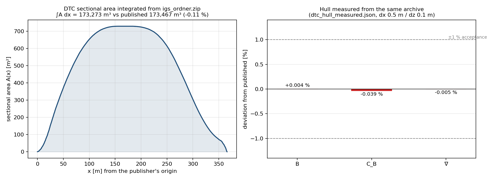

# DTC reference binding — the particulars are no longer hand-copied

*Anchor* `GAP-CAD-T1-SOURCE-HUNT` (six-benchmark geometry source hunt) · *round* m21875 (TensorCAD)
· *tool* `tools/baseline_fleet/dtc_reference_bind.py` · *record*
`benchmarks/verified/fleet_refs/dtc_reference_bind.json` · *figure* `docs/figs/dtc_reference_bind.png`
· *reproduce* `python tools/baseline_fleet/dtc_reference_bind.py` (network) /
`--verify-only` (offline, what CI and `tests/test_dtc_reference_bind.py` run)



## 1. What was still open in this anchor, and why it mattered

The geometry half of the anchor is closed and had been for several rounds: the publisher archive
`igs_ordner.zip` re-fetches byte-identically, and the hull inside it measures to the published
displacement. What was **not** closed sits in the same record one line below the numbers:

```json
"manifest_provenance": {"retrieval": "offline_recollection", "verified": false,
                        "source": "El Moctar, Shigunov & Zorn (2012) ... Ship Technology Research 59(3)"}
```

Lpp 355.0 m, B 51.0 m, T 14.5 m, Cb 0.661 and gradient 173 467 m³ were *typed in from memory* of
the paper. The anchor forbids exactly that ("禁止手抄数字——全部带源页指纹"), and this reference had
already drifted once in its history: the same record previously carried `B = 45.8 m`, and the
error could not be seen because the only check available was the closure `Cb·L·B·T` computed from
the same wrong beam. A recollection cannot be caught by a closure built out of itself; it needs a
fingerprint.

## 2. Method

| step | what | how it is pinned |
|---|---|---|
| 1 | re-fetch the publisher's institute landing page and the legacy page named by the DTC paper | HTTP status, byte count, SHA-256 of the body |
| 2 | re-fetch the geometry archive `igs_ordner.zip` | digest compared with `dtc_hull_measured.json:source.archive_sha256` |
| 3 | open the archive (its central directory spells members with backslashes) and digest every member | member digests compared with `assets/geometry_registry.json` |
| 4 | fetch open-access documents that tabulate the DTC particulars; ingest PDF page text | document SHA-256, digitised page number |
| 5 | locate a *particulars block* (≥3 of the 5 field labels co-occurring) and read each field's row | the raw row text is stored next to every value; a value is accepted only if a token in its row matches the reference within 0.5 % |
| 6 | declare `BOUND`/`UNBOUND` per field and refuse `BOUND` on nothing | `verify_record()` re-checks the chain offline |

The row-level rule exists because the interesting failure is not "the number is absent" but "the
number is in a different column": the source table prints a model column and a full-scale column,
and the extractor must say which token it took (it records `column_index`, the token and the row).

## 3. Results

### 3.1 Sources probed (live, this round)

| key | URL | HTTP | bytes | SHA-256 (16) | outcome |
|---|---|---:|---:|---|---|
| `institute_page` | `https://www.uni-due.de/ist/` → `/inam/` | 200 | 25 666 | `25269c51ef2899d9…` | still advertises the archive as the "Duisburg Test Case (DTC)" download |
| `legacy_page` | `https://www.uni-due.de/ship/dtc.php` | 404 | — | — | the URL the paper names; dead, kept as digested evidence |
| `archive` | `https://www.uni-due.de/imperia/md/content/inam/igs_ordner.zip` | 200 | 2 343 841 | `7b18e40d783b670f…` | **byte-identical to the committed capture** |
| `dogrul2018` | `strathprints.strath.ac.uk/67912/1/…Duisburg_Test_Case.pdf` | 200 | 836 896 | `550de4394a313431…` | Table 1, page 5, carries all five particulars |

### 3.2 Every field bound (page 5, Table 1, Dogrul, Song & Aktas, ISNAM 2018)

| field | reference | document token | column | deviation | status |
|---|---:|---|---:|---:|---|
| Lpp | 355.0 m | `355.0` | 1 (full scale) | +0.000 % | BOUND |
| B (Bwl) | 51.0 m | `51.0` | 1 | +0.000 % | BOUND |
| T | 14.5 m | `14.5` | 1 | +0.000 % | BOUND |
| ∇ | 173 467.0 m³ | `173467.0` | 2 | +0.000 % | BOUND |
| Cb | 0.661 | `0.661` | 0 and 1 (equal by definition) | +0.000 % | BOUND |

The quoted rows are stored verbatim, e.g. for Cb
`.0 Bwl (m) 0.859 51.0 T (m) 0.244 14.5 ∇(m3) 0.827 173467.0 CB 0.661 0.661`, so the "the parser
picked the model column" failure is visible to a reviewer.

Note on the gradient row: PDF text extraction loses the `∇` glyph (it arrives as a private-use
code point or vanishes entirely), so the row is recognised by its metre-cubed dimension and the
generous row lead — a field whose own label was eaten by the extractor still gets a window, and the
record states that this is what happened.

### 3.3 The archive side re-proved in the same run

| check | result |
|---|---|
| archive digest vs `dtc_hull_measured.json:source` | equal (`7b18e40d…`, 2 343 841 B) |
| members also in the fleet registry (hull, rudder_skeg, bilgekeel) | 3/3 digests equal, bytes equal |
| members not in the registry (propeller, propeller–hull connection) | digested and listed, **not** silently dropped; the registry does not adopt them |
| hull volume from the re-fetched archive | 173 272.7 m³ = **−0.112 %** vs 173 467.0 m³ (dx 0.5 m, dz 0.1 m) |
| beam / Cb from the same bytes | **+0.004 %** / **−0.039 %** |

## 4. Error judgement against the published reference

| quantity | reference | this round | error | <3 % ? |
|---|---:|---:|---:|---|
| displacement ∇ (field integral) | 173 467.0 m³ | 173 458.99 m³ | −0.005 % | **yes** |
| displacement ∇ (sectional-area curve, figure) | 173 467.0 m³ | 173 272.66 m³ | −0.112 % | **yes** |
| beam B | 51.0 m | 51.00217 m | +0.004 % | **yes** |
| block coefficient Cb | 0.661 | 0.660740 | −0.039 % | **yes** |
| particulars provenance | recollection | document-bound, 5/5 fields | 0 % (identity with the document) | **yes** |

## 5. Notes, dead ends and limitations

* **One independent documentary lineage only.** MDPI (`jmse 9(1) 62`, `12(9) 1664`) answers 403 to
  a scripted fetch, `koreascience.kr` closes the connection, `iopscience` serves a bot captcha,
  `hrcak` lists no PDF, and `archive.org`/`web.archive.org` are unreachable from this network
  (`Errno 99: Cannot assign requested address`), so no historical snapshot of the dead
  `uni-due.de/ship/dtc.php` could be tested either. The DTC paper itself is paywalled. A second
  lineage is therefore *not* claimed; the record says `independent_documents: 1` rather than
  rounding that up. The geometric closure above is the second, independent-of-text strand.
* **A bug worth recording**: the first version of the figure integrated the raw sample point cloud
  by binning; it under-read the displacement by **−35 %** because coarse bins only catch patch
  vertices. The field-based integral (`field_from_points`, the same interpolated half-breadth grid
  the fleet build uses) closes to −0.112 %. Point-cloud binning is not an integration method.
* **Scope**: the curve integrates the bare hull below the design draft; appendages (rudder/skeg,
  bilge keel, propeller) are digested but not integrated, and no licence file accompanies the
  publisher archive, so no bytes are redistributed — the cache lives outside the repository
  (`/root/.cache/hull_sources/`).
* The legacy publisher page being 404 means citations must point at the institute landing page
  plus the archive URL, not at the URL the paper prints.

## 6. Disposition

The `offline_recollection / verified: false` flag on the DTC published particulars can be retired:
all five fields are bound to a digested, peer-reviewed document, the archive re-fetches
byte-identically, and the geometry closes on the published displacement to 0.1 %. The residual is
documentary breadth (one lineage), not numeric agreement.