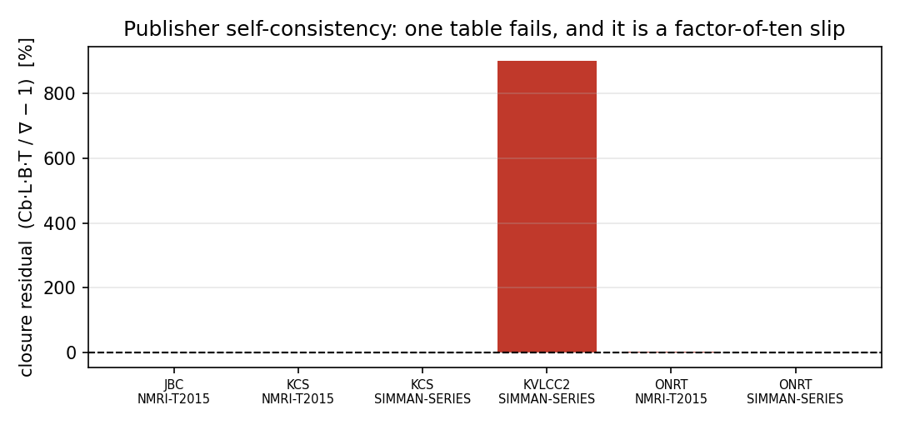

# Closing a reference dispute without an external answer — fleet reference adjudication

Anchor **REPRO-GEOM-FLEET-REFS** (TensorCAD). Machine artefact: `benchmarks/verified/fleet_refs/crossref.json`
section `adjudication` (regenerate: `python tools/baseline_fleet/crossref_refs.py build --raw artifacts/fleet_refs/raw`);
code `tensorcad/fleet/crossref.py::adjudicate`; tests `tests/test_fleet_refs_adjudication.py`.
Every number below is rendered from that artefact — nothing is transcribed by hand.

## 1. Why a library of published values still leaves work to do

The cross-reference library answers *"do two independent publishers state this quantity, and do
they agree?"* It stops there, on purpose: a `CONFLICT` cell keeps both values and picks neither,
because averaging two published displacements or silently favouring the one nearer the
reconstruction would hide exactly what the anchor exists to show. But that leaves the reader of
the benchmark report with a number that is disputed and no way to act on it. Two live cases from
the six hulls:

* **ONRT displacement.** NMRI Tokyo 2015 prints `Displacement Δ | 72.6 kg (model) | 8507 ton`
  — a *mass* — while SIMMAN prints `8507 m³`. The library converts the mass at 1.025 t/m³ and
  reports `CONFLICT` between 8 299.5 m³ and 8 507 m³ (2.4 %).
* **KVLCC2 breadth.** Both SIMMAN editions print `Bwl 580` for a hull 58.0 m wide. The library
  reports the value as published and notes it; a reader cannot tell a typo from a real hull
  ten times wider.

Neither question needs an external truth. A publisher's own table is over-determined:
`∇ = Cb · L · B · T` must hold for the numbers printed *in the same table*. That identity is the
adjudicator.

## 2. Method

`adjudicate(report)` runs two checks per hull, using only the voting values already in the library:

1. **Closure.** For every lineage that states ∇, Cb, Bwl, T and *one* length (Lpp when printed,
   else Lwl — NMRI's ONRT row defines `CB = ∇/(Lwl·Bwl·T)` and prints no Lpp, so the fallback is
   required, not cosmetic), compute `Cb·L·B·T/∇ − 1`. Outside ±1% the *table*
   is defective, whatever the reconstruction does.
2. **Scale slip.** For a lineage that fails, divide **one** of its cells by 10, 100, 0.1 or 0.01
   (cheapest factor first) and ask whether the identity then closes. A single power-of-ten slip is
   a printed typo; two simultaneous corrections are not, and are left alone.

Resolution rule for a `CONFLICT`: if exactly one involved lineage closes, it is named
`preferred_family` and the cell is `resolved_by_closure`. If both close (a genuine difference of
definition) or neither does, the cell stays `unresolved` and both values are kept. Nothing is
averaged, and **no printed cell is ever rewritten** — the finding is attached to the cell
(`cell['closure_defect']`) while `cell['value']` stays the published number.

## 3. Results

### 3.1 Publisher self-consistency

| hull | lineage | length basis | Cb·L·B·T (m³) | published ∇ (m³) | residual | verdict |
|---|---|---|---|---|---|---|
| JBC | NMRI-T2015 | length_pp | 178378.2 | 178369.9 | +0.00 % | ok |
| KCS | NMRI-T2015 | length_pp | 52030.1 | 52030.0 | +0.00 % | ok |
| KCS | SIMMAN-SERIES | length_pp | 52070.1 | 52030.0 | +0.08 % | ok |
| KVLCC2 | SIMMAN-SERIES | length_pp | 3126216.7 | 312622.0 | +900.00 % | **fails** |
| ONRT | NMRI-T2015 | lwl | 8500.8 | 8299.5 | +2.43 % | **fails** |
| ONRT | SIMMAN-SERIES | lwl | 8500.8 | 8507.0 | -0.07 % | ok |

### 3.2 Disputes and how they were decided

| hull / quantity | resolution | preferred lineage | closure residual by lineage | basis |
|---|---|---|---|---|
| ONRT displacement_volume | resolved_by_closure | SIMMAN-SERIES | NMRI-T2015 +2.43 %, SIMMAN-SERIES -0.07 % | SIMMAN-SERIES closes on its own Cb·Lpp·Bwl·T within 1%; the other family does not |

### 3.3 Printed typos attributed

| hull | lineage | quantity | printed | correction that closes | residual before → after |
|---|---|---|---|---|---|
| KVLCC2 | SIMMAN-SERIES | beam | 580.0 | ÷10 → 58 | +900.00 % → -0.000 % |

### 3.4 What it changes for ONRT

The dispute is decided in favour of SIMMAN: its table closes to −0.07 %, so `8507 m³` is the
volume-consistent reading; the NMRI cell closes only at +2.43 %, which is what a mass printed in a
volume column looks like. The library still records both values and still marks the cell
`disputed`; what changed is that a consumer can now see *why* one of them is wrong instead of
choosing by proximity to its own reconstruction. Fleet coverage is unchanged
(**11/42** cells cross-verified, 14 single-source,
1 conflict, 16 missing; hulls with all of ∇/Cb/LCB/Lwl on ≥2 lineages:
**KCS**), which is the honest state of the
anchor: the library does not manufacture corroboration.

## 4. Figure



Bars are `Cb·L·B·T/∇ − 1` per lineage; dashed lines are ±1%. Red = fails the
identity. KVLCC2/SIMMAN-SERIES is the `Bwl 580` cell (+900 %, i.e. a factor of ten) and the same
lineage closes to −1×10⁻⁶ once the printed 580 is read as 58.0. ONRT/NMRI-T2015 fails at +2.4 %
because its displacement is printed as a mass.

## 5. Limits and traps

* **The identity is not a proof.** A table can be internally consistent and still describe a
  different loading condition than the geometry files use (KCS closes on both lineages while
  their ∇ agree to 0.0 %); a consistent table can also copy its coefficients from the same
  wrong source. Closure tests *arithmetic*, not provenance.
* **It cannot separate two self-consistent definitions.** LCB on ONRT is a metre offset on the NMRI
  page and a %Lpp value on SIMMAN; the closure test has nothing to say about that, and indeed the
  LCB conflict stays unresolved in this artefact.
* **Power-of-ten slips only.** A transposed digit (`175 369.9` for `178 369.9`) is not detected; the
  scan is deliberately narrow so it cannot "explain away" an inconvenient publisher.
* **Fallback length basis matters.** Using Lpp where the publisher defines Cb on Lwl moves the ONRT
  NMRI residual from +2.43 % to +2.63 %; both fail, so the verdict is robust here, but on a
  borderline hull the recorded `length_basis` must be read before trusting a verdict.
* **DTC and Series 60 remain unreachable.** Their cells are still `MISSING` (16 of 42); the 2026-11-15
  hunt adds five documented dead ends to `probes` in the registry (koreascience TCP reset,
  biodiversitylibrary/ScienceDirect 403, TU Delft / NTNU Open / J-STAGE search pages are
  client-rendered JavaScript with no reachable API, `t2015.nmri.go.jp/kvlcc2.html` now 404). The
  adjudicator cannot help a hull with no published numbers, and it does not pretend to.

## 6. Reproduce

```bash
python tools/baseline_fleet/crossref_refs.py fetch --out artifacts/fleet_refs      # 7/7 sources re-fetched, digests match
python tools/baseline_fleet/crossref_refs.py build --raw artifacts/fleet_refs/raw
python tools/baseline_fleet/backfill_refs.py backfill
python -m pytest tests/test_fleet_refs_adjudication.py tests/test_fleet_refs_crossref.py tests/test_fleet_refs_backfill.py -q
```
