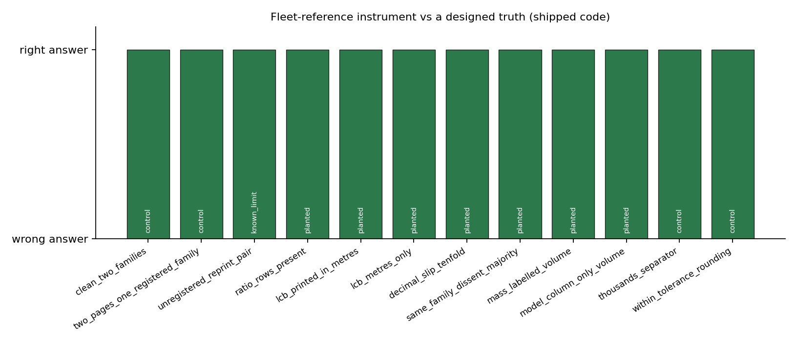

# The reference instrument, audited against a designed truth

Anchor **REPRO-GEOM-FLEET-REFS** (TensorCAD). Machine artefact: `artifacts/fleet_refs/instrument_audit.json`
(regenerate: `python tools/baseline_fleet/refs_instrument_audit.py --docs`). Every number below is rendered from that file.

## 1. The question this round answers

The library answers one question per hull and quantity: *do two independent publishers state the
same numeral?* Its tests all feed it **real** pages, so they can show the machine runs but not that
it reads the right cell -- when the reader picks the neighbouring row of a table, test and bug
agree. This round puts the machine against documents whose answer is **designed**: a synthetic
table plus the verdict it must produce. A wrong reading then becomes a named numeral in a diff
instead of a plausible-looking percentage.

Corpus: **12 fixtures**, each one behaviour, in three classes:

* **control** -- clean data that must stay clean (specificity);
* **planted** -- a defect that must be caught (sensitivity);
* **known_limit** -- a case the bytes cannot decide; the fixture asserts the behaviour we accept, so
  the limit is documented instead of rediscovered as a surprise.

## 2. Score

Shipped code:

* sensitivity (planted defects caught): **7/7** (100 %)
* specificity (controls left clean): **4/4** (100 %)
* known-limit behaviour reproduced: **1/1** (100 %)

Same corpus with the guards switched off (`--no-guards`, the pre-fix reading): sensitivity **3/7**, specificity **4/4**, known-limit **1/1**.



## 3. Fixture by fixture

| fixture | class | result | machine vs designed truth |
|---|---|---|---|
| `clean_two_families` | control | pass | -- |
| `two_pages_one_registered_family` | control | pass | -- |
| `unregistered_reprint_pair` | known_limit | pass | -- |
| `ratio_rows_present` | planted | pass | -- |
| `lcb_printed_in_metres` | planted | pass | -- |
| `lcb_metres_only` | planted | pass | -- |
| `decimal_slip_tenfold` | planted | pass | -- |
| `same_family_dissent_majority` | planted | pass | -- |
| `mass_labelled_volume` | planted | pass | -- |
| `model_column_only_volume` | planted | pass | -- |
| `thousands_separator` | control | pass | -- |
| `within_tolerance_rounding` | control | pass | -- |

## 4. Verdicts on the quantities that carry the arguments

| fixture | quantity | verdict | disputed | families | family values |
|---|---|---|---|---|---|
| `clean_two_families` | displacement_volume | CROSS_VERIFIED | False | 2 | FAM-A=52030, FAM-B=52030 |
| `clean_two_families` | cb | CROSS_VERIFIED | False | 2 | FAM-A=0.6505, FAM-B=0.6505 |
| `two_pages_one_registered_family` | displacement_volume | SINGLE_SOURCE | False | 1 | FAM-A=52030 |
| `two_pages_one_registered_family` | cb | SINGLE_SOURCE | False | 1 | FAM-A=0.6505 |
| `unregistered_reprint_pair` | displacement_volume | CROSS_VERIFIED | False | 2 | unregistered_1=52030, unregistered_2=52030 |
| `unregistered_reprint_pair` | cb | CROSS_VERIFIED | False | 2 | unregistered_1=0.6505, unregistered_2=0.6505 |
| `ratio_rows_present` | displacement_volume | CROSS_VERIFIED | False | 2 | FAM-A=52030, FAM-B=52030 |
| `ratio_rows_present` | cb | CROSS_VERIFIED | False | 2 | FAM-A=0.6505, FAM-B=0.6505 |
| `lcb_printed_in_metres` | displacement_volume | CROSS_VERIFIED | False | 2 | FAM-A=52030, FAM-B=52030 |
| `lcb_printed_in_metres` | cb | CROSS_VERIFIED | False | 2 | FAM-A=0.6505, FAM-B=0.6505 |
| `lcb_metres_only` | displacement_volume | CROSS_VERIFIED | False | 2 | FAM-A=52030, FAM-B=52030 |
| `lcb_metres_only` | cb | CROSS_VERIFIED | False | 2 | FAM-A=0.6505, FAM-B=0.6505 |
| `decimal_slip_tenfold` | displacement_volume | CONFLICT | True | 2 | FAM-A=52030, FAM-B=5203 |
| `decimal_slip_tenfold` | cb | CROSS_VERIFIED | False | 2 | FAM-A=0.6505, FAM-B=0.6505 |
| `same_family_dissent_majority` | displacement_volume | CROSS_VERIFIED | False | 2 | FAM-A=52030, FAM-B=52030 |
| `same_family_dissent_majority` | cb | CROSS_VERIFIED | False | 2 | FAM-A=0.6505, FAM-B=0.6505 |
| `mass_labelled_volume` | displacement_volume | CONFLICT | True | 2 | FAM-A=52030, FAM-B=50761 |
| `mass_labelled_volume` | cb | CROSS_VERIFIED | False | 2 | FAM-A=0.6505, FAM-B=0.6505 |
| `model_column_only_volume` | displacement_volume | SINGLE_SOURCE | False | 1 | FAM-B=52030 |
| `model_column_only_volume` | cb | CROSS_VERIFIED | False | 2 | FAM-A=0.6505, FAM-B=0.6505 |
| `thousands_separator` | displacement_volume | CROSS_VERIFIED | False | 2 | FAM-A=52030, FAM-B=52030 |
| `thousands_separator` | cb | CROSS_VERIFIED | False | 2 | FAM-A=0.6505, FAM-B=0.6505 |
| `within_tolerance_rounding` | displacement_volume | CROSS_VERIFIED | False | 2 | FAM-A=52030, FAM-B=52043 |
| `within_tolerance_rounding` | cb | CROSS_VERIFIED | False | 2 | FAM-A=0.6505, FAM-B=0.6505 |

## 5. What the pre-guard reading got wrong

| fixture | pre-fix failure (verbatim from the audit run) |
|---|---|
| `ratio_rows_present` | source famA: lwl read as 1.0109 but the page states 232.5 (label 'Lwl/Lpp') |
| `ratio_rows_present` | source famA: length_pp read as 0.1386 but the page states 230 (label 'Bwl/Lpp') |
| `ratio_rows_present` | source famA: draft read as 0.0464 but the page states 10.8 (label 'T/L') |
| `ratio_rows_present` | lwl: verdict CONFLICT, the fixture designs CROSS_VERIFIED |
| `ratio_rows_present` | lwl: disputed=True, the fixture designs False |
| `ratio_rows_present` | length_pp: verdict CONFLICT, the fixture designs CROSS_VERIFIED |
| `ratio_rows_present` | length_pp: disputed=True, the fixture designs False |
| `ratio_rows_present` | draft: verdict CONFLICT, the fixture designs CROSS_VERIFIED |
| `ratio_rows_present` | draft: disputed=True, the fixture designs False |
| `lcb_printed_in_metres` | source famA: lcb_percent read as -3.395 but the page states -1.48 (label 'LCB (m)') |
| `lcb_printed_in_metres` | lcb_percent: verdict CONFLICT, the fixture designs CROSS_VERIFIED |
| `lcb_printed_in_metres` | lcb_percent: disputed=True, the fixture designs False |
| `lcb_metres_only` | source famA: lcb_percent basis 'volume', expected 'lcb_as_length' (value -3.395) |
| `lcb_metres_only` | lcb_percent: verdict CONFLICT, the fixture designs SINGLE_SOURCE |
| `lcb_metres_only` | lcb_percent: disputed=True, the fixture designs False |
| `lcb_metres_only` | lcb_percent: 2 independent families, the fixture has 1 (family_values {'FAM-A': -3.395, 'FAM-B': -1.5}) |
| `mass_labelled_volume` | source famB: displacement_volume read as 52030 but the page states 50761 (label 'Displacement (t)') |
| `mass_labelled_volume` | source famB: displacement_volume basis 'volume', expected 'mass' (value 52030) |
| `mass_labelled_volume` | displacement_volume: verdict CROSS_VERIFIED, the fixture designs CONFLICT |
| `mass_labelled_volume` | displacement_volume: disputed=False, the fixture designs True |

Three defects, all latent -- no stored cell carries them, which is exactly why no existing test
could see them:

1. **A ratio row voted as a length.** A page that prints `Lwl/Lpp 1.0109` above the row it divides
   had the quotient read as `lwl = 1.0109 m` with basis `volume`, so it voted; `Bwl/Lpp` became
   `length_pp = 0.1386` and `T/L` became `draft = 0.0464`, because a quotient label matches the
   patterns of whichever of its two names comes first. The genuine rows were then skipped by the
   "first row for a quantity wins" rule, and the library compared a dimensionless ratio against a
   length in metres -- reporting a conflict that no publisher states. Fixed by refusing a row whose
   label is a quotient of two particulars (`_RATIO_LABEL`, hull-letter symbols only, so `kg/m3`,
   `m/s` and `TFP / TAP` are untouched).
2. **LCB in metres voted as a percentage.** `_LCB_AS_LENGTH` existed and was documented but was
   never applied: `LCB (m) -3.395` became `lcb_percent = -3.395 %` and voted against another
   family's `-1.48 %` -- a 129 % disagreement manufactured from a unit mismatch. Fixed by marking
   such a cell `lcb_as_length` (kept for the audit trail, never votes) and by letting a later
   percentage row replace a length row, never the reverse.
3. **A model-only displacement was dropped.** `derive_cells` recovered lengths and LCB from a
   table's model column but left a model-only volume at the model numeral. Volume scales as the
   third power of the table's own length ratio, which the same table pins (`Lpp 230 / 2.3 = 100`),
   so the recovery is arithmetic on one publisher's numerals like every other derivation. It is now
   emitted with basis `derived_model_column_cubed`: auditable, and **not voting**, because a
   derivation is evidence about the document, not a second opinion about the ship.

4. **A mass stated only in the row label was read as a volume.** The unit heuristic looked at the
   numeral cell, so `Displacement (t) | 52 030` -- a bare numeral under a mass header -- became
   `52 030 m3`. That is the failure mode this anchor exists to prevent: a 2.4 % unit error crosses
   as `CROSS_VERIFIED` because both families agree on a *numeral*. Fixed by reading the row label
   too (`_MASS_LABEL`), converting at 1.025 t/m3 and keeping the reading as a disputed 50 761 m3 --
   the conflict stays visible and the closure adjudicator can resolve it.

## 6. Impact on the shipped library

* stored cells scanned: **104** (52 of them HTML row cells, the only kind the guards address)
* cells the new guards would reclassify: **0** (ratio-label voters 0, LCB-as-length voters 0, model-column volume cells 0)

No stored cell is reclassified: the guards fire only on row labels the corpus of record does not
contain, and no stored displacement cell sits in a fallback column. The fix is behaviour-preserving
on the six-hull library, so the verdicts published in `benchmarks/verified/fleet_refs/crossref.json`
stand unchanged -- and that statement is now a measurement rather than a hope.

## 7. Limits this audit makes explicit

* **Independence is read from a registry, not from the document.** `cross_reference` resolves a
  source's family by key from `LINEAGE`/`FAMILIES`, and an *unknown* key is its own family. So two
  unregistered reprints of one table are reported `CROSS_VERIFIED` (`unregistered_reprint_pair`,
  a known-limit fixture). The default is fail-open; a new source must be registered or its
  agreement counts twice.
* **A unit stated only in a table caption is still invisible.** The mass guard reads the row label
  and the numeral cell; a page that names the unit once, in the caption above the table, is read as
  a volume. The `mass_labelled_volume` fixture asserts that when the label *does* carry the unit the
  library keeps both readings and marks the cell disputed instead of averaging them; resolution is
  the closure adjudicator's job (`docs/fleet_refs_adjudication.md`).
* **Sensitivity is bounded by the defect classes written down.** A transposed digit inside one
  column, a unit stated only in a table caption, or a numeral belonging to a different loading
  condition are not in the corpus and are caught by nothing here.
* **Fixtures are synthetic HTML tables**, so they exercise `table_rows` and `parse_source` only. The
  PDF path reads *quotes* (regex addresses into extracted text) and cannot be exercised with a
  designed table; its exactness rests on the stored quote strings, not on this audit.
* The corpus scores the **instrument, not the ships**: a passing fixture says the machine reads the
  table it was designed to read, nothing about how a real publisher lays out a page.

## 8. Reproduce

```bash
python tools/baseline_fleet/refs_instrument_audit.py --docs \
    --prefix artifacts/fleet_refs/instrument_audit_prefix.json
python -m pytest tests/test_fleet_refs_instrument_audit.py -q
```
