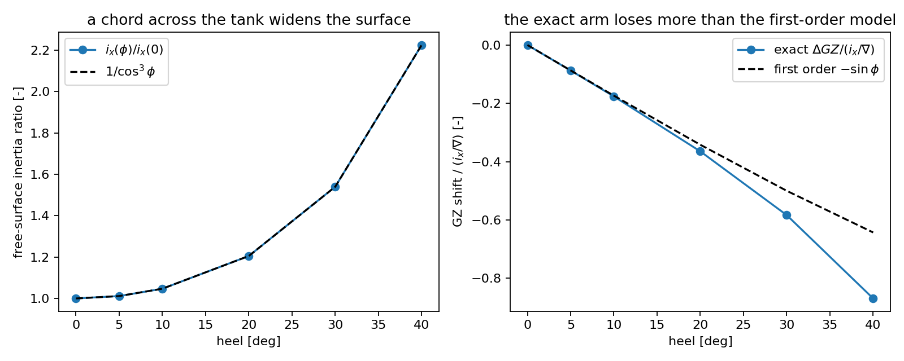
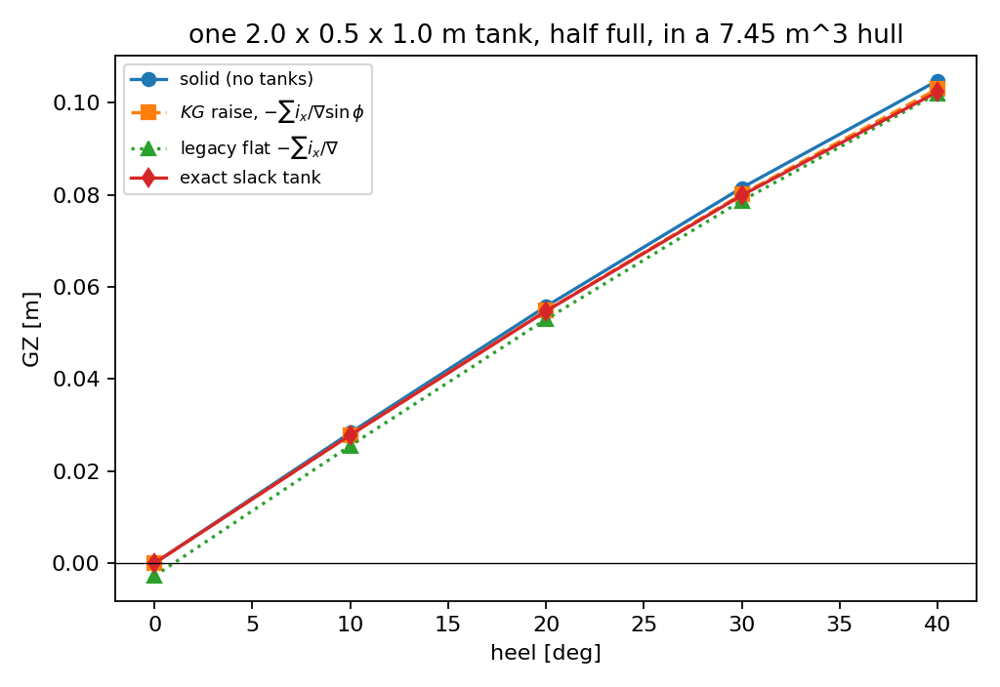

# Slack tanks: the free-surface correction at heel

`tensorcad.free_surface` computes where the liquid in a prismatic rectangular tank
actually goes when the ship heels, and `tensorcad.gz.righting_arm_curve` now applies
the classical correction the way it is derived -- as a raise of `KG`, i.e.
`GZ -= i_x/nabla * sin(phi)` -- instead of the historical flat subtraction of
`i_x/nabla` from every ordinate.

*Generated by `python examples/free_surface/run_example.py`; the script exits non-zero
if any claim on this page stops holding. Numbers are written in place, so a stale
table shows up as a diff.*

## Why the flat subtraction was wrong

The corrected arm is `KN - (KG + i_x/nabla) sin(phi)`: the loss is a loss of *metacentric*
height. Subtracting it from every ordinate instead moves the whole curve down by
`2.798 mm` and, at zero heel, gives an upright symmetric ship
`GZ(0) = -2.798 mm` instead of zero. The areas move too: `A(0-30)` loses
`1.465e-03` m rad under the flat model against
`3.739e-04` m rad under the `KG` raise, i.e. the flat
model's penalty on that area is 3.92x the `KG` raise's (`IS Code 2008` asks for
0.055 m rad there). The model is still selectable as `free_surface_model="flat"` so
an earlier release's curve can be reproduced, and it is no longer the default.

## How the exact shift is computed

The free surface stays horizontal while the tank rotates, so the wetted section is the
part of a rectangle below the line `-y sin(phi) + z cos(phi) = level` in the tank's own
frame. The level is one scalar unknown fixed by the liquid volume (bisection to
round-off, so the volume residual below is machine noise), and everything else --
area, centroid, chord width -- is a closed-form polygon computation on top of it.
That makes the model exact for a prismatic tank and free of any mesh or quadrature
error, which is exactly what makes it usable as a *reference* for the first-order
correction.

## Results

| heel [deg] | width [m] | `b/cos` [m] | `i_x/i_x(0)` | `1/cos^3` | exact `dGZ` [mm] | first order [mm] |
| ---: | ---: | ---: | ---: | ---: | ---: | ---: |
| 0 | 0.500000 | 0.500000 | 1.000000 | 1.000000 | -0.0000 | -0.0000 |
| 5 | 0.501910 | 0.501910 | 1.011503 | 1.011503 | -0.2448 | -0.2438 |
| 10 | 0.507713 | 0.507713 | 1.046997 | 1.046997 | -0.4934 | -0.4858 |
| 20 | 0.532089 | 0.532089 | 1.205154 | 1.205154 | -1.0203 | -0.9569 |
| 30 | 0.577350 | 0.577350 | 1.539601 | 1.539601 | -1.6320 | -1.3989 |
| 40 | 0.652704 | 0.652704 | 2.224529 | 2.224529 | -2.4314 | -1.7983 |

* Volume conservation over the table: worst `|V/V_fill - 1| = 1.3e-15`.
* Independent trapezoid centroid: worst relative deviation `1.0e-12`
  (hand-derived in `tests/test_free_surface.py`, not called from the module).
* The `1/cos^3` law holds to `1e-12` while the free surface runs wall to wall (window `63.43 deg` for this tank) and breaks by `40.5 %` at `73.4 deg`,
  so the check is not vacuous.
* Small-angle limit: `dGZ/sin(phi) -> -i_x/nabla = -2.7977 mm` from below, with
  a `phi^2` defect (`100.0x` between 0.1 and 1.0 deg, i.e. the 100x the
  quadratic term predicts).

### What the first-order correction costs at large heel

`1/cos^3(30) = 1.54`: the same tank's free surface is half again as wide at 30 deg, so
the arm loses 16.7 % more than `-i_x/nabla sin(phi)` says. That is not an error in the
classical form -- it is the finite-angle term the form deliberately drops, and the
whole point of having the exact model.

### Splitting the tank across its breadth

| compartments | `sum i_x / i_x(1)` | `1/n^2` |
| ---: | ---: | ---: |
| 1 | 1.000000 | 1.000000 |
| 2 | 0.250000 | 0.250000 |
| 4 | 0.062500 | 0.062500 |
| 5 | 0.040000 | 0.040000 |

The exact `1/n^2` reduction is the classical argument for longitudinal bulkheads, and
it is a property of the geometry, not of the correction: subdividing *along* the
length does nought (the second moment is about the longitudinal axis).



## The curve, four ways

| heel [deg] | solid | `KG` raise | flat (legacy) | exact tank |
| ---: | ---: | ---: | ---: | ---: |
| 0 | -0.000000 | -0.000000 | -0.002798 | -0.000000 |
| 10 | 0.028306 | 0.027820 | 0.025508 | 0.027812 |
| 20 | 0.055751 | 0.054794 | 0.052953 | 0.054731 |
| 30 | 0.081503 | 0.080104 | 0.078705 | 0.079871 |
| 40 | 0.104778 | 0.102979 | 0.101980 | 0.102346 |

`A(0-30)` m rad: solid `0.021783`, `KG` raise `0.021409`,
flat `0.020318`, exact `0.021376`. The flat column's zero-heel
ordinate is `-0.002798 m`, which no symmetric ship can have.



## Notes and limits

* The exact model is a **prismatic rectangular tank heeling about an axis parallel to
  its length**, with no trim, one liquid, and structure-free interior. A real tank's
  sounding table, sloped top and suction well are not modelled; a shipyard tank is not
  a rectangle, and this module does not claim to be a tank model.
* The `KG` raise is the first-order correction and remains the right default: class
  rules and the IS Code are written in terms of `i_x/nabla`, and the exact model is a
  diagnostic of how far the finite-angle answer departs from it, not a replacement for
  the conventional number.
* `density_ratio` is the liquid's density over the displacement density, so a fuel tank
  scales its loss and its shift by 0.85 rather than sea-water's 1.0.

## Reproduce

```bash
python3 -m pytest tests/test_free_surface.py -q
python3 examples/free_surface/run_example.py
```

Artefacts: `artifacts/free_surface/results.json`, `docs/free_surface/*.png`.
