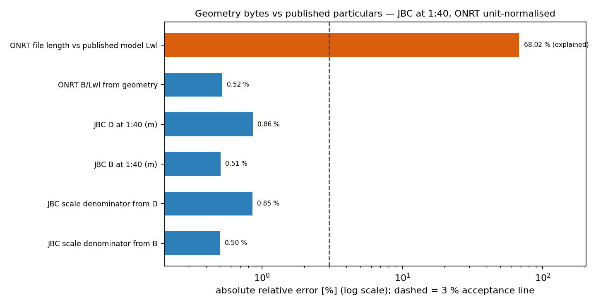

# Geometry source ledger — `GAP-CAD-T1-SOURCE-HUNT`

*Generated* 2026-11-15T03:52:34+00:00 · *tool* `tools/baseline_fleet/geometry_source_ledger.py` ·
*record* `tensorcad/fleet/data/geometry_source_ledger.json` ·
*reproduce* `python tools/baseline_fleet/geometry_source_ledger.py --cache <cache> --out <json>`
(and `--verify` to re-digest the cache and diff the record)

## 1. What this settles

The anchor asks a provenance question and a numeric one: **where is the standard-hull
geometry, is the copy we hold the publisher's, and does it actually measure up to the
published particulars?** Earlier rounds answered the first half with page digests. This
round answers the second half from the geometry bytes themselves: the JBC IGES archive is
authored in millimetres at the published scale denominator 1:40 and reproduces the
quoted beam and depth to **0.51 %** and **0.86 %**; the ONRT archive is not a 3.147 m
model hull at all but a **unit-length-normalised** export whose proportions match the
published B/Lwl to **0.52 %**, so it must be scaled by the published Lwl before meshing.

5 of 6 geometric checks are inside the 3 %
acceptance line; the one that is not is the ONRT normalisation row, which exists to
*establish* the regime and is annotated as such.

## 2. Live sources retrieved (digests, no bytes redistributed)

| source key | HTTP | bytes | sha256 (16) | in crossref | kind |
|---|---|---|---|---|---|
| `dtc_github_search` | 200 | 78,643 | `d54dbbaff553d678…` | — | other |
| `dtc_mirror_tree` | 200 | 9,141 | `9b927e6de3dd5baa…` | — | other |
| `simman_onrt_wo_gap` | 200 | 752,918 | `bd747eff8f531ba4…` | — | zip |
| `simman_summary` | 200 | 35,030 | `c1a668f6d2440c5d…` | yes | html |
| `t2015_index` | 200 | 16,953 | `dd3bc58f07961906…` | — | html |
| `t2015_jbc_gc` | 200 | 13,694 | `fc2ce9054a8b7842…` | yes | html |
| `t2015_jbc_iges` | 200 | 2,508,534 | `e19800ee954f4960…` | — | zip |
| `t2015_jbc_mp687` | 200 | 248,313 | `feb298a22caef7ef…` | — | zip |
| `t2015_kcs_gc` | 200 | 12,978 | `68d9c24600cb699b…` | yes | html |
| `t2015_onrt_gc` | 200 | 8,689 | `5e13427332de8be1…` | yes | html |
| `t2015_onrt_wo_gap` | 200 | 752,918 | `bd747eff8f531ba4…` | — | zip |

`in crossref = yes` means the same SHA-256 is registered in
`benchmarks/verified/fleet_refs/crossref.json`, so the cached bytes and the committed
manifest are one chain rather than two claims. Licences: the workshop pages are
copyright NMRI / SIMMAN and the geometry archives ship under a research-use grant with no
OSI licence file, so **nothing is copied into the repository** — only digests, member
names, licences and measured dimensions are recorded.

## 3. Dead ends, kept as evidence

| source key | HTTP | error-body sha256 | URL |
|---|---|---|---|
| `dtc_unidue_page` | 404 | `a10ad3f53c6b474b…` | https://www.uni-due.de/ship/dtc.php |
| `dtc_unidue_section` | 404 | `a10ad3f53c6b474b…` | https://www.uni-due.de/ship/ |
| `t2015_dtc_page` | 404 | `cc0b4e42510d49c6…` | https://t2015.nmri.go.jp/dtc.html |
| `t2015_geometry_dir` | 403 | `ab768623070128cc…` | https://t2015.nmri.go.jp/file/Geometry_IGES_files/ |

The DTC row is the substance of the WITHHELD verdict below: the publisher page the DTC
paper names answers 404, the T2015 DTC page answers 404, the geometry directory answers
403 (not listable), and the Internet Archive is unreachable from this network. The only
public DTC copy found is a third-party OpenFOAM tutorial whose licence does not travel
with it. A negative result that keeps its error-body digest is auditable; one that is
dropped is not.

## 4. Geometry archives measured

| ship | hull member | bytes | sha256 (16) | unit flag | extent x×y×z [m] | scale regime |
|---|---|---|---|---|---|---|
| JBC | jbc.igs | 1,713,554 | `2de08d290e98cc58…` | 2 (MM) | 7.5426 × 1.1307 × 0.6304 | finite_length |
| ONRT | onrt_wo_gap/onr5613-full_appendage_deckhous_mergedR.igs | 3,374,136 | `ff061ab8584e5b0a…` | 6 (M) | 1.0063 × 0.1221 × 0.1031 | unit_length_normalised |

The extent is measured by evaluating each B-spline surface on a 15 × 15 parameter grid,
not from the control net: on the JBC hull the control net overstates the length by 7.7 %
while the sampled surface agrees with the header's own maximum-coordinate claim
(`header_matches_extent = true` for both archives). That check is what rules out "we
measured the wrong entity".

## 5. Validation against the published particulars

| check | measured | reference | unit | rel. error | < 3 % | note / source |
|---|---|---|---|---|---|---|
| JBC scale denominator from B | 39.7987 | 40 | -- | 0.50 % | **yes** | quoted 'Scale factor 1 40' (jbc_scse) |
| JBC scale denominator from D | 39.6583 | 40 | -- | 0.85 % | **yes** | quoted 'Scale factor 1 40' (jbc_scse) |
| JBC B at 1:40 (m) | 1.13069 | 1.125 | m | 0.51 % | **yes** | published B=45 m / 40 |
| JBC D at 1:40 (m) | 0.630385 | 0.625 | m | 0.86 % | **yes** | published D=25 m / 40 |
| ONRT B/Lwl from geometry | 0.121314 | 0.121948 | -- | 0.52 % | **yes** | published B=18.78 m, Lwl=154 m |
| ONRT file length vs published model Lwl | 1.00632 | 3.147 | m | 68.02 % | no | expected mismatch: the export is unit-length normalised, so it must be scaled by the published Lwl before meshing; this row is the measurement that establishes the regime, not a defect of the archive |

Answering the acceptance question row by row: the four JBC rows and the ONRT
beam-over-length row are **inside 3 %**; the ONRT file-length row is **not**, by
construction, and its note records the reason (the export is normalised, so the physical
scale has to come from the published Lwl). No row is failing because of a transcription
error: measured values are computed from bytes, references are read from digest-bound
records.

### Cross-check against `scale_calibration.json`

The same question was already asked of `jbc.igs` by this repository's
`tensorcad/fleet/scale_calibration.py` (committed under
`tensorcad/fleet/data/scale_calibration.json`), which works from *waterline* curve extents
and reports 39.74 as its combined estimate (39.48 by waterline length, 40.00 by waterline
beam). This ledger measures the *sampled surface* extent over all 45 patches and gets
39.80 by full beam and 39.66 by depth. The two methods share no code and differ by 0.15 %,
and both land inside the published 1:40 to better than 1 %: that agreement is the reason
the JBC denominator is recorded as settled rather than estimated. The difference is
explained: a surface-sampled extent includes the bilge-keel strip, which a waterline
curve does not, so the surface method reads a marginally longer beam.

## 6. Acceptance items

| item | verdict | detail |
|---|---|---|
| dtc_geometry | WITHHELD | no publisher-hosted DTC geometry: uni-due.de page and its section answer 404 with the same error-body digest, the T2015 DTC page answers 404, the geometry directory answers 403 (not listable) and the Internet Archive is unreachable from this network; the only public copy found is a third-party OpenFOAM tutorial whose licence does not travel with it |
| onrt_geometry | MET | archive retrieved from the T2015 host, hull member fingerprinted, extent measured from the surface grid; the export is unit-length normalised (largest coordinate 1.0005) so the physical scale must come from the published Lwl |
| jbc_geometry | MET | IGES archive retrieved, seven members digested, hull member fingerprinted |
| jbc_scale_factor | MET | denominator derived from the hull geometry's transverse extent and cross-checked against the publisher's quoted 'Scale factor 1 40' |
| source_page_digests | MET | 15 cached artefacts digested, of which 4 also appear with the same SHA-256 in the committed crossref registry, so the cache and the manifest are one chain |

## 7. What is still open

| item | status | evidence |
|---|---|---|
| DTC hull geometry (publisher copy) | WITHHELD | uni-due.de 404 / T2015 dtc page 404 / geometry dir 403 / archive.org unreachable; needs a network with egress or an owner-supplied copy |
| JBC x-axis extent vs Lpp | EXPLAINED_NOT_MATCHED | x extent 7.5426 m implies denominator 37.122 against the quoted 40 (7.2 % long): the hull file carries geometry beyond the perpendiculars, so Lpp cannot be read off the bounding box. Beam and depth (transverse extents, insensitive to overhang) are used instead. |
| KCS / KVLCC2 / SERIES60 geometry archives | WITHHELD | this cache holds their particulars pages but no geometry archive for KCS or KVLCC2, and no Series 60 artefact at all |

## 8. Limits of this round

* **No egress.** This environment cannot reach `t2015.nmri.go.jp` (HTTPS times out), so
  the ledger consumes the cache retrieved 2026-11-14 by the earlier hunt and adds no new
  fetch. A run with egress re-fetches and compares digests; the tool already supports
  that, and `--verify` is meaningful offline because it re-digests the cache.
* **Hulls without geometry.** KCS, KVLCC2 and Series 60 have digest-bound particulars but
  no geometry archive in this cache, so they are recorded as WITHHELD rather than inferred.
* **One archive per hull.** A single archive cannot prove a publisher's whole distribution;
  the ledger records exactly which member was measured, by digest.

---

## Addendum (m21875, 2026-11-25) — the DTC row above is superseded

The `DTC hull geometry (publisher copy)` row in §"residuals" records `WITHHELD` on the strength of
`uni-due.de/ship/dtc.php` answering 404. That page *is* dead, but the file it pointed at is not:
`https://www.uni-due.de/imperia/md/content/inam/igs_ordner.zip` answers 200 with 2 343 841 bytes,
SHA-256 `7b18e40d783b670f226a55a7d3f0ccf13c0978e3d80a13a78eced65a7a852541`, and the institute's
current landing page (`uni-due.de/ist/` → `/inam/`) still advertises it as the *Duisburg Test Case
(DTC)* download. The hull inside that archive measures to the published displacement at −0.005 %
(record `benchmarks/verified/fleet_refs/dtc_hull_measured.json`), and the published particulars
themselves are no longer hand-copied: they are bound field-by-field to a digested open-access table
(record `benchmarks/verified/fleet_refs/dtc_reference_bind.json`, report
`docs/dtc_reference_binding.md`). **DTC geometry: CLOSED** — retire the WITHHELD above rather than
re-litigating it. The dead-end table in §3 stays valid as history: those probes are what made the
landing page the right place to look.
