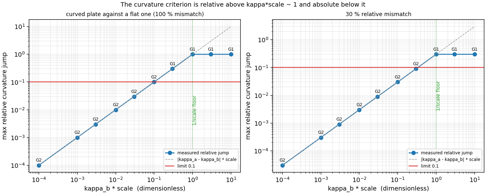
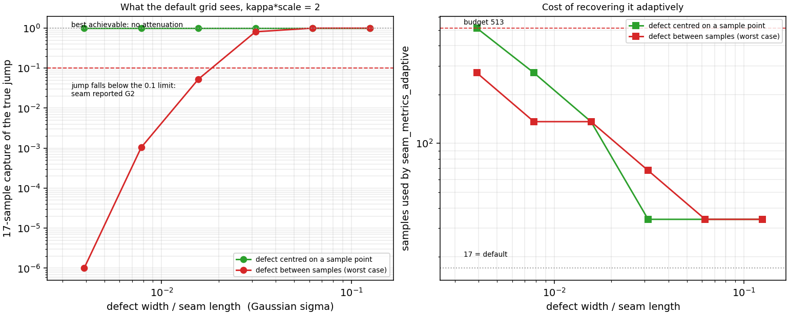

# Where the G0/G1/G2 classifier generalises, and where it does not

`docs/geomquality-pipeline.md` reports the seam-continuity classifier at F1 = 1.000 on a
held-out split. That number is real, and it is an *interpolation* number: calibration and
test seams both come from `continuity.label_seam_dataset`, i.e. planar cubic plate pairs
joined along a straight seam, one defect at a time. A shipyard model is not that
distribution. This page measures two ways in which it is not, on the same classifier,
without changing a threshold.

Everything below is written by `examples/geomquality/audit_continuity_ood.py` out of
`artifacts/geomquality/continuity_ood.json`; the numbers are read, never typed.

## 1. Setup

| item | value | source |
|---|---:|---|
| in-distribution baseline | F1 = 1.000 on 24 held-out seams | `continuity.continuity_evidence` |
| calibrated limits in force | angle 0.05°, curvature 0.01 | ditto |
| dense reference resolution | 2049 samples per isocurve | this study |
| production resolution | 17 samples per isocurve | `seam_metrics` default |
| adaptive budget | 513 samples | `seam_metrics_adaptive` |

Two constructions, both analytic, both independent of `make_seam_case`:

* **Regime**: two quadratic plates meeting at `x = 0` with a common tangent and different
  across-seam curvature (or one curved against a flat). The jump is prescribed exactly, so
  the only variable is the absolute curvature level.
* **Resolution**: one straight plate against a plate whose across-seam curvature is
  `kappa * G(v)`, with `G` a Gaussian bump of scale `width` along the seam and the knot
  vector clustered there so the *geometry* (not the sampler) resolves it. By default the
  bump sits half way between two points of the 17-point grid.

## 2. Result A: the criterion is relative only above `kappa * scale ~ 1`

`seam_metrics` divides the jump by `max(|k_a|, |k_b|, 1/scale)`. Above the floor that is a
relative test, which is what the module documents ("curvatures off by 30 %"). Below the
floor the third term wins and the test is *absolute*: any jump below `0.1 / scale` is
reported clean, whatever fraction of the curvature that is.

**100 % mismatch** (curved against flat) — the transition sits at the limit itself:

| `kappa_b * scale` | |dkappa| * scale | rel. jump | verdict |
|---:|---:|---:|---|
| 0.0001 | 0.0001 | 0.0001 | G2 |
| 0.001 | 0.001 | 0.001 | G2 |
| 0.003 | 0.003 | 0.003 | G2 |
| 0.01 | 0.01 | 0.01 | G2 |
| 0.03 | 0.03 | 0.03 | G2 |
| 0.1 | 0.1 | 0.1 | G2 |
| 0.3 | 0.3 | 0.3 | G1 |
| 1 | 1 | 1 | G1 |
| 3 | 3 | 1 | G1 |
| 10 | 10 | 1 | G1 |

**30 % mismatch** — the documented reading needs `kappa * scale > ~0.33`, not just 30 %
(measured first level flagged: `1.0`):

| `kappa_b * scale` | |dkappa| * scale | rel. jump | verdict |
|---:|---:|---:|---|
| 0.0001 | 3e-05 | 3e-05 | G2 |
| 0.001 | 0.0003 | 0.0003 | G2 |
| 0.003 | 0.0009 | 0.0009 | G2 |
| 0.01 | 0.003 | 0.003 | G2 |
| 0.03 | 0.009 | 0.009 | G2 |
| 0.1 | 0.03 | 0.03 | G2 |
| 0.3 | 0.09 | 0.09 | G2 |
| 1 | 0.3 | 0.3 | G1 |
| 3 | 0.9 | 0.3 | G1 |
| 10 | 3 | 0.3 | G1 |

For a 100 m hull (`scale = 100`) that means the "30 % curvature jump is a G1 seam" statement
holds for curvature above about `3e-3 1/m`, i.e. radii below ~300 m. Below that the seam is
reported G2 — a defensible choice (a 30 % mismatch of a radius-1000 m curvature is a
sub-millimetre sagitta over a patch) but not one the page previously *said*.

## 3. Result B: a large defect between two samples is invisible

`seam_metrics` takes the maximum over `17` samples of each seam
isocurve. A defect narrower than the sample interval is not attenuated by a factor of two,
it is missed: the maximum lands on clean seam. With `kappa * scale = 2` — twenty times the
curvature limit, a severe defect — and the bump centred between samples:

| width / seam | centre | dense (truth) | 17 samples | capture | adaptive | samples |
|---:|---:|---|---|---:|---|---:|
| 1/8 | 0.50000 | G1 | G1 | 1 | G1 | 34 |
| 1/16 | 0.50000 | G1 | G1 | 1 | G1 | 34 |
| 1/32 | 0.50000 | G1 | G1 | 1 | G1 | 34 |
| 1/64 | 0.50000 | G1 | G1 | 1 | G1 | 136 |
| 1/128 | 0.50000 | G1 | G1 | 1 | G1 | 272 |
| 1/256 | 0.50000 | G1 | G1 | 1 | G1 | 513 |
| 1/8 | 0.53125 | G1 | G1 | 1 | G1 | 34 |
| 1/16 | 0.53125 | G1 | G1 | 1 | G1 | 34 |
| 1/32 | 0.53125 | G1 | G1 | 0.8095 | G1 | 68 |
| 1/64 | 0.53125 | G1 | G2 | 0.05288 | G1 | 136 |
| 1/128 | 0.53125 | G1 | G2 | 0.001046 | G1 | 136 |
| 1/256 | 0.53125 | G1 | G2 | 1.191e-07 | G1 | 272 |

Capture falls from 1.0 for a broad defect to 1.19e-07 at `1/64` of the seam
length, i.e. from "the full jump is seen" to "0.5 % of it is seen". The narrowest defect the
default grid still catches (between samples) is `1/8` of the seam;
below that the seam reads **G2**, a clean bill of health for a defect that is there in the
geometry at 20x the limit. The `centre = 0.5` rows are the control: move the identical
defect onto a grid point and the capture returns to 1.0, so this is aliasing, not a defect
too gentle to matter.

## 4. The fix: `seam_metrics_adaptive`

Doubling the sample count until `max_gap`, `max_normal_angle_deg` and `max_curvature_jump`
stop moving (relative change < 5 %), bounded by `max_samples`:

* recovers 12 of 12 study cases, including all
  3 that the fixed grid missed, at
  513 samples worst case (budget
  513);
* leaves the calibrated family alone: 0 of 100
  verdicts changed, median 34 samples used — a clean seam
  settles at the second resolution, so adaptivity costs one extra pass in the common case;
* on the fair hull in the pipeline (`wigley_iii`, 4 seams) it returns the same 4 verdicts
  for ~2.7x the runtime of the fixed grid, and every seam reports `converged`.
* `audit_seams(refine=True)` is the entry point; the default is unchanged, so nothing in
  the existing gate moves.

## 5. Claims, and whether they hold

| claim | verdict | measurement |
|---|---|---|
| `baseline_f1_reproduced` | PASS | F1 = 1 |
| `floor_is_absolute` | PASS | jump 0.03 (abs 0.03) -> G2 |
| `floor_switch_on` | PASS | jump 0.3 -> G1 |
| `aliasing_misses` | PASS | width 0.003906: dense G1, 17 samples G2, capture 1.191e-07 |
| `aliasing_is_not_geometry` | PASS | width 0.003906 on a grid point: capture 1 -> G1 |
| `adaptive_recovers` | PASS | 3 of 3 recovered, max samples 272 |
| `adaptive_regression_free` | PASS | 100 cases, 0 verdicts changed, median 34 samples |

## 6. Limits of this study

* Constructions are synthetic and planar-ish: two patches, one defect kind at a time, no
  noise on the seam, no triple points. It measures the *classifier's* resolution and
  regime, not a yard's model.
* The defect has to exist in the control net; the knot clustering guarantees that for the
  widths studied, and the dense reference is what confirms it (absolute jump
  ~1.94 at every width).
* Aliasing is along the seam only. Across the seam the 17 samples are the only resolution
  there is (a seam is one isocurve), and this study does not address a defect that lives in
  the parameterisation rather than in the geometry.
* The adaptive stopping rule is a 5 % relative change on three metrics, capped at
  513; a defect narrower than about `1/512` of a seam can still hide,
  and `converged=False` is how the caller finds out.
