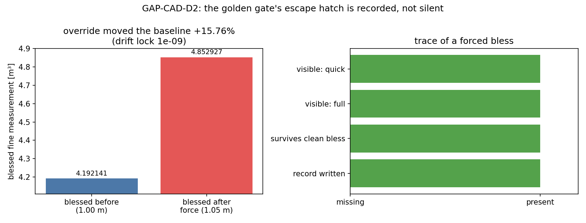

# Forced bless (`--bless --force`): what it overrides and what it leaves behind

- schema: `tensorcad.golden.forced_bless_audit/1`
- verdict: **PASS**
- blessed fine measurement: `4.19214124` -> `4.8529275` (drift `+1.576e-01`, = `1.58e+08x` the `1e-09` lock)
- findings the override stepped over: `drift, geometry_changed, reference_not_reproducible, tolerance_not_derived`
- record entries after a later clean bless: `1` (append-only: `True`)
- visible in full mode: `['forced_bless_recorded']`, quick mode: `['forced_bless_recorded']`, severity: `['warning']`

| check | result |
| --- | --- |
| override exceeded the drift lock | PASS |
| the override is recorded | PASS |
| the record names the findings overridden | PASS |
| the record survives a later clean bless | PASS |
| a tree never forced has no record | PASS |
| full mode announces it | PASS |
| quick mode announces it | PASS |
| the announcement is a warning | PASS |
| the gate stays green after a reviewed override | PASS |

Reproduce: `python tools/golden/forced_bless_audit.py`

