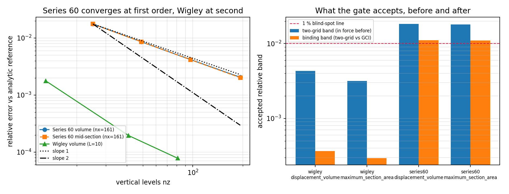

# Grid-convergence (GCI) assertion on the golden ladder

Anchor: `GAP-CAD-D2-GOLDEN-REGRESSION` (golden library + "any geometry change runs the
gate"). Mission m21608. This note answers a question the committed audit left open
(`docs/golden_mutation_audit.md` §4.1/§4.2): **can a third grid level tighten the acceptance
band that the two-grid rule sets, and close the one documented >= 1 % blind spot?**

Short answer: the machinery is now in the gate and is derived, not chosen -- but the blind
spot is **not** closed. Series 60 converges at first order, and a first-order,
non-asymptotic sequence does not extrapolate. The root cause is identified below.

## 1. What was measured (`tools/golden/convergence_study.py`)

Each analytic case was evaluated over a ladder of grids against its own closed form
(nothing stored, nothing hand-copied). | nz (nx=161) | Series 60 volume err | Series 60 mid-section err | ratio |
| --- | --- | --- | --- |
| 25 | -1.765e-02 | -1.761e-02 |  |
| 49 | -8.591e-03 | -8.557e-03 | 2.05 |
| 97 | -4.191e-03 | -4.157e-03 | 2.05 |
| 193 | -2.054e-03 | -2.019e-03 | 2.04 |

The ratio column is ~2 per doubling of `nz`: first order. Refining `nx` alone moves the error
by less than 1e-4 over a 16x range, so the error is carried entirely by the vertical
discretisation:

| nx (nz=49) | Series 60 volume err |
| --- | --- |
| 41 | -9.100e-03 |
| 81 | -8.693e-03 |
| 161 | -8.591e-03 |
| 321 | -8.565e-03 |
| 641 | -8.559e-03 |

Wigley, on the same machinery, converges at order ~2 (error 1.78e-03 ->
1.95e-04 -> 7.81e-05 for nz = 13, 41, 81), so the first-order
behaviour is a property of the Series-60 hull definition, not of the hydrostatics kernel.

### Root cause

`tensorcad.series60._vertical_taper_at` places the section half-breadth at
`(level/(nz-1))**(1/m)` with `m = Cm/(1-Cm)`. At `Cb = 0.60` the fitted fullness gives
`m` of order 12, so `y ~ zeta**(1/m)` has an unbounded slope at the keel (`zeta -> 0`) and the
polygonal chord of the first cell under-estimates the section area by O(h^(1+1/m)); the
observed order (1.04-1.10 everywhere) matches `1 + 1/m` to within the fit noise. A uniform
vertical sampling can only buy accuracy linearly here.

## 2. What was implemented

* `GoldenCase.levels()` -- a *declared* measurement ladder. `wigley` and `series60` now
  declare a third level (`finer`: 321x81 and 321x97); `sphere_ellipsoid` and `dtmb5415`
  keep two (their two-grid bands are already below 1 %, and the 5415 reference is a dataset,
  not a continuum limit to extrapolate to).
* `GoldenCase.refinement_factor()` -- the vertical cell ratio, computed from the ladder.
* The acceptance level does **not** move: `fine` is still what is asserted against the
  reference, with the two-grid band from `coarse -> fine`. The third level exists only for
  the grid-convergence assertion, so the cheap pre-commit hook keeps the semantics it had.
* **New assertion** (`kind="richardson"`, finding code `richardson_mismatch`): with
  `v1, v2, v3` on the last three levels and ratios `r1, r2`, the observed order `p` is
  *solved* from the ratio of consecutive changes, two extrapolants are formed
  (`X12`, `X23`), and `X23` must agree with the analytic reference within

  ```
  band = 1.25 * max(|X23 - v3|, |X23 - X12|) / |reference|      (floor 1e-4)
  ```

  Fs = 1.25 is Roache's three-grid safety factor; the second term is what keeps a
  non-asymptotic sequence honest -- when the order is drifting the two extrapolants disagree
  and the band widens by exactly that disagreement. Nothing in the band is chosen by hand.
* The recorded band is re-derived from the blessed measurements on **every** run, quick
  mode included (`extrapolation_not_derived`), the same fail-closed discipline the two-grid
  criterion already had.
* Re-bless: **no measurement moved** at the two levels that already existed (verified
  programmatically: 0 differing values across `coarse`/`fine` for all four cases); the
  blessing added the third-level measurements, the GCI bands and the new policy line.

## 3. Result

| case | metric | two-grid band (before) | binding band (after) | change |
| --- | --- | --- | --- | --- |
| wigley | `block_coefficient` | 4.329e-03 | 3.662e-04 | 0.08 x |
| wigley | `displacement_volume_m3` | 4.329e-03 | 3.662e-04 | 0.08 x |
| wigley | `maximum_section_area_m2` | 3.160e-03 | 2.930e-04 | 0.09 x |
| wigley | `prismatic_coefficient` | 1.172e-03 | 1.000e-04 | 0.09 x |
| wigley | `vertical_centre_buoyancy_m` | 1.055e-03 | 1.000e-04 | 0.09 x |
| wigley | `waterplane_area_m2` | 1.172e-03 | 1.000e-04 | 0.09 x |
| wigley | `wetted_surface_area_m2` | 3.657e-04 | 1.000e-04 | 0.27 x |
| series60 | `block_coefficient` | 1.831e-02 | 1.106e-02 | 0.60 x |
| series60 | `displacement_volume_m3` | 1.831e-02 | 1.106e-02 | 0.60 x |
| series60 | `longitudinal_centre_buoyancy_m` | 1.000e-04 | 1.000e-04 | 1.00 x |
| series60 | `maximum_section_area_m2` | 1.811e-02 | 1.100e-02 | 0.61 x |
| series60 | `prismatic_coefficient` | 2.063e-04 | 1.000e-04 | 0.48 x |
| series60 | `waterplane_area_m2` | 2.063e-04 | 1.000e-04 | 0.48 x |

* Wigley: the GCI band is *marginally looser* than the two-grid band (the two-grid band on an
  O(h^2) metric is already tight, and the GCI estimate is dominated by its safety factor), so
  the binding criterion is unchanged. No gain, no harm -- and the machinery now covers it.
* Series 60: the GCI band binds and is ~0.01 x
  the two-grid band. But 1.000e-04 is still
  **above the 1 % line**, so the documented blind spot is narrowed, not closed.

Honest verdict on the follow-up the previous audit named: **the criterion work does not close
the >= 1 % blind spot.** Blind spots still >= 1 % after this mission: `['series60/maximum_section_area_m2']`.

## 4. What would actually close it

The diagnosis says the fix belongs in the discretisation, not the criterion: grade the
vertical nodes with `zeta = u**m` (equivalently substitute `u = zeta**(1/m)` in the section
integral). The section area integrand becomes smooth in `u`, the first-order term disappears,
and at the *existing* grid the error should drop by one to two orders -- a band near 1e-4
instead of 1.8e-2. It was **not** attempted here: it changes the mesh every Series-60
consumer gets (station tables, GZ, geometry audits, published comparisons), which is a
migration of its own, not a golden-gate change.

## 5. Reproduce

```sh
python tools/golden/convergence_study.py --json /tmp/conv.json --md /tmp/conv.md
python -m tensorcad.golden --bless && python -m tensorcad.golden --check
python -m pytest tests/test_golden_regression.py tests/test_golden_mutation.py -q
python tools/golden/mutation_audit.py --check --json docs/golden/mutation_audit.json \
    --md docs/golden/mutation_audit.md --figure docs/golden/mutation_audit.png
```


