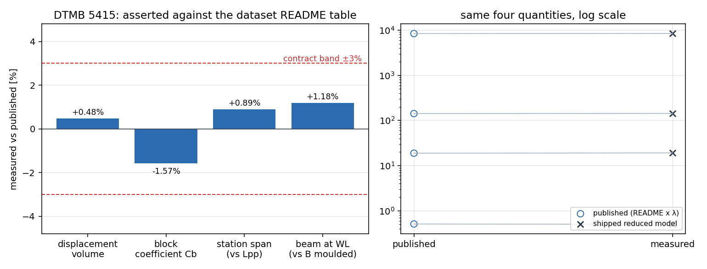

# Golden geometry regression suite (GAP-CAD-D2-GOLDEN-REGRESSION)

`tensorcad/golden.py` locks what the geometry pipeline produces. Four golden hulls are
measured at two discretisations on every geometry change, against an independent
reference for each asserted quantity and against a committed baseline of the last
blessed measurement.

## 1. The golden library

| case | geometry path | reference | why this case |
|---|---|---|---|
| `wigley` | analytic surface → loft → deck cap → surface integrals | `tensorcad.wigley.wigley_analytic_hydrostatics` (closed forms) | the classic verification hull: ∇, A_w, S_w, Cb, Cp, LCB, VCB, A_m all have closed forms |
| `series60` | Series-60 exponent family → loft → cap → integrals | `tensorcad.series60.analytic_*` over the exponents fitted from Cb | a *fitted* family: the reference must follow the fit, not a hand-typed table |
| `sphere_ellipsoid` | SDF primitives → marching tetrahedra | (4/3)πr³, 4πr², (4/3)πabc, and the triaxial area from converged quadrature of the exact area element | the marching-tetrahedra path, where an error is a tessellation error, not a hull error |
| `dtmb5415` | shipped rank-40 reduced model of the DTMB 5415 dataset (`docs/data/dtmb5415/design_space.npz`) | `docs/data/dtmb5415/holdout_fixture.npz:per_config_rms_m[0]` | the dataset-backed hull: accuracy is measured against the recorded holdout residual, no 1 GB source needed |

## 2. Three structural disciplines

1. **No hand-copied criteria.** A reference value is never a literal. Each case computes
   its references by calling the closed form or reading the dataset array named in
   `reference_source`, and the checker re-invokes that source on every run. If a stored
   reference no longer reproduces, the run fails with `reference_not_reproducible` —
   editing a number in the baseline cannot buy a pass.
2. **Tolerances are derived, not chosen.** Acceptance tolerance = 2 × |fine − coarse| /
   |reference| (a two-grid bound: the observed discretisation error, doubled), with a
   1e-4 relative floor for metrics that do not move between grids. The derivation is
   recomputed and printed with every result. Quick mode (used by the git hook) has no
   coarse level, so it runs on the tolerance recorded at bless time — the same criterion.
3. **Fail closed.** Missing baseline, unreadable baseline, wrong schema, a case the
   baseline does not know, a case the baseline knows and the code dropped, a case that
   crashes: all errors. Never "skipped".

Additional assertions that are identities rather than references: `Cb = Cp·Cm`,
`V = Cb·L·B·T` on the same mesh, `Cb = ∇/(L·B·T)` on the reported particulars, and the
mirror identities of the 5415 hull (full-hull extent = 2 × half-cloud extent on the
mirrored axis, equal extent on the other two).

## 3. What triggers a run

| path | mechanism |
|---|---|
| `tensorcad/**` (any `.py`, including a module that does not exist yet), `tests/test_golden_regression.py`, `docs/golden/**` | CI: `.github/workflows/golden-geometry.yml` (`paths:` filter), full two-grid check |
| the same paths, staged | git hook `.githooks/pre-commit`, quick check (~5 s) |

Install the hook once per checkout: `tools/golden/install_git_hooks.sh` (it only sets
`core.hooksPath=.githooks`). `TENSORCAD_GOLDEN_SKIP=1` bypasses one commit, visibly.

## 4. Commands

```bash
python -m tensorcad.golden --list                     # the golden library
python -m tensorcad.golden --check                    # full gate (CI)
python -m tensorcad.golden --check --quick --json r.json
python -m tensorcad.golden --bless                    # new baseline (refuses on errors)
python -m tensorcad.golden --staged path-list.txt --quick   # what the hook runs
python tools/golden/render_evidence.py                # docs/golden/results.{json,md} + figure
pytest tests/test_golden_regression.py -q             # engine + golden library, 36 tests
```

`--bless` refuses to bless a tree that fails its own gate (override deliberately with
`--force`); blessing is a reviewed act, because the drift check treats any change of a
blessed measurement above 1e-9 relative as a regression.

### A forced bless is recorded, not forgotten

`--force` is the only path that can write a baseline the gate itself refuses, so it is the
one place where a regression could be laundered into "the new truth".  It therefore has to
be an *auditable* act rather than a silent one:

* `--bless --force` on a failing tree writes `provenance.forced_bless` into the baseline:
  the commit that overrode the gate, the finding codes it overrode, and up to ten of those
  findings verbatim.
* the list is **append-only** — a later (clean) bless carries existing entries forward
  instead of clearing them, so re-blessing cannot erase the trace; a tree that was never
  force-blessed has no such key at all.
* every later run, in full and in quick mode, emits `forced_bless_recorded` as a
  **warning**: a deliberate override stays visible in the table the developer and CI read,
  but a reviewed decision does not keep the gate permanently red.

`tests/test_golden_regression.py::test_forced_bless_records_the_findings_it_overrode`,
`::test_a_forced_bless_is_not_erased_by_a_later_bless` and
`::test_a_forced_bless_stays_visible_in_every_later_run` hold the three properties; on the
pre-fix engine all three fail (the baseline carried nothing but `git_commit`).

The measured evidence is `docs/golden/forced_bless_audit.{json,md,png}`, regenerated by
`python tools/golden/forced_bless_audit.py` (nine checks, all programmatic: the override's
drift against the lock, the record's contents, its survival of a clean bless, and its
visibility in full and quick mode). Note the guard at the top of that tool: it inserts the
repo root on `sys.path` before importing `tensorcad`, because a script run from
`tools/golden/` otherwise imports whatever `tensorcad` is installed in site-packages — on a
multi-worktree machine that is routinely a *different* checkout, and the probe did report
the record as missing until the guard was added.

## 5. Results

Numbers live in `docs/golden/results.md` (generated by `tools/golden/render_evidence.py`
from `docs/golden/results.json`), never typed here. Worst assertion of the current tree:
the Series-60 displacement volume, −0.859 % against its closed form inside a derived
tolerance of 1.83 %; the Wigley hull is at −0.020 % with 0.43 % allowed; the sphere and
ellipsoid volumes are at −0.089 % with 0.55 % allowed, and the ellipsoid surface area is
at −0.045 % with 0.28 % allowed — an exact reference, `docs/golden/analytic_reference.md`,
not a drift lock. See `results.md` for every metric.

## 6. Limitations (recorded, not hidden)

* **DTMB 5415 absolute displacement has no published counterpart in the repository**, so
  it is drift-locked only. The suite asserts the dataset-recorded holdout residual
  (0.1174 m reproduced to 2.7e-8 relative) and the mirror/`Cb` identities instead.
* **The 5415 surface-integral displacement is withheld, because the shell is a sheet.**
  `DTMB5415Space.mesh()` is the hull *surface*, open at the deck edge and along the stem
  seam: 722 boundary edges forming one component, `is_watertight == False` (both asserted
  as topology invariants). A tetrahedron sum over an open surface is a signed integral,
  not a volume — it is −13 658 m³ here, which no displacement can be. An earlier version
  of this suite passed `closed=True` to `compute_hydrostatics` on that shell and published
  the result as a "surface-integral volume" disagreeing with the cloud integral by 2.6;
  that number measured the artifact of the caller's assumption, not an integration error.
  The suite now records `signed_tetra_sum_open_shell_m3` under a name that says what it
  is, asserts the open topology, and withholds the displacement (only the dataset /
  station-area displacement of 8 452.76 m³ is reported). Closing the sheet is not a
  one-liner: after welding, `mesh_repair.boundary_loops` refuses the boundary (a vertex is
  walked twice at the stem pinch), so a watertight repair must stitch the seam first —
  that remains a feature-ledger item.
* **The ellipsoid surface area was long only drift-locked.** It has no elementary closed
  form (it is an elliptic integral), so it used to be exempt from a reference: the gate
  would notice a *changed* area, never a *wrong* one. It is now asserted against converged
  Gauss-Legendre quadrature of the exact area element
  (`tensorcad.analytic_solids.ellipsoid_surface_area`), which agrees with the elementary
  spheroid closed forms to ~1e-14 over aspect ratios 1.1–10 and shares no code with the
  mesher. Derivation, cross-checks and the applicability limit (the tensor rule needs an
  order proportional to the axis ratio, capped at 512, and raises rather than returning a
  truncated area beyond roughly 10:1): `docs/golden/analytic_reference.md`.
* **Proxy sampling allowance**: the analytic Wigley/Series-60 references are integrated
  exactly, while the measurements come from a station-sampled loft; the two-grid tolerance
  absorbs that gap, so a *systematic* bias smaller than the discretisation error would go
  unnoticed between grids. The drift lock is what catches it if it changes.

## Geometry identity: the mesh is asserted, not only the integrals

`--bless` has always written a per-case `geometry_sha256` (a quantised hash of the
vertices, the faces and their order), but nothing read it back: three of the four cases
stored `""` (only `wigley` computed one) and `evaluate_case` never compared it. A change
that keeps every measured quantity bit-identical — re-triangulation, vertex renumbering,
inverted winding, since the surface area takes the norm and the sphere/ellipsoid volume
the absolute value — therefore passed the gate silently.

Now:

* all four golden forms fingerprint their fine mesh (`series60`, `sphere_ellipsoid` — both
  bodies folded into one digest, `dtmb5415`, `wigley`);
* `evaluate_case` compares the measured fingerprint with the blessed one and raises
  `geometry_changed` (error) on a mismatch, `geometry_fingerprint_not_blessed` (error)
  when the baseline entry does not lock the mesh, and `geometry_fingerprint_missing`
  (warning) when a case cannot identify its mesh at all;
* the baseline was re-blessed: the diff is `geometry_sha256` only, every measurement is
  unchanged (`dtmb5415` moved by 7.8e-13 relative, four orders below the 1e-9 drift lock).

The hash is quantised to 1e-9 before hashing so that equal geometry hashes equal across
machines, and a mismatch is never "skipped": it is an error that only a deliberate
`--bless` clears.

## Red-team: the gate must be able to fail

`tools/golden/mutation_redteam.py` breaks one thing at a time in a **scratch copy** of the
tree (nothing in the worktree is touched) and runs the real gate against it. A null
control (the unmodified copy) must pass; every mutant must exit non-zero **and** report
the finding code that mutation is supposed to trip.

```
python tools/golden/mutation_redteam.py                      # quick gate (default)
python tools/golden/mutation_redteam.py --full                # full two-grid gate
python tools/golden/mutation_redteam.py --only <mutant-id> --json out.json
```

Result on this tree (`docs/golden/redteam.md`, `docs/golden/redteam_quick.json`): null
control PASS, **7/7 mutants killed**, ~97 s for eight gate runs. The three classes of
mutant are represented deliberately:

| class | mutant | killed by |
|---|---|---|
| reference | Wigley/Series-60 closed form perturbed by 1e-3 | `reference_not_reproducible` |
| reference | a blessed reference edited by hand in the baseline (+0.4 %) | `reference_not_reproducible` |
| numeric | fine grid silently coarsened (quick / full) | `geometry_changed` / `drift`+`geometry_changed` |
| numeric | sphere radius changed in the case definition | `drift`+`geometry_changed`+`reference_not_reproducible` |
| identity | winding repair disabled in marching tetrahedra | `geometry_changed` **only** |
| structural | 5415 mirror axis swapped in the case declaration | `invariant_violated` **only** |

The last two are the point of the exercise: they are killed by exactly one check, so the
fingerprint assertion and the invariant identities are shown to be load-bearing rather
than redundant decoration. `tests/test_golden_regression.py` keeps a fast unit-level
version of each claim plus one end-to-end run of the harness.

## DTMB 5415: the published particulars are asserted, not only drift-locked

The 5415 case used to assert exactly one number, the holdout residual of the reduced model.
Its displacement, waterline beam, station length and block coefficient were *drift-locked*:
the gate could tell that they had **changed**, never that they were **wrong**. That is the
same gap the ellipsoid area had before it was bound to converged quadrature, and it is now
closed the same way — against a reference that comes from outside this repository's
geometry code.

### Where the reference comes from

`tensorcad.dtmb5415.readme_reference()` derives the full-scale principal particulars from
the dataset README's **model-scale table** (`Lpp` 5.720 m, `B` 0.760 m, `T` 0.248 m,
displaced mass 0.549 t at rho = 998.5 kg/m3), scaled by the case's own
`SCALE_LAMBDA = 142.0 / 5.720`. Nothing is typed into the golden case:

| quantity | reference | derived as |
|---|---|---|
| displacement volume | 8412.038 m3 | 0.549 t / 998.5 kg/m3 x lambda^3 |
| Cb | 0.50999 | reference volume / (Lpp · B · T) — derived, not quoted |
| station span | 142.000 m | README `geometry_scale` |
| beam | 18.867 m | 0.760 m x lambda |

The tool that first established the hull (`tools/dtmb5415_param/verify_geometry.py`) now
delegates to the same function, so the contract and the gate cannot drift apart.

### The band is quoted from the hull's own contract

A published table has no coarse-to-fine signal, so the derived two-grid bound collapses to
its 1e-4 floor and would reject the reference's own four-significant-figure precision. The
case therefore **declares** its band from the geometry contract that already owns this
comparison: 3 % accept / 15 % reject, declared in `verify_geometry.py` *before* its numbers
were looked at. The engine supports this through `GoldenCase.reference_tolerance()` and
refuses an unjustified declaration three ways (unknown metric, empty basis, or a band above
`DECLARED_TOLERANCE_CAP = 5 %`), so "declare 40 % and pass" is an error, not a shortcut.

| metric | measured | published | error | band |
|---|---|---|---|---|
| displacement volume | 8452.758 m3 | 8412.038 m3 | **+0.48 %** | 3 % |
| Cb | 0.501988 | 0.509992 | **-1.57 %** | 3 % |
| station span | 143.265 m | 142.000 m | **+0.89 %** | 3 % |
| beam at design WL | 19.091 m | 18.867 m | **+1.18 %** | 3 % |

All four are inside the band; Cb is the binding one because it carries the whole
definitional mismatch (published `Lpp · B_moulded · T` against the measured station span,
WL beam and moulded draft) and is still well inside 3 %.

### What is deliberately *not* asserted

* **`draft_m`** — `hydrostatics()` cuts the hull at `DRAFT_M = 0.248 m x lambda`, so the
  reported draft *is* the README draft scaled to full size. Asserting it would compare a
  constant with itself; it stays a drift-locked measurement and the band's basis says so.
* **Surface-integral displacement** — still withheld, for the reason recorded in the case's
  `known_limitations`: the shipped 5415 shell is an open sheet with one 722-edge boundary
  loop, and its tetrahedron sum is not a volume. The displacement now asserted is the
  dataset/station-area one, cross-checked against the README table; the surfaced integral
  remains a disclosed gap rather than a passing number.

### Teeth

`tests/test_golden_regression.py::test_dtmb5415_particulars_gate_has_teeth` corrupts the
README displaced mass by 10 % (what a unit slip looks like) and requires the gate to go red
twice over: `reference_not_reproducible` (the stored reference no longer follows its source)
and `reference_mismatch` on the displacement (the measurement left the band).


