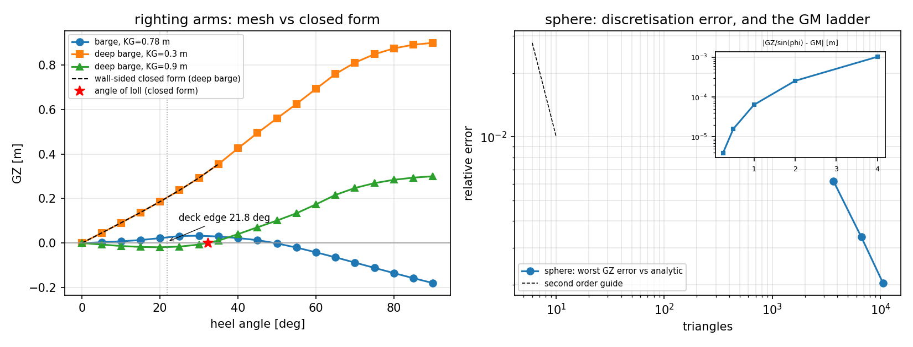

# Large-angle stability: the righting-arm curve

`GM` answers "is the upright position stable". `GZ(phi)` answers the questions that
actually decide a design: where the curve peaks, how far it stays positive, and how
much energy it absorbs before it does not. `tensorcad.stability` computes the first and
states in its own docstring that the second is "a different integration (a heeled
displacement integration, not a waterplane moment)". `tensorcad.gz` is that
integration, and this page is its evidence.

Everything here is measured by `python examples/gz/run_example.py`, which writes
`docs/gz/{results.json,report.md,gz_curves.png}` and exits non-zero if any of its twelve
claims stops holding. `tests/test_gz.py` pins the same numbers (62 tests).

## The two equations

Heel the waterplane to ``phi`` about the longitudinal axis. In the ship's own frame
world-up tips towards port, so that starboard goes down and ``GZ`` comes out positive on
a stable ship:

```
up        n(phi) = (0, -sin phi, cos phi)
in-plane  e(phi) = (0,  cos phi, sin phi)
GZ        = (B(phi) - G) . e = (y_B - y_G) cos phi + (z_B - z_G) sin phi
```

with ``G = (y_G, z_keel + KG)``. ``KG`` is measured above the keel -- the mesh's lowest
point, the datum `initial_stability` already uses -- and ``y_G`` defaults to the
centreline.

The second equation is the one that has to be *solved*, not evaluated: the ship heels
at constant displacement. The plane offset ``d`` enters as an unknown and is found by a
safeguarded secant iteration on ``V(d) - V_upright``, which is monotone in ``d``. The
residual is reported in `relative_volume_error` rather than assumed away; it is
``6.8e-14`` worst over both barges at every sampled heel.

## How the heeled displacement is integrated

The immersed region is a half-space intersection of a polytope, so its volume and
centroid are *exact*: clip each triangle against ``n.p <= d`` (Sutherland-Hodgman on a
triangle), fan-triangulate the result, and sum signed tetrahedra from ``o = d n`` -- a
point that lies *on* the cut plane. That reference point is the trick: the cap that
would close the clipped surface is coplanar with ``o``, so every cap tetrahedron has
zero volume and the cap is never built. What comes out is exact for the polyhedron the
mesh actually is; the only error left is the discretisation the mesh already carries.
This is the same philosophy as the Green's-theorem waterplane integral in
`tensorcad/stability.py`, and it is why a barge reproduces its closed forms to one ulp
while a faceted sphere reproduces its own to `0.2 %`.

## Three references, two of them closed-form

| reference | geometry | what it checks |
|---|---|---|
| `wall_sided_righting_arm` | any rectangular section, ``\|phi\| < atan(2T/B)`` | the *physics and the sign*: ``GZ = sin phi (GM + BM tan^2 phi / 2)`` |
| `barge_righting_arm` | a rectangular barge at any heel | the *integrator*: a 2-D clip and shoelace, a different algorithm on the same polytope |
| ``(KM - KG) sin phi`` | a sphere, every heel, ``KM = R`` | the *whole pipeline* on a curved body |

The wall-sided form is not a small-angle truncation. Holding the displaced area at
``B T`` gives ``d = T cos phi`` exactly, ``y_B = B^2 tan phi / (12 T)`` and
``z_B = T/2 + B^2 tan^2 phi/(24 T)`` in closed form, and projecting ``B - G`` on the
heeled waterplane collapses to the expression above. It integrates to a closed-form
area as well (`wall_sided_dynamical_stability`), which is how the quadrature of a
*measured* curve is checked against an exact number instead of against itself.

## Measured

Barge: ``L = 10 m``, ``B = 2 m``, ``T = 0.8 m``, ``D = 1.2 m`` (freeboard ``0.4 m``),
``KG = 0.78 m``. Its metacentre is ``KM = T/2 + B^2/(12T) = 0.816667 m``, so
``GM = 0.036667 m`` -- stable, but only just, which is what makes the curve turn over.

| item | value |
|---|---:|
| ``GZ`` maximum | ``0.032825 m`` |
| heel at the maximum | ``30.0 deg`` |
| angle of vanishing stability | ``49.452 deg`` |
| dynamical stability, 0 to vanishing | ``0.015181 m rad`` |
| deck-edge immersion | ``21.801 deg`` |
| wall-sided limit ``atan(2T/B)`` | ``38.660 deg`` |

The deck edge is *inside* the wall-sided limit, so the barge leaves the closed form at
21.8 deg and the 2-D reference takes over: the two arms agree to ``1.44e-14 m`` worst
over 0 to 90 deg in 5 deg steps, and on the deep barge (``D = 2.4 m``, deck edge 58.0 deg)
the mesh and the wall-sided closed form agree to ``6.14e-16`` relative, i.e. round-off.

| check | measured | limit |
|---|---:|---|
| mesh arm vs 2-D section reference, 0-90 deg | ``1.44e-14 m`` | ``< 1e-12 m`` |
| mesh arm vs wall-sided closed form, 5-35 deg | ``6.14e-16`` rel | ``< 1e-12`` |
| heeled displacement balance, all angles | ``6.84e-14`` rel | ``< 1e-13`` |
| ``GZ/sin phi - (BM/2) tan^2 phi`` vs ``GM`` at 0.25 deg | ``7.99e-15 m`` | ``< 1e-12 m`` |
| angle of loll vs ``tan^2 phi = -2 GM / BM`` | ``6.5e-13 deg`` | ``< 1e-6 deg`` |
| ``GZ`` at the bisected vanishing angle | ``3.61e-16 m`` | ``< 1e-12 m`` |
| dynamical stability, 0-30 deg, Simpson vs closed form | ``1.32e-5`` rel | ``< 1e-3`` |
| ``dGZ/dKG = -sin phi`` | ``2.8e-17 m`` | ``< 1e-13 m`` |

**The metacentric height falls out of the curve, and so does its own curvature.** The
naive estimate ``GZ/sin(phi)`` at 0.25 deg is ``3.97e-6 m`` *above* ``GM`` -- which is
exactly ``(BM/2) tan^2(0.25 deg)``, not a quadrature error. Removing that term leaves
``GM`` to ``7.99e-15 m``, and halving the heel quarters the deficit (measured order
``4.0002``). A curve that did not have the right second derivative could not do both.

**An unstable ship settles at its loll angle.** With ``KG = 0.9 m`` the deep barge has
``GM = -0.083333 m``: ``GZ`` is negative out of the upright and returns to zero at
``32.311533 deg``, which is ``atan(sqrt(-2 GM / BM))`` to ``6.5e-13 deg``. Both crossings
-- loll before the peak, vanishing after it -- are bisected rather than read off the
samples.

**The sphere is pure discretisation.** ``R = 1 m``, ``KG = 0.5 m``, warped to a mesh by
`to_mesh(SphereField(...))`: at ``20^3`` (10,568 triangles) the worst arm error against
``(R - KG) sin phi`` over 15 to 90 deg is ``0.204 %``, and the error between ``12^3`` and
``20^3`` falls by ``3.03x`` while the triangle count grows by ``2.87x``.



## The trap this module refuses to fall into

A mesh capped at the design waterline -- which is exactly what
`tensorcad.hull.generate_hull` produces -- has no freeboard. Heel it and the displaced
volume is *only* conserved by submerging the whole model, so the solver walks straight
onto the flat branch of ``V(d)`` and returns the constant arm ``KB - KG`` for every heel
angle. For the ``10 x 2 x 0.8 m`` box that is ``-0.15 sin phi`` instead of
``+0.266667 sin phi``: a plausible-looking, completely wrong curve.

`heeled_displacement` therefore counts the faces that emerge above the heeled
waterplane and raises `HeelError` when there are none, naming freeboard. Upright queries
(``heel = 0``) are still allowed, because that is a legitimate slice. Large-angle work
needs the hull modelled to the deck edge.

## What this is not

No free-surface correction (that is the caller's tankage, and `GM` here is solid ``GM``);
no flooding or damage stability -- a flooded compartment changes the body, not the heel
angle; no trim coupling, since the waterplane is rotated about ``x`` only; no wind or
launching curves; and no statutory verdict. `gz_curve` reports the geometry of the curve
-- peak, loll, vanishing angle, area -- and not whether it passes IMO A.749 or the IS
Code 2008 intact-stability criteria, which need down-flooding points and openings the
mesh does not carry.

`compute_hydrostatics` integrates the *closed* volume of the mesh, so a mesh with
freeboard must not be fed to it: it reports ``48.0 m^3`` for the decked barge whose
displacement is ``16.0 m^3``. `upright_displacement` slices the half-space instead and
gets ``16.0``. On a hull capped at the waterline the two agree exactly, which is the
assumption the rest of the package was built on.

Only the Python standard library is used.