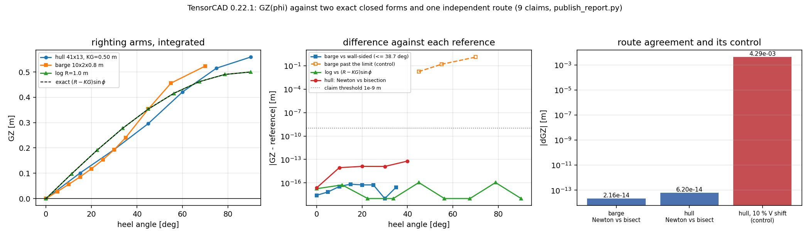

# Large-angle stability `GZ(phi)`: measured evidence page

TensorCAD 0.22.1, written by `publish_report.py`. Every number below is recomputed by that script, and `python publish_report.py --check` fails if this page and the code disagree. Discussion and the API live in [docs/gz.md](../gz.md); this page is the measurement record.

## 1. The case

Three bodies, chosen so that two of them have a right answer that does not come from the integrator under test:

| body | L x B x T [m] | depth / freeboard [m] | KG [m] | reference |
|---|---|---|---|---|
| box barge | 10.00 x 2.00 x 0.80 | 2.00 / 1.20 | 0.50 | wall-sided closed form `sin(phi)(GM0 + BM0/2 tan^2 phi)` |
| log (circular section) | 4.00 x 2.00 x 2.00 | 64-gon | 0.50 | central symmetry: `(R - KG) sin(phi)` |
| parametric hull | 10.00 x 2.00 x 0.80 | freeboard 1.00 | 0.50 | `GM` from waterplane moments (`tensorcad.stability`) |

Waterlines: barge `z = 0.80 m` (keel datum `z = 0`), log `z = 1.00 m` (half submerged), hull `z = 0` with the `41x13` mesh closed above the waterline by `with_freeboard`. Upright displacement of the hull 7.446554 m^3, `KB = 0.483005 m`, `BM = 0.438618 m`, `GM = 0.421623 m`.

## 2. How it was done

1. `tensorcad.gz.heeled_hydrostatics` rotates the closed mesh about the `x` axis through the keel line, cuts it with `z = c`, and integrates the part below with the divergence theorem, apex on the waterline plane so the closing cap contributes exactly zero; the same pass accumulates the waterplane area and the wetted area.
2. `c` is Newton-solved per heel on `dV/dc = A(c)` until `V(phi) = V(0)` to a relative `1e-13`. Then `GZ(phi) = KN(phi) - KG sin(phi)` with `KN = y_B cos phi + z_B sin phi`, all measured from the keel datum.
3. References: the wall-sided closed form on a `10 x 2 x 0.8 m` barge (valid to `38.66 deg` here), central symmetry on the log, and `tensorcad.stability.initial_stability` (Green's theorem on the cut waterplane loops) for the hull slope.
4. Cross-route check: `tensorcad.righting_arm.righting_arm_curve` integrates the clipped sections in the body frame and finds the waterline by bracket-and-bisect on the monotone `V(h)` -- a different integral and a different solver -- and the two curves are compared at `0, 10, 20, 30, 40 deg`.
5. `publish_report.py` writes `results.json`, this page and `figures/gz-curve.png` from one run; `--check` re-derives the claims and compares them with the committed JSON.

## 3. Results

### 3.1 Barge against the wall-sided trapezoid (inside the window)

| heel [deg] | GZ [m] | closed form [m] | abs diff [m] |
|---|---|---|---|
| 0 | -0.000000000000 | 0.000000000000 | 2.60e-18 |
| 5 | 0.027738300466 | 0.027738300466 | 6.94e-18 |
| 10 | 0.056113366873 | 0.056113366873 | 3.47e-17 |
| 15 | 0.085830691654 | 0.085830691654 | 6.94e-17 |
| 20 | 0.117745730766 | 0.117745730766 | 5.55e-17 |
| 25 | 0.152973972824 | 0.152973972824 | 5.55e-17 |
| 30 | 0.193055555556 | 0.193055555556 | 0 |
| 35 | 0.240219857585 | 0.240219857585 | 2.78e-17 |

`GM0 = 0.316667 m`, `BM0 = 0.416667 m`, worst diff `6.94e-17 m` -- round-off: the polyhedral integral and the closed form are both exact for this shape.

**Negative control** -- the same comparison past the limit, where the closed form must fail:

| heel [deg] | GZ [m] | wall-sided [m] | abs diff [m] |
|---|---|---|---|
| 45 | 0.353553 | 0.371231 | 0.018 |
| 55 | 0.456144 | 0.607471 | 0.151 |
| 70 | 0.523111 | 1.775360 | 1.252 |

### 3.2 Log against central symmetry

| heel [deg] | GZ [m] | (R - KG) sin phi [m] | abs diff [m] |
|---|---|---|---|
| 0 | 0.000000000000 | 0.000000000000 | 1.81e-17 |
| 11.25 | 0.097545161008 | 0.097545161008 | 5.55e-17 |
| 22.50 | 0.191341716183 | 0.191341716183 | 0 |
| 33.75 | 0.277785116510 | 0.277785116510 | 0 |
| 45 | 0.353553390593 | 0.353553390593 | 1.11e-16 |
| 56.25 | 0.415734806151 | 0.415734806151 | 0 |
| 67.50 | 0.461939766256 | 0.461939766256 | 0 |
| 78.75 | 0.490392640202 | 0.490392640202 | 1.11e-16 |
| 90 | 0.500000000000 | 0.500000000000 | 0 |

Off the polygon's symmetry axes the identity is only approximate -- the cut no longer splits the section into equal areas -- and that is reported rather than hidden by the grid: `10.0 deg -> 9.64e-06 m`; `30.0 deg -> 7.43e-06 m`.

### 3.3 Hull curve (`41 x 13`, KG = 0.50 m, freeboard 1.0 m)

| heel [deg] | GZ [m] | KN [m] |
|---|---|---|
| 0 | -0.000000 | -0.000000 |
| 15 | 0.100967 | 0.230377 |
| 30 | 0.193606 | 0.443606 |
| 45 | 0.296144 | 0.649697 |
| 60 | 0.420732 | 0.853745 |
| 75 | 0.515141 | 0.998104 |
| 90 | 0.558859 | 1.058859 |

- `GZ'(0) = 0.421622996 m/rad` vs `GM = 0.421622996 m` from the waterplane moments (relative difference `1.77e-09`).
- peak `GZ = 0.558859 m` at `90 deg`, range of stability no vanishing angle below 90 deg, area under the curve `0.472815 m rad`.
- mesh watertight `True`; upright waterplane area `14.061669 m^2`.

### 3.4 Cross-route agreement (Newton vs bracket-and-bisect)

| heel [deg] | hull Newton [m] | hull bisection [m] | abs diff [m] |
|---|---|---|---|
| 0 | -0.000000000000 | 0.000000000000 | 2.29e-17 |
| 10 | 0.068975985466 | 0.068975985466 | 8.95e-15 |
| 20 | 0.132034360477 | 0.132034360477 | 1.30e-14 |
| 30 | 0.193605845702 | 0.193605845703 | 1.27e-14 |
| 40 | 0.259171095177 | 0.259171095177 | 6.20e-14 |

Worst over both meshes `6.20e-14 m`. Negative control: shifting the displacement target by `10 %` moves `GZ(20 deg)` by `0.004 m`, so the agreement above is a measurement and not an artefact of both routes ignoring the displacement.

### 3.5 Free surface and displacement bookkeeping

- slack tank `2.0 x 0.5 m`: `i_x = 0.020833 m^4`, flat loss `i_x/V = 2.7977 mm`; worst departure from a flat shift `4.55e-17 m`.
- peak `GZ` 0.558859 m -> 0.556061 m (drop 2.7977 mm).
- displacement residual, worst over all curves `4.77e-16` relative (barge `2.22e-16`, log `2.83e-16`, hull `4.77e-16`).

*Left: the three righting-arm curves with the log's closed form dashed. Middle: absolute difference against each reference on a log scale -- the two exact benchmarks sit at double-precision round-off across their whole validity window, while the barge's closed form departs by metres once the bilge emerges. Right: the Newton/bisection cross-route difference next to the 10 % displacement-shift control, which has to be far above it for the comparison to mean anything.*

## 4. Caveats and scope

- The barge and log references are exact *for the polygonal mesh*; they measure the integrator and the waterline solve, not the meshing of a real hull. On the log the identity holds on the polygon's symmetry axes only: between them the discretisation shows its own asymmetry (section 3.2), which is a property of the 64-gon, not of the waterline solver.
- The hull has no closed-form `GZ`. Its checks are the slope against the waterplane moments (a different integration of the same mesh), the cross-route comparison and the displacement residual; none of them is a validation against model-test or sea-trial data.
- `KN` is limited by the chord-wise resolution of the `41 x 13` mesh, exactly as `KB`/`BM` are; no convergence ladder is claimed on this page (see [docs/righting_arm.md](../righting_arm.md) for one).
- `KG` is the only loading input: no tanks other than the idealised `i_x` shift, no flooding, no damage, no trim equilibrium, no wind heeling arm, no statutory or class criterion. `area_under_curve` is an input to such a check, not the check.
- Deck-edge immersion is reported by `deck_edge_immersion_deg`, but the curve keeps rising past it because nothing floods; that is a flooding criterion, not geometry.

## 5. Error verdict

| id | quantity | value | threshold | verdict |
|---|---|---|---|---|
| C1 | barge abs(GZ - wall-sided) [m] | `6.94e-17` | `1.00e-09` | **pass** |
| C2 | barge abs(GZ - wall-sided) past the limit [m] (must be large) | `1.252` | `0.010` | **pass** |
| C3 | log abs(GZ - (R-KG) sin phi) [m] | `1.11e-16` | `1.00e-09` | **pass** |
| C4 | rel(hull GZ'(0), GM) [-] | `1.77e-09` | `1.00e-06` | **pass** |
| C5 | max displacement residual [-] | `4.77e-16` | `1.00e-11` | **pass** |
| C6 | max abs(Newton - bisection) [m] | `6.20e-14` | `1.00e-09` | **pass** |
| C7 | GZ shift under a 10 % volume error [m] (must exceed C6) | `0.004` | `1.00e-08` | **pass** |
| C8 | departure from the flat free-surface shift [m] | `4.55e-17` | `1.00e-12` | **pass** |
| C9 | abs(peak drop - i_x/V) [m] | `4.55e-17` | `1.00e-12` | **pass** |

Whether each key quantity is within **3 %** of its benchmark, stated explicitly:

- barge `GZ` vs the wall-sided closed form: worst absolute error `6.94e-17 m` on arms of order 0.1 m, i.e. round-off -- **yes, below 3 %**.
- log `GZ` vs central symmetry: `1.11e-16 m` -- **yes, below 3 %**.
- hull `GZ'(0)` vs `GM`: `1.77e-09` relative -- **yes, below 3 %** (round-off plus the Richardson residual).
- hull `GZ` vs the independent bisection route: `6.20e-14 m` absolute, i.e. round-off -- **yes, below 3 %**; note this is an implementation cross-check, not an experimental benchmark.
- hull `GZ` vs model test or sea trial: **no such benchmark exists in this repository**, so no percentage is claimed. Nothing on this page validates the righting arms of a real ship; the honest status of that comparison is *no reference data*, not *agreement*.

**Verdict: all 9 claims hold.**
