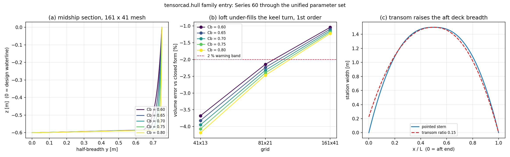

# The unified hull-family entry: Series 60 through `tensorcad.hull`

**Scope**: `tensorcad/hull.py` (`family` dispatch) · **Family module**:
`tensorcad.series60` · **Evidence**: `artifacts/hull_family/hull_family.json`
(regenerate with `python tools/hull_family/report.py`) · **Figure**:
`docs/hull_family.png` · **Gate power**: `artifacts/hull_family/gate_power.json`

## 1. Case

`tensorcad.hull` was the only parametric entry downstream code knew: one
`HullParameters(L, B, T, nx, nz, fore_exponent, aft_exponent)` lofted a
`sin^p`-taper surface with a `sqrt` vertical profile. The Series 60 family
lived next door in `tensorcad.series60` with its own parameter class, so a
caller who wanted the Todd station law had to know which module to import --
and the cross-check audit of the Series 60 unit recorded exactly that as the
blocker to L3 (`docs/audit_m17252_gap_cad_t2_param_series.md` §0: *"the
declared entry point `tensorcad/hull.py` was not touched by a single line"*).

This unit puts the family behind the existing entry, without changing either
station law:

| `HullParameters` field | sine (default) | series60 |
|---|---|---|
| `length`, `beam`, `draft`, `nx`, `nz`, `water_density` | used | used |
| `fore_exponent`, `aft_exponent` | sine taper exponents | refused (the law derives its own) |
| `block_coefficient` | refused | required, 0.55-0.85 (Todd ladder) |
| `waterplane_coefficient`, `lcb_ratio` | refused | optional coupling (`Cwp`, `LCB/L`) |
| `transom_ratio` | refused | aft deck half-breadth over `B/2` |
| `bulb_length_ratio`, `bulb_area_ratio`, `bulb_centre_height_ratio` | refused | bulbous bow as a separate closed solid |

Principal dimensions used for every number below: L = 10.0 m, B = 1.5 m,
T = 0.6 m, fresh water (1000.0 kg/m^3).

## 2. Method

* `family="series60"` maps the parameters onto `Series60Parameters` and calls
  `generate_series60`; the result is presented as a `HullModel` with this
  module's validation report, hydrostatics block, offsets convention and
  `metadata()` schema. The delegated family's own report (station law,
  exponents, transom, bulb) is carried under `family_report`.
* Mesh equivalence is asserted **bit for bit** against the family module, not
  within a tolerance: two entries that claim to build the same surface have to
  produce the same vertices.
* `_build_family_mesh` converts the family module's half-breadths to this
  module's full-girth `offsets`, once, at the boundary.
* `estimate_discretisation_error` and `resolve_resolution` carry the whole
  parameter set through `dataclasses.replace`, so a refinement measures the
  same form at a finer grid, and the accepted-error test uses the family's own
  closed form rather than the sine formula.
* Parameters a family cannot honour are **refused** with a message, on the
  ground that a caller who asks for `Cb` and silently gets an exponent has been
  lied to.

## 3. Numbers

### 3.1 Five parents against their closed forms

| Cb | grid | triangles | V [m^3] | V error | Awp error | Cb measured | Cb error | VCB error |
|---|---|---|---|---|---|---|---|---|
| 0.60 | 41x13 | 1998 | 5.201439 | -3.68 % | -0.05 % | 0.577938 | -3.68 % | -3.69 % |
| 0.60 | 81x21 | 6558 | 5.284288 | -2.14 % | -0.01 % | 0.587143 | -2.14 % | -2.19 % |
| 0.60 | 161x41 | 25918 | 5.343948 | -1.04 % | -0.00 % | 0.593772 | -1.04 % | -1.07 % |
| 0.65 | 41x13 | 1998 | 5.626530 | -3.82 % | -0.06 % | 0.625170 | -3.82 % | -3.79 % |
| 0.65 | 81x21 | 6558 | 5.719181 | -2.24 % | -0.02 % | 0.635465 | -2.24 % | -2.26 % |
| 0.65 | 161x41 | 25918 | 5.786175 | -1.09 % | -0.00 % | 0.642908 | -1.09 % | -1.11 % |
| 0.70 | 41x13 | 1998 | 6.051213 | -3.95 % | -0.07 % | 0.672357 | -3.95 % | -3.89 % |
| 0.70 | 81x21 | 6558 | 6.153837 | -2.32 % | -0.02 % | 0.683760 | -2.32 % | -2.32 % |
| 0.70 | 161x41 | 25918 | 6.228259 | -1.14 % | -0.00 % | 0.692029 | -1.14 % | -1.15 % |
| 0.75 | 41x13 | 1998 | 6.475374 | -4.07 % | -0.09 % | 0.719486 | -4.07 % | -3.97 % |
| 0.75 | 81x21 | 6558 | 6.588253 | -2.40 % | -0.02 % | 0.732028 | -2.40 % | -2.38 % |
| 0.75 | 161x41 | 25918 | 6.670212 | -1.18 % | -0.01 % | 0.741135 | -1.18 % | -1.19 % |
| 0.80 | 41x13 | 1998 | 6.898818 | -4.18 % | -0.11 % | 0.766535 | -4.18 % | -4.04 % |
| 0.80 | 81x21 | 6558 | 7.022396 | -2.47 % | -0.03 % | 0.780266 | -2.47 % | -2.43 % |
| 0.80 | 161x41 | 25918 | 7.112039 | -1.22 % | -0.01 % | 0.790227 | -1.22 % | -1.22 % |

Mesh identical to `generate_series60` at every parent and grid: **True**.

Worst volume error over all 15 cases: **+4.18 %**; at the 161 x 41 grid
(the resolution the Series 60 audit publishes): **+1.22 %**.
The sign is negative everywhere and the magnitude falls with the grid: the loft
chords cut inside the analytic surface, and the `zeta^(1/m)` section turns within
the first mesh cell above the keel.

### 3.2 Transom and bulb pass-through

* Transom ratio 0.15: aft station width 0.225000 m against an expected 0.225000 m (`0.15 * B`); the pointed-stern
  control gives 0.000000 m. Immersed
  transom area 0.132168 m^2 = 0.1500 of the midship section.
  Watertight with the stern face (no validation errors): **True**.
* Bulb (0.03 L long, `A_BT`/`A_m` = 0.08): closed-form volume 0.014098 m^3 = +0.23 % of the
  hull displacement, forward-perpendicular area 0.070490 m^2.
  The hull displacement is bit-identical with and without the bulb
  (**True**): the bulb is a second closed
  solid, not a boolean union, so nothing is double counted.

### 3.3 Refusal matrix

| case | refused | message names the reason |
|---|---|---|
| series60 without block_coefficient | True | True |
| sine family with a Cb | True | True |
| sine family with a transom | True | True |
| series60 with a sine exponent | True | True |
| unknown family | True | True |
| Cb outside the ladder | True | True |

## 4. Figure



(a) midship sections read off the generated 161 x 41 meshes, one per parent --
the U-form fills as `Cb` rises. (b) displacement error against the closed form on
the three-grid ladder, all five parents. (c) station breadth along the length for
the pointed stern and for a 0.15 transom: the aft deck breadth is the parameter,
the rest of the run is unchanged.

## 5. What this does *not* establish

* **External anchor still withheld.** The closed form is the resolved Todd (1951)
  station law; the published coefficient ladder is an *input*, so §3.1 measures the
  loft against the law, not the law against a scanned parent-form offsets table.
  The cross-check audit's finding F4 applies to this page unchanged.
* **No hydrodynamic claim.** Resistance, seakeeping, stability and GZ are out of
  scope; this is geometry and hydrostatic integration.
* **The keel turn is unresolved at the default grid.** At 41 x 13 the same
  parameters sit at about -4 % on displacement, which trips the module's 2 %
  `sampling_error_within_tolerance` warning (a warning, not an error). 161 x 41 is
  the resolution at which the sub-1.2 % claim holds; a production export should go
  through `resolve_resolution`.
* **`vertex_manifold` warning is inherited.** `generate_series60` itself reports it
  on the reference hull (the ring closes on the centreline), so it is a property of
  the family mesh, not of the dispatch.
* The bulb is a separate body: any downstream solver that needs a single
  watertight solid has to unite it explicitly.

## 6. Error judgement against the acceptance bands

| quantity | band | measured | < 3 % ? |
|---|---|---|---|
| displacement per parent, 161 x 41 (worst of five) | 3 % | +1.22 % | yes |
| measured `Cb` vs target, 161 x 41 (worst of five) | 3 % | +1.22 % | yes |
| mesh vs family module, all 15 cases | exact | True | yes (bit-identical) |
| transom aft width vs `0.15 B` | 1e-9 relative | +0.00 % | yes |
| hull displacement with vs without bulb | exact | True | yes (bit-identical) |

Answer for the key quantity (displacement): **yes**, < 3 % at the published resolution (+1.22 %), with the coarse-grid
numbers published rather than hidden.

## 7. Gate power of the new tests

`python tools/hull_family/gen_doc_and_gate.py` → **4/5 = 80.0 % mutants killed**.

| mutant | defect it injects | documented claim | verdict |
|---|---|---|---|
| `HF-1-target-cb-ignored` | cb=0.60, | the unified entry must use the Cb it was given, not the first parent form | **KILLED** (6 test(s) red) |
| `HF-2-offsets-half-breadth` | return mesh, tuple((x, half) for x, half in half_breadths) | HullModel.offsets is full girth width; the family module reports half-breadths | **SURVIVED** (0 test(s) red) |
| `HF-3-family-branch-dead` | if False:
        return _generate_family_hull(p) | family='series60' must not silently fall back to the sine loft | **KILLED** (3 test(s) red) |
| `HF-4-family-validation-dropped` | pass  # mutant: family errors dropped | a knob a family cannot honour must be refused, not ignored | **KILLED** (5 test(s) red) |
| `HF-5-transom-dropped` | transom_ratio=0.0, | the transom ratio must reach the station law | **KILLED** (1 test(s) red) |

A survivor would mean a documented claim about the dispatch is not actually
asserted by any test.

## 8. Reproduction

```bash
python -m pytest tests/test_hull_family.py -q          # the dispatch itself
python tools/hull_family/report.py                     # JSON + figure
python tools/hull_family/gen_doc_and_gate.py           # this page + mutants
python -c "from tensorcad.hull import *; m = generate_hull(
          HullParameters(family='series60', block_coefficient=0.70));
          print(m.metadata()['family'], m.hydrostatics.block_coefficient)"
```
