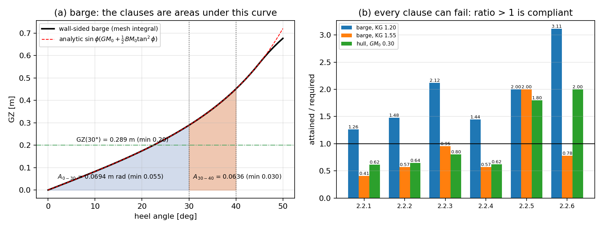
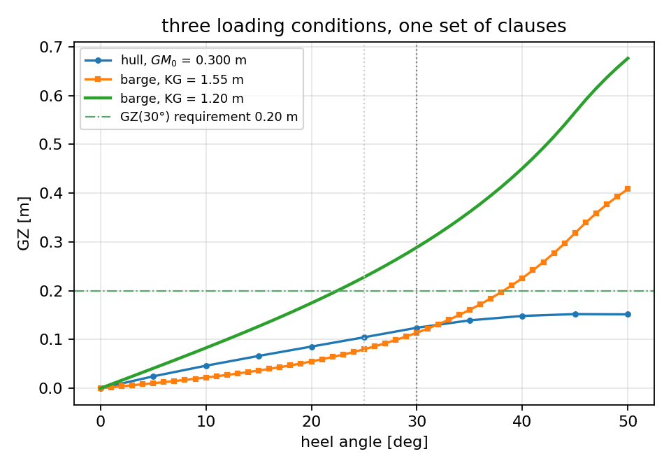
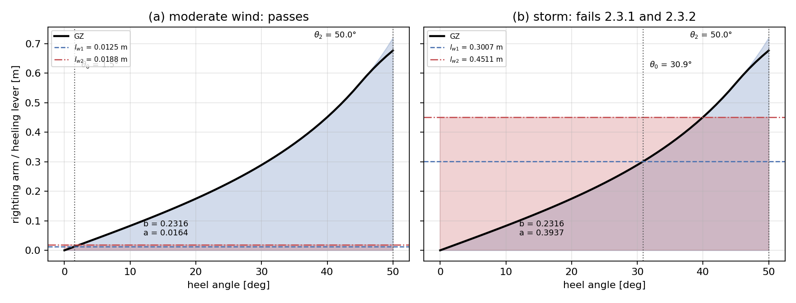
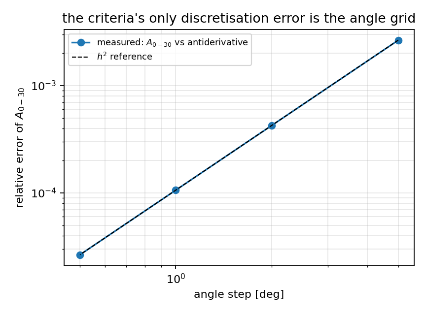
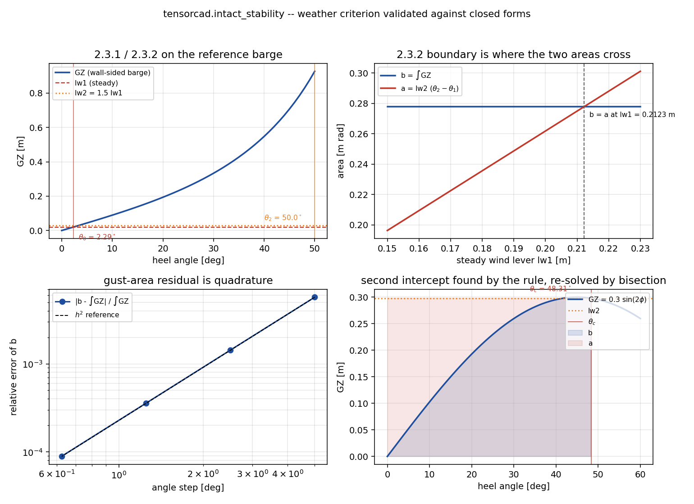

# Intact-stability criteria: IS Code 2008 part A on a measured GZ curve

Two pages in this repository end by naming the same missing capability, in almost the same
words:

> *"**No weather criterion.** Nothing here computes a wind heeling arm, a `GZ` area criterion
> or an IMO/IS-Code check; the areas `area_under_curve` returns are the input to such a check,
> not the check."* — [`docs/gz.md`](gz.md)

> *"no righting-arm curve, area under it, or statutory criterion (`IS Code 2008`, damage
> stability, weather criterion) is computed or claimed here."* — [`docs/stability.md`](stability.md)

`tensorcad.intact_stability` closes the first half of that: the curve the integrators produce
is turned into the six general criteria and the weather criterion of IS Code 2008 part A. It
adds no hydrostatics — it is arithmetic on the polyline `(angle, GZ)` plus the loading numbers
the criteria need — which is exactly why it has to be verified against a closed form rather
than trusted.

Sections 1-5 and 7 are generated by `python examples/intact_stability/run_example.py
--output docs/intact_stability`, which writes `results.json`, `report.md` and four figures and
**exits non-zero if one of its 17 claims stops holding**. Section 6 is a second, independent
harness (`tools/intact_stability_validation.py`): it checks the arithmetic the weather
criterion performs on that curve rather than the curve itself, and its ten claims gate its own
exit code the same way. `tests/test_intact_stability.py` pins 47 cases of this page,
`tests/test_intact_stability_validation.py` pins the section-6 evidence.

## 1. The clauses, as implemented

| clause | what it demands | threshold | how it is evaluated |
|---|---|---|---|
| 2.2.1 | area under `GZ` to 30° | ≥ 0.055 m rad | trapezoid, both limits interpolated |
| 2.2.2 | area to 40°, or to the flooding angle if that is less | ≥ 0.090 m rad | same, upper limit = `min(40°, θ_f)` |
| 2.2.3 | area between 30° and 40° (or `θ_f`) | ≥ 0.030 m rad | difference of the two |
| 2.2.4 | `GZ` at 30° | ≥ 0.20 m | linear interpolant |
| 2.2.5 | angle of maximum `GZ` | ≥ 25° | argmax over the samples |
| 2.2.6 | initial `GM_0` | ≥ 0.15 m | **input** (usually from `initial_stability`) |
| 2.3.1 | steady wind heel `θ_0`, `lw1 = P A Z/(1000 g Δ)`, `P = 504 Pa` | ≤ `min(16°, 0.8 θ_deck-edge)` | first upward crossing of `GZ` with `lw1` |
| 2.3.2 | gust areas, `lw2 = 1.5 lw1` | `b ≥ a` | `b = ∫GZ`, `a = lw2·(θ_2 − θ_1)` |
| 2.3.3 | windward roll amplitude `θ_1` | ≤ `θ_f` | **input** `θ_1` compared with the supplied `flooding_angle_deg` |

Three details are decisions rather than transcription, and each is encoded in the code so it
cannot drift:

* **Comparison direction.** 2.2.x are "shall be at least" clauses and 2.2.5 is "shall not be
  less than"; 2.3.1 and 2.3.3 are "shall not exceed" ones. A single `>=` would report every ship
  compliant on the weather heel, so `Criterion.comparison` carries `at least` or
  `not more than` and `margin` is the slack in the passing direction — non-negative exactly
  when `satisfied`, which is what `failures` and `verdict()` are built on.
* **The flooding angle replaces 40°, not 30°.** When `θ_f < 40°` it is the upper limit of
  2.2.2 and 2.2.3; when `θ_f < 30°` the two clauses cannot be evaluated and the call is
  refused rather than quietly evaluated at 30°.
* **`θ_f` is an input to 2.3.3.** Passing `flooding_angle_deg` adds the clause *and* puts
  the same angle into 2.3.2's `θ_2 = min(θ_f, 50°, θ_c)` — one number where the code uses
  one. Omit it and 2.3.3 is reported as **not evaluated** (`clauses` says `2.3.1 and 2.3.2`,
  `flooding_angle_deg` is `null`), never as passed.
* **`θ_1` is an input.** Clause 2.3.4 computes the windward roll amplitude from
  `θ_1 = 109 k X₁ X₂ √(r s)`, whose factors are read off three tables keyed on `Ak/B`, `B/d`,
  `Cb` and the roll period. Those tables are not transcribed anywhere in this repository, and
  a table reconstructed from memory would be worse than a missing one, so `θ_1` is a parameter
  (`roll_amplitude_deg`, default 0 — no windward roll). A non-zero `θ_1` moves the start of
  both gust areas, which the tests check against the antiderivative.

The module also refuses the inputs it cannot honestly answer: a curve that stops short of the
40° clause, non-monotone angles, a mismatched pair of arrays, a non-finite `GM_0`, a
`θ_2 ≤ θ_1` span. Each of those is a named `IntactStabilityError`, not a silent clamp.

**Interpolation.** The curve is a polyline, so point values at 30° and 40° are read off the
segment containing them, areas are trapezoidal on the segments, and the wind-heel crossing is a
linear solve. Nothing is extrapolated. The consequence is that the **angle step is the
criteria's only discretisation error**, and it is measured in §5 rather than assumed.

## 2. The reference: a barge with an antiderivative

A wall-sided box barge has `GZ(φ) = sin φ (GM_0 + ½ BM_0 tan²φ)` with `KB_0 = T/2`,
`BM_0 = B²/12T`, and — unlike most ship quantities — an elementary antiderivative:

    ∫ GZ dφ = GM_0 (1 − cos φ) + (BM_0/2) (sec φ + cos φ − 2)

So the areas the criteria are quoted from have a closed form, not only the curve. The run uses
`L = 10 m, B = 4 m, T = 2 m, depth 4 m, KG = 1.2 m` (floating at `z = T`), which gives
`KB_0 = 1.0000 m`, `BM_0 = 0.6667 m`, `GM_0 = 0.4667 m`, and keeps the closed form exact up to
45° (bilge emergence and deck-edge immersion coincide because `T = D − T`).

| clause | requirement | attained | margin |
|---|---|---|---|
| 2.2.1 | ≥ 0.055 m rad | 0.069437 m rad | +0.014437 |
| 2.2.2 | ≥ 0.090 m rad | 0.133014 m rad | +0.043014 |
| 2.2.3 | ≥ 0.030 m rad | 0.063576 m rad | +0.033576 |
| 2.2.4 | ≥ 0.20 m | 0.288889 m | +0.088889 |
| 2.2.5 | ≥ 25° | 50.0° | +25.0° |
| 2.2.6 | ≥ 0.15 m | 0.466667 m | +0.316667 |

Verdict: **passes 2.2.1–2.2.6**. Analytic reference on the same grid:
`A(0,30) = 0.069430126`, `A(0,40) = 0.132996504`, `A(30,40) = 0.063566378` m rad,
`GZ(30°) = 0.288888889 m`.

One honest caveat about that table: 2.2.5's attained 50° is the last sampled angle. A
wall-sided barge never *loses* righting arm, so its `GZ` is still rising at the top of the
grid and "where the peak is" is not a meaningful question for this shape — the clause is
evaluated, and it passes trivially. The clause that does carry weight on this shape is 2.2.4
and the three areas.



*Panel (a)*: the integrated arm over the analytic one (they coincide to 2.8e-16 m, so the
dashed line is hidden), with the 0–30° and 30–40° areas shaded and the 0.20 m lever
requirement drawn across. *Panel (b)*: attained/required for every clause of every case in
this page — the line at 1.0 is the code's threshold.

## 3. Two loading conditions, one geometry: the verdict must flip

`KG` is the only thing that changes between the passing barge and the failing one (1.20 m →
1.55 m), so the criteria are reading the loading, not the shape.

| clause | requirement | attained at `KG = 1.55 m` | margin | verdict |
|---|---|---|---|---|
| 2.2.1 | ≥ 0.055 m rad | 0.022548 | −0.032452 | **fail** |
| 2.2.2 | ≥ 0.090 m rad | 0.051131 | −0.038869 | **fail** |
| 2.2.3 | ≥ 0.030 m rad | 0.028584 | −0.001416 | **fail** |
| 2.2.4 | ≥ 0.20 m | 0.113889 | −0.086111 | **fail** |
| 2.2.5 | ≥ 25° | 50.0° | +25.0° | pass |
| 2.2.6 | ≥ 0.15 m | 0.116667 | −0.033333 | **fail** |

`GM_0 = 0.1167 m` is under the 0.15 m floor and five clauses go with it; 2.2.5 survives,
which is the reading one wants — the maximum did not move, only its size did. Note 2.2.3 fails
by 1.4 mm·rad: that is a genuine consequence of loading, not a rounding artefact, and the
margin column is there so it is visible.

**A negative control on the comparison itself.** The *passing* curve scaled by 0.5 (with
`GM_0` halved to match) fails 2.2.1, 2.2.2 and 2.2.4 on the same geometry. Without that
control, "passes" and "always passes" would be indistinguishable.

## 4. A hull with no closed form

`L = 12 m, B = 2.4 m, T = 0.9 m` parametric hull, 0.6 m of freeboard added by
`with_freeboard` (a hull modelled only to its waterline runs out of surface when heeled and
the displaced volume stops meaning anything), `KG` set so that `GM_0 = 0.3000 m` comes out of
the waterplane moments of `tensorcad.stability`. Displacement 12.1331 m³ = 12.436 t.

| clause | requirement | attained | verdict |
|---|---|---|---|
| 2.2.1 | ≥ 0.055 m rad | 0.033962 | **fail** |
| 2.2.2 | ≥ 0.090 m rad | 0.057996 | **fail** |
| 2.2.3 | ≥ 0.030 m rad | 0.024035 | **fail** |
| 2.2.4 | ≥ 0.20 m | 0.124050 | **fail** |
| 2.2.5 | ≥ 25° | 45.0° | pass |
| 2.2.6 | ≥ 0.15 m | 0.300000 | pass |

Verdict: **fails 2.2.1, 2.2.2, 2.2.3, 2.2.4.** That is the honest answer for this shape: a
12 m hull of `L/B = 5` carries `GM_0 = 0.30 m` but not the beam to develop 0.20 m of arm at
30°, and the code's general criteria are written for ships an order of magnitude larger. The
page reports it as it comes out rather than tuning the hull until it passes; what matters here
is that the chain mesh → curve → clause is verified, and §7 says by how much.

There is no closed form for this hull, so the checks that can be made are made:

* the curve's slope at zero, from a ±0.25° central difference on the same integrals,
  against `GM_0` **from the waterplane moments** — a completely different computation
  (Green's theorem on the cut loops instead of a volume integral): 0.298910 m vs 0.300000 m,
  **3.6e-3 relative**;
* the displacement residual at every heel: ≤ 2.6e-15;
* the angle-grid error of §5, transferred from the barge.



## 5. The weather criterion, and the angle grid

With `Δ = 80 m³ × 1.025 = 82 t`, `A = 10 m²` and `Z = 2 m`: `lw1 = 504·10·2/(1000·9.81·82) =
0.012531 m`, `lw2 = 1.5 lw1 = 0.018796 m`.

| case | `θ_0` [deg] | limit [deg] | `θ_2` [deg] | b [m rad] | a [m rad] | verdict |
|---|---|---|---|---|---|---|
| moderate wind (`A = 10 m²`) | 1.538 | 16.0 | 50.0 | 0.231617 | 0.016403 | passes 2.3.1, 2.3.2 |
| storm (`A = 240 m²`) | 30.881 | 16.0 | 50.0 | 0.231617 | 0.393666 | **fails both** |
| deck edge at 12° (`lw1 = 0.1 m`) | 11.982 | 9.6 | 50.0 | 0.231617 | 0.130900 | **fails 2.3.1** |
| `θ_f = 20°, θ_1 = 8°` | 1.538 | 16.0 | 20.0 | 0.024862 | 0.003937 | passes 2.3.1, 2.3.2, 2.3.3 |
| `θ_f = 20°, θ_1 = 25°` | 1.538 | 16.0 | 20.0 | not measured | not measured | **fails 2.3.3** |

The last two rows are clause 2.3.3, which needs one more input, the flooding angle. At
`θ_1 = 8° < θ_f = 20°` it passes, and because `θ_f` also enters 2.3.2's minimum the gust areas
stop at 20° instead of 50° (`b = 0.024862` against `0.231617` m rad on the same curve). At
`θ_1 = 25° > θ_f` the span `θ_2 − θ_1` is empty: 2.3.3 fails and 2.3.2 is **not measured** —
the two cells say so rather than quoting a zero the arithmetic does not produce.

The third row is why the 80 % deck-edge rule is implemented instead of the 16° limit alone:
with `θ_deck-edge = 12°` the limit is 9.6°, and a heel of 11.98° is legal under the 16° rule and
illegal under the code. The `θ_2 = 50°` column is the down-flooding cap doing its job — a
wall-sided barge has no down-flooding point and never re-crosses the gust lever, so `θ_2` is
the code's 50° ceiling, and `a` is the lever times that full span.



`b` is the `GZ` area (blue), `a` the gust-lever area (red), both measured from `θ_1 = 0`.

**Angle-grid convergence**, `A(0,30)` against the antiderivative as the step is halved:

| step [deg] | `A(0,30)` [m rad] | relative error | verdict on that grid |
|---|---|---|---|
| 5.0 | 0.069614 | 2.65e-3 | passes 2.2.1–2.2.6 |
| 2.0 | 0.069460 | 4.24e-4 | passes 2.2.1–2.2.6 |
| 1.0 | 0.069437 | 1.06e-4 | passes 2.2.1–2.2.6 |
| 0.5 | 0.069432 | 2.65e-5 | passes 2.2.1–2.2.6 |

Successive ratios 6.24, 4.00, 4.00: the trapezoid signature appears from 2° down, and the 5°
rung is not yet in the asymptotic regime (worth stating instead of averaging away). A 5° ladder
is still accurate to 0.27 % on this barge, but its error is not predicted by `h²`. The report
carries `angle_step_max_deg` so a consumer can see which rung a verdict came from.



<!-- BEGIN intact_stability_validation (generated by tools/intact_stability_validation.py) -->
## 6. An independent check of the numbers the weather criterion compares

`examples/intact_stability` (§1-§5) validates the *curve* the rule is applied to and the
verdict flags. It reports `b` and `a` but does not check them, and it reads `θ_c` off the
same interpolant the module uses. `tools/intact_stability_validation.py` closes that gap:
ten claims, each compared against an antiderivative or an independent bisection,
aggregated under `docs/intact_stability/intact_stability_validation.json` and
`intact_stability_validation.png`, exiting non-zero if one of them stops holding.
`tests/test_intact_stability_validation.py` re-runs it and pins both the json and this
section to a fresh run, so neither can go stale. **Nothing here is typed by hand: this
block is written by `--update-docs`.**

The reference is the barge's arm and its antiderivative (`B = 6` m, `T = 3` m, `KG = 2` m,
so `GM_0 = 0.5` m and `BM_0 = 1.0` m),

```
GZ(phi)          = sin(phi) (GM0 + BM0/2 tan^2 phi)
int_0^a GZ dphi  = GM0 (1 - cos a) + BM0/2 (sec a + cos a - 2)
```

plus a second curve `GZ = 0.3 sin(2 phi)`, which peaks at 45° and so lets `θ_2` be the
*second intercept* rather than one of the code's caps.

### 6.1 The two gust areas and the flooding-angle areas

| quantity | the module | reference | relative error |
|---|---|---|---|
| `b` over `[θ_1, θ_2]`, `θ_1 = 8°`, `θ_2 = 50°` | 0.273010630 m rad | antiderivative `A(θ_2) − A(θ_1) = 0.272948127` | 2.29e-04 |
| `a = lw2 (θ_2 − θ_1)` | 0.021991148575129 m rad | `0.030000000 m × 42°` in rad = 0.021991148575129 | 0.00e+00 |
| area to `θ_f = 35°` (code `2.2.1b`, sibling `2.2.2`) | 0.110405289 m rad | `A(θ_f) = 0.110387294` | 1.63e-04 |
| area `[30°, θ_f]` (code `2.2.1c`, sibling `2.2.3`) | 0.033043286 m rad | `A(θ_f) − A(30°) = 0.033037025` | 1.90e-04 |

`b` is a trapezoidal integral on the 1° ladder, so its residual is the grid and not the
rule — §6.6 shows it falling as `h²`. `a` is a rectangle and the module multiplies it out
rather than integrating a constant, which is why it lands on round-off.

### 6.2 `θ_2` is the least of its caps

| binding cap | `θ_2` [deg] | expected | `b` [m rad] | reference [m rad] | rel. error |
|---|---|---|---|---|---|
| no cap but the code's 50 deg | 50.000 | 50 | 0.277925047 | 0.277861913 | 2.27e-04 |
| down-flooding at 38 deg | 38.000 | 38 | 0.134532183 | 0.134509108 | 1.72e-04 |
| flooding angle 35 deg | 35.000 | 35 | 0.110405289 | 0.110387294 | 1.63e-04 |

Three calls on one curve, one per cap: the code's own 50°, a down-flooding angle of 38°,
and a flooding angle of 35°. In each, the reported `θ_2` is the cap that binds and `b` is
measured to *that* angle — which is what makes the cap a rule rather than a truncation.

### 6.3 The second intercept `θ_c`

On `GZ = 0.3 sin(2 phi)` with `lw2 = 0.298000` m the gust lever is crossed twice, so
`θ_2 = min(50°, θ_c) = θ_c`:

| quantity | the module | independent bisection / antiderivative | difference |
|---|---|---|---|
| `θ_c` | 48.309682 deg | 48.309814 deg | 1.32e-04 deg |
| `b` over `[0, θ_c]` | 0.167290763 m rad | 0.167291616 m rad | 5.10e-06 relative |

The bisection runs on the analytic `GZ` itself (200 halvings in the harness), not on the
module's interpolant, so agreement means the module found the crossing of the real curve.

### 6.4 Where `b ≥ a` flips

`b` is a constant for a given curve, `A(θ_2) − A(θ_1)`, while `a` grows linearly in `lw1`,
so clause 2.3.2 flips at `lw1 = b / (1.5 θ_2)`. Measured on the module:

| quantity | value |
|---|---|
| analytic flip lever | 0.212270866 m |
| reported margin at `−0.1 %` of it | +2.936e-04 m rad (2.3.2 passes) |
| reported margin at `+0.1 %` of it | -2.621e-04 m rad (2.3.2 fails) |
| reported margin vs `b − a` on that call | 0.00e+00 relative |

Both sides are checked, so this tests the comparison *direction* as well as the areas: a
flipped sign or a single `>=` would put the wrong flag on one of the two calls.

### 6.5 The "shall not exceed" boundary

Clause 2.3.3 says the windward roll amplitude *shall not exceed* the flooding angle, so
equality must pass. At `θ_1 = θ_f = 20°`:

* 2.3.3 is `satisfied = True` with `margin = 0.0` deg;
* `b` and `a` are `None` and `None` — the span `θ_2 − θ_1` is empty, and the report
  says so instead of quoting a zero;
* at `θ_1 = 20.5°` the clause is `satisfied = False` with `margin = -0.5` deg.

### 6.6 The flooding angle in 2.2, and the sibling implementation

Omitting `θ_f` measures to 40°; supplying `θ_f = 35°` measures to 35° and moves the number
by 0.042 m rad (0.110405 against 0.152731) — the substitution is a computation, not a
field that gets echoed. The two area clauses are the code's `2.2.1b` and `2.2.1c`; the
sibling labels them `2.2.2` and `2.2.3`, which is the numbering divergence
`docs/statutory.md` §6 records — the thresholds and verdicts are the same, a report that
quotes a clause number is not. The same curve through `tensorcad.statutory`:

| implementation | `A(0, 35°)` [m rad] | relative error vs antiderivative |
|---|---|---|
| `tensorcad.intact_stability` (1° trapezoid) | 0.110405289 | 1.63e-04 |
| `tensorcad.statutory` (adaptive Simpson) | 0.110387295151 | 6.98e-09 |
| antiderivative | 0.110387294381 | — |

They agree to 1.63e-04 relative — the sibling's `O(h²)` trapezoidal error —
and the statutory run's own uncertainty
(1.80e-05 m rad) is above its actual error. Both are read
against the closed form, not against each other.

### 6.7 The residuals are quadrature

`b` against the antiderivative as the ladder is refined:

| step [deg] | samples | `b` [m rad] | relative error | ratio to the next rung |
|---|---|---|---|---|
| 5.000 | 11 | 0.274503237 | 5.70e-03 |  |
| 2.500 | 21 | 0.273338683 | 1.43e-03 | 3.98 |
| 1.250 | 41 | 0.273045790 | 3.58e-04 | 4.00 |
| 0.625 | 81 | 0.272972540 | 8.94e-05 | 4.00 |

Successive ratios 3.98, 4.00, 4.00: the trapezoid
signature from the first halving already, so the residual is the sampling of the curve and
not a disagreement about the rule. The 5° rung is inside 5.70e-03
relative, which is why a coarse ladder still returns the right verdict on this barge — but
that is not where the error bar should be read from.



*Top left: the barge's `GZ` with the steady lever `lw1` (`θ_0`) and the gust lever `lw2`
(`θ_2`). Top right: `b` and `a` against `lw1`, crossing at the 2.3.2 boundary. Bottom left:
the residual of `b` under grid refinement against an `h²` reference. Bottom right: the
`0.3 sin(2 phi)` curve, where `θ_2` is `θ_c` found by the rule and re-solved by bisection.*

### 6.8 Error judgement for this section

| quantity | reference | measured error | < 3 %? |
|---|---|---|---|
| `b` over `[8°, 50°]` | antiderivative of the barge's arm | 2.29e-04 relative | ✅ |
| `a = lw2 (θ_2 − θ_1)` | the lever's rectangle | 0.00e+00 relative | ✅ |
| `θ_c`, second intercept | independent bisection of `GZ = lw2` | 1.32e-04 deg | ✅ |
| `b` over `[0, θ_c]` | antiderivative at `θ_c` | 5.10e-06 relative | ✅ |
| area to `θ_f = 35°` (code `2.2.1b`), this module | antiderivative at 35°, 1° grid | 1.63e-04 relative | ✅ |
| same area, `tensorcad.statutory` | antiderivative at 35°, adaptive Simpson | 6.98e-09 relative | ✅ |
| spread between the two implementations | one curve, one closed form | 1.63e-04 relative | ✅ |
| 2.3.2 margin against `b − a` | the two areas the report itself quotes | 0.00e+00 relative | ✅ |
| coarsest grid tested (5°) | antiderivative of the gust area | 5.70e-03 relative | ✅ |

**Every quantity in this section is inside 3 % of its reference, most by four to twelve
orders of magnitude.** What is *not* covered, and is named rather than glossed: `θ_1`
(clause 2.3.4's tables are absent from this repository, so it stays an input — its
boundary is checked in §6.5, its value is not derived), the barge's areas above bilge
emergence (the closed form stops applying there, as §2 shows with a negative control), and
any real ship.

<!-- END intact_stability_validation -->

## 7. Error judgement against the references

| quantity | reference | measured | error | < 3 %? |
|---|---|---|---|---|
| barge `GZ`, 0–45° | wall-sided closed form | mesh integral | 2.8e-16 m | ✅ round-off |
| barge `A(0,30)` | antiderivative 0.069430126 | 0.069437494 m rad | 1.06e-4 relative | ✅ 0.011 % |
| barge `A(0,40)` | antiderivative 0.132996504 | 0.133014 m rad | 1.3e-4 relative | ✅ 0.013 % |
| barge `A(30,40)` | antiderivative 0.063566378 | 0.063576 m rad | 1.5e-4 relative | ✅ 0.015 % |
| barge `GZ(30°)` | closed form | interpolant on the 1° grid | < 1e-12 m | ✅ |
| clause attainments, two waterline solvers | Newton on the wetted area vs bisection on `V(h)` | same six numbers | 1.6e-13 (max) | ✅ |
| `θ_0`, moderate wind | independent bisection of the closed form | 1.537691° vs 1.537879° | 1.9e-4 deg (1.2e-4 relative) | ✅ |
| hull `dGZ/dφ` at 0 | `GM_0` from the waterplane moments | 0.298910 m vs 0.300000 m | 3.6e-3 relative | ✅ 0.36 % |
| grid error at 5° | antiderivative | 2.65e-3 relative | — | ✅ 0.27 % |

**Every quantity on this page that has a reference is inside 3 %, most of them by three orders
of magnitude.** The quantities without a reference are named rather than glossed: the hull's
absolute `GZ` values (no closed form for the parametric body — only its slope at zero is
checkable), the weather areas of the barge beyond 45° (the closed form no longer applies
there, as the run's own negative control shows: the arm leaves the formula by 4.4e-2 m above
the bilge-emergence angle), and anything depending on `θ_1`, which is an input.

## 8. API and files

```python
from tensorcad import general_criteria, weather_criterion
from tensorcad.gz import righting_arm_curve

curve = righting_arm_curve(hull_mesh, kg=1.10, angles_deg=range(0, 51, 1), waterline_z=0.0)
report = general_criteria(curve, gm0_m=0.30, flooding_angle_deg=None)
report.satisfied            # False
report.verdict()            # 'fails IS Code 2008 part A 2.2.1, 2.2.2, 2.2.3, 2.2.4'
[next(f.clause for f in report.failures)]
report.to_dict()            # JSON-ready: clause, required, attained, comparison, margin
```

Both curve objects in the package are accepted (`tensorcad.gz.RightingArmCurve` through
`angles_deg`/`gz`, `tensorcad.righting_arm.RightingArmCurve` through its `points`), as is a
plain `(angles, gz)` pair, so the criteria can be applied to a curve measured elsewhere.

| file | what it is |
|---|---|
| `tensorcad/intact_stability.py` | the module (standard library only) |
| `tests/test_intact_stability.py` | 47 cases: closed-form areas, all six clauses, negative controls, weather (2.3.1-2.3.3), malformed input |
| `examples/intact_stability/run_example.py` | the run behind this page; 17 claims, non-zero exit on failure |
| `docs/intact_stability/{results.json,report.md,fig_*.png}` | its output |
| `tools/intact_stability_validation.py` | the weather-arithmetic harness behind §6; 10 claims, non-zero exit, `--update-docs` regenerates §6 |
| `tests/test_intact_stability_validation.py` | 9 cases: every claim holds, a broken claim exits 1, and the committed json + §6 are pinned to a fresh run |
| `docs/intact_stability/{intact_stability_validation.json,intact_stability_validation.png}` | that harness's output |

## 9. What this is **not**

* **No clause 2.3.4 roll amplitude.** `θ_1` is an input; the tables behind it are not here.
  2.3.3 is implemented, but only for a `θ_1` the caller brings.
* **No damage stability** (part B), no grain / timber-deck codes, none of the 2.2 variants for
  special ship types, no class-society rule sets.
* **No `GM_0` computation.** It comes from `tensorcad.stability` (or from a loading manual);
  a `GM_0` inconsistent with the curve is not detectable here and makes 2.2.6 meaningless —
  the two belong to the same loading condition and must be stated together.
* **No claim about a real ship.** The barge is a reference shape and the hull is a synthetic
  parametric body. Compliance of an actual vessel is a class calculation with its own windage
  drawing, down-flooding points and tankage.
* **The answer is only as good as the curve.** The criteria inherit every limitation
  `docs/gz.md` lists — symmetric hull for the sign convention, no tanks (except the flat
  free-surface reduction `gz.righting_arm_curve` already applies), mesh resolution as the
  accuracy of `KN`.