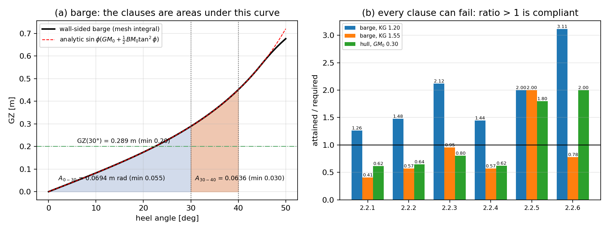
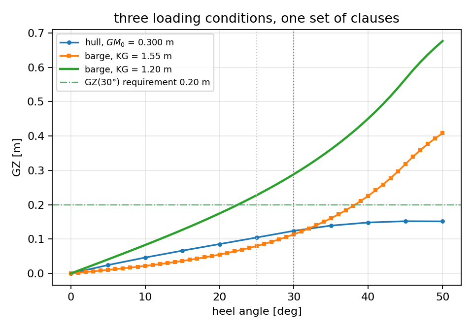
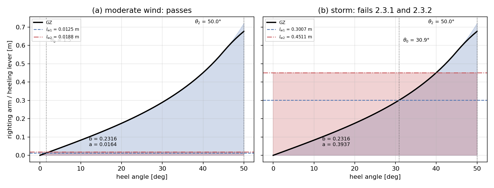
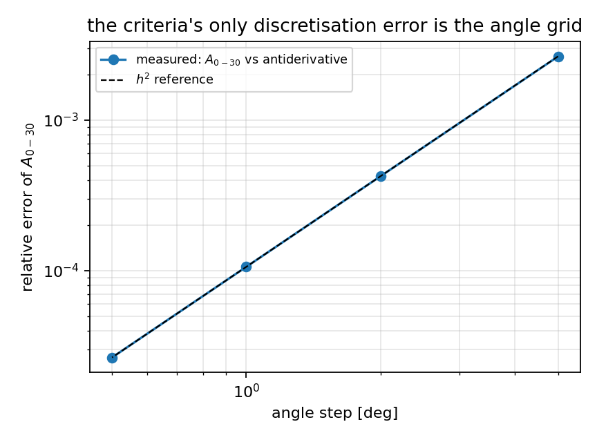

# Intact-stability criteria (IS Code 2008 part A) on measured curves

Generated by `python examples/intact_stability/run_example.py --output docs/intact_stability`
with TensorCAD 0.23.0 at 2026-11-06T14:17:29Z in
2.76 s. Every table below is read from `results.json` in this directory;
nothing is typed from a different run.

## 1. What this run is

`tensorcad.gz` and `tensorcad.righting_arm` integrate a righting-arm curve from the surface
(two independent routes); `tensorcad.stability` gives its slope at zero.
`tensorcad.intact_stability` turns that curve into the six general criteria and the weather
criterion, which is arithmetic -- and arithmetic that is easy to make vacuously true. So the
run is a control experiment: the barge below has a closed-form arm *and* a closed-form
antiderivative, one loading is driven out of compliance deliberately, one curve is halved to
show the comparison can fail on the same geometry, and a real hull is reported as it comes
out.

## 2. The wall-sided barge

`L = 10 m`, `B = 4 m`, `T = 2 m`,
depth `4 m`, `KG = 1.2 m` from the keel, floating at `z = T`.
Then `KB_0 = 1.0000 m`, `BM_0 = 0.6667 m`,
`GM_0 = 0.4667 m`, and the closed form is exact up to
`45.00°` (bilge emergence and deck-edge immersion coincide here
because `T = D - T`).

| clause | quantity | requirement | attained | margin | verdict |
|---|---|---|---|---|---|
| 2.2.1 | area under GZ up to 30 deg | at least 0.055 m rad | 0.069437 | +0.014437 | pass |
| 2.2.2 | area under GZ up to 40 deg or the flooding angle | at least 0.09 m rad | 0.133014 | +0.043014 | pass |
| 2.2.3 | area under GZ between 30 deg and 40 deg or the flooding angle | at least 0.03 m rad | 0.063576 | +0.033576 | pass |
| 2.2.4 | GZ at 30 deg | at least 0.2 m | 0.288889 | +0.088889 | pass |
| 2.2.5 | angle of maximum GZ | at least 25 deg | 50.000000 | +25.000000 | pass |
| 2.2.6 | initial metacentric height GM_0 | at least 0.15 m | 0.466667 | +0.316667 | pass |

Analytic reference on the same grid: `A(0,30) = 0.069430126`,
`A(0,40) = 0.132996504`,
`A(30,40) = 0.063566378` m rad,
`GZ(30°) = 0.288888889 m`, `GZ_max = 0.720152412 m`.
The integrated arm differs from the closed form by at most
`2.8e-16 m` -- round-off, because the divergence
integral of a polyhedron is exact.

*Panel (a)*: the integrated curve drawn over the analytic one, with the 0–30° and 30–40° areas
shaded in and the 0.20 m lever requirement drawn across. *Panel (b)*: attained / required for
every clause of every case in this run; the line at 1.0 is the code's threshold, and the red
bars are the deep-loaded barge.

## 3. The same hull, loaded 0.35 m deeper

`KG = 1.55 m`, so `GM_0 = 0.1167 m` -- under the 0.15 m floor,
which is the point of the case: the geometry is unchanged and the whole report has to change.

| clause | requirement | attained | margin | verdict |
|---|---|---|---|---|
| 2.2.1 | at least 0.055 m rad | 0.022548 | -0.032452 | **fail** |
| 2.2.2 | at least 0.09 m rad | 0.051131 | -0.038869 | **fail** |
| 2.2.3 | at least 0.03 m rad | 0.028584 | -0.001416 | **fail** |
| 2.2.4 | at least 0.2 m | 0.113889 | -0.086111 | **fail** |
| 2.2.5 | at least 25 deg | 50.000000 | +25.000000 | pass |
| 2.2.6 | at least 0.15 m | 0.116667 | -0.033333 | **fail** |

The verdict flips to **fails IS Code 2008 part A 2.2.1, 2.2.2, 2.2.3, 2.2.4, 2.2.6**, while 2.2.5 (a pure shape clause: where
the peak sits) survives -- the right reading, because the maximum did not move, only its size
did.

**Negative control on the comparison itself.** The passing barge curve scaled by 0.5, gm_0 halved with it:
**fails IS Code 2008 part A 2.2.1, 2.2.2, 2.2.4**.

| clause | attained | required | verdict |
|---|---|---|---|
| 2.2.1 | 0.034719 | 0.055 | **fail** |
| 2.2.2 | 0.066507 | 0.09 | **fail** |
| 2.2.3 | 0.031788 | 0.03 | pass |
| 2.2.4 | 0.144444 | 0.2 | **fail** |
| 2.2.5 | 50.000000 | 25 | pass |
| 2.2.6 | 0.233333 | 0.15 | pass |

The area and lever clauses fail on the same geometry, so the comparison is capable of failing
without a change of shape.

## 4. A real hull: `L = 12 m` parametric hull

`B = 2.4 m`, `T = 0.9 m`,
`0.6 m` of freeboard added by `with_freeboard` (without it a
heeled hull runs out of surface and `GZ` stops meaning anything), `KG` set so that
`GM_0 = 0.3000 m` comes out of the waterplane moments of `tensorcad.stability`.
Displacement `12.1331 m³` = `12.436 t`. Curve
on a `5°` ladder, displacement residual
`2.64e-15`.

| clause | quantity | requirement | attained | verdict |
|---|---|---|---|---|
| 2.2.1 | area under GZ up to 30 deg | at least 0.055 m rad | 0.033962 | **fail** |
| 2.2.2 | area under GZ up to 40 deg or the flooding angle | at least 0.09 m rad | 0.057996 | **fail** |
| 2.2.3 | area under GZ between 30 deg and 40 deg or the flooding angle | at least 0.03 m rad | 0.024035 | **fail** |
| 2.2.4 | GZ at 30 deg | at least 0.2 m | 0.124050 | **fail** |
| 2.2.5 | angle of maximum GZ | at least 25 deg | 45.000000 | pass |
| 2.2.6 | initial metacentric height GM_0 | at least 0.15 m | 0.300000 | pass |

Verdict: **fails IS Code 2008 part A 2.2.1, 2.2.2, 2.2.3, 2.2.4**. No closed form exists for this hull, so the checks
that can be made are made: the curve's slope at zero against `GM_0` from a completely different
integration (relative 3.63e-03), the displacement residual above, and
the grid study in §6. The rest of the number is the integral, and the integral is the one
verified on the barge.

## 5. The weather criterion

`lw1 = P A Z / (1000 g Δ)` with `P = 504 Pa`, `g = 9.81 m/s²` and `Δ` in tonnes; the barge
displaces `82.00 t` (80 m³ x 1.025). For
`A = 10 m²`, `Z = 2 m`: `lw1 = 0.012531 m`,
`lw2 = 1.5 lw1 = 0.018796 m`.

| case | `θ_0` [deg] | limit [deg] | `θ_2` [deg] | b [m rad] | a [m rad] | clauses | verdict |
|---|---|---|---|---|---|---|---|
| moderate wind (A = 10 m²) | 1.538 | 16.0 | 50.0 | 0.231617 | 0.016403 | 2.3.1 and 2.3.2 | passes IS Code 2008 part A 2.3.1 and 2.3.2 (weather criterion) |
| storm (A = 240 m²) | 30.881 | 16.0 | 50.0 | 0.231617 | 0.393666 | 2.3.1 and 2.3.2 | fails IS Code 2008 part A 2.3.1, 2.3.2 |
| deck edge at 12° (lw1 = 0.1 m) | 11.982 | 9.6 | 50.0 | 0.231617 | 0.130900 | 2.3.1 and 2.3.2 | fails IS Code 2008 part A 2.3.1 |
| θ_f = 20°, θ_1 = 8° | 1.538 | 16.0 | 20.0 | 0.024862 | 0.003937 | 2.3.1, 2.3.2 and 2.3.3 | passes IS Code 2008 part A 2.3.1, 2.3.2 and 2.3.3 (weather criterion) |
| θ_f = 20°, θ_1 = 25° | 1.538 | 16.0 | 20.0 | not measured | not measured | 2.3.1 and 2.3.3 | fails IS Code 2008 part A 2.3.3 |

The third row is why the 80 % deck-edge rule is implemented rather than the 16° limit alone:
with `θ_deck-edge = 12°` the limit becomes 9.6°, and `θ_0 = 11.982°` is
legal under the 16° rule and illegal under the code.

`θ_1`, the windward roll amplitude, is an **input** here: clause 2.3.4's empirical formula
needs the roll-period tables, which are not in this repository and were not guessed. A
non-zero `θ_1` moves both areas to start at that angle, which the tests check against the
antiderivative.

The last two rows are clause 2.3.3, which needs one more input: `θ_f`, the flooding angle.
`θ_1 = 8° < θ_f = 20°` passes it, and because the code gives `θ_f` the same role in 2.3.2's
minimum the gust areas then stop at 20° instead of 50° (`b = 0.024862`
instead of `0.231617` m rad on the same curve). At `θ_1 = 25° > θ_f` the
span `θ_2 - θ_1` is empty: 2.3.3 fails and 2.3.2 is reported as **not measured** rather than
as a zero, which is why the two area cells are not numbers there.

## 6. Angle-grid convergence

The curve is a polyline, so the sampled step is the criteria's only discretisation error.
`A(0,30)` against the antiderivative as the step is halved:

| step [deg] | `A(0,30)` [m rad] | relative error | verdict on that grid |
|---|---|---|---|
| 5 | 0.069613966 | 2.648e-03 | passes IS Code 2008 part A 2.2.1-2.2.6 |
| 2 | 0.069459593 | 4.244e-04 | passes IS Code 2008 part A 2.2.1-2.2.6 |
| 1 | 0.069437494 | 1.061e-04 | passes IS Code 2008 part A 2.2.1-2.2.6 |
| 0.5 | 0.069431968 | 2.653e-05 | passes IS Code 2008 part A 2.2.1-2.2.6 |

Successive error ratios: 6.24, 4.00, 4.00. The two finest ratios are 4.00, the trapezoid
signature; the 5° rung is not yet in the asymptotic regime, which is worth stating rather
than averaging away -- a 5° ladder is still accurate to 0.26 % on this barge, but its error
is not predicted by `h^2`.

## 7. The claims, as asserted

The script exits non-zero if any of these stops holding.

| claim | measured | expected | holds |
|---|---|---|---|
| barge GZ from the mesh equals the wall-sided closed form inside its validity window | max |GZ - GZ_analytic| = 2.776e-16 m over 0-45.00 deg | < 1e-11 m | yes |
| the closed form stops applying beyond the bilge-emergence angle, and the mesh says so | max |GZ - GZ_analytic| = 4.391e-02 m above 45.00 deg (the formula is not the barge's arm there) | > 1e-3 m, so the agreement above is not vacuous | yes |
| barge displacement is held at every heel | max |V(phi)/V(0) - 1| = 4.974e-15 | < 1e-12 | yes |
| the report's 30 deg area matches the antiderivative | 0.069437494 m rad vs 0.069430126 (relative 1.06e-04) | < 5e-4 relative on a 1 deg grid | yes |
| the light barge passes all six general criteria | passes IS Code 2008 part A 2.2.1-2.2.6 | passes 2.2.1-2.2.6 | yes |
| the two waterline solvers produce the same report | max |difference| over the six clauses = 1.590e-13 | < 1e-8 (each clause keeps its own unit: m, m rad or deg) | yes |
| loading 0.35 m deeper flips the verdict | GM_0 = 0.1167 m; fails IS Code 2008 part A 2.2.1, 2.2.2, 2.2.3, 2.2.4, 2.2.6 | fails, with GM_0 under the 0.15 m floor | yes |
| the failing clauses are the five the areas and levers predict | 2.2.1, 2.2.2, 2.2.3, 2.2.4, 2.2.6 | 2.2.1, 2.2.2, 2.2.3, 2.2.4, 2.2.6 (2.2.5 is a shape clause and survives) | yes |
| scaling the passing arm by 0.5 makes the same geometry fail | fails IS Code 2008 part A 2.2.1, 2.2.2, 2.2.4 | fails (the comparison can fail on the same geometry) | yes |
| the hull curve's slope at zero equals GM_0 from the waterplane moments | dGZ/dphi = 0.298910 m vs GM_0 = 0.300000 m (relative 3.63e-03, central difference over +/-0.25 deg) | < 1e-2 relative (the rest is the 81x25 hull's own resolution) | yes |
| the steady wind heel angle matches an independent bisection | theta0 = 1.537691 deg vs 1.537879 deg | < 1e-3 deg (linear interpolant on a 1 deg grid) | yes |
| a moderate wind passes the weather criterion | passes IS Code 2008 part A 2.3.1 and 2.3.2 (weather criterion); lw1 = 0.012531 m, lw2 = 0.018796 m, b = 0.231617, a = 0.016403 m rad | passes 2.3.1 and 2.3.2 | yes |
| a storm wind fails both weather clauses | fails IS Code 2008 part A 2.3.1, 2.3.2; theta0 = 30.881 deg, b = 0.231617, a = 0.393666 m rad | fails 2.3.1 and 2.3.2 | yes |
| the 80 % deck-edge rule binds before the 16 deg limit | limit = 9.6 deg, theta0 = 11.982 deg, fails IS Code 2008 part A 2.3.1 | limit 0.8 x 12 = 9.6 deg < theta0 < 16 deg, so 2.3.1 fails | yes |
| clause 2.3.3 passes and theta_f caps the gust areas | theta_f = 20 deg, theta_1 = 8 deg, theta_2 = 20 deg, b = 0.024862, a = 0.003937 m rad | theta_1 < theta_f, theta_2 = theta_f = 20 deg (not 50 deg), 2.3.3 satisfied | yes |
| a roll amplitude past theta_f fails 2.3.3 and leaves the gust areas unmeasured | fails IS Code 2008 part A 2.3.3; theta_1 = 25 deg > theta_f = 20 deg, b = None | fails 2.3.3 alone; theta_2 - theta_1 span is empty, so b and a are None | yes |
| the criteria's grid error falls as the step squared | errors 2.65e-03 at 5 deg, 4.24e-04 at 2 deg, 1.06e-04 at 1 deg, 2.65e-05 at 0.5 deg; successive ratios 6.24, 4.00, 4.00; verdict identical on all four grids | successive ratios 3.5-4.5 for 2 deg and below (the 5 deg rung is not asymptotic), same verdict | yes |

## 8. What this page is not

* `θ_1` from clause 2.3.4 (see §5), and the roll-period tables behind it.
* Damage stability (part B), grain, timber deck, and the 2.2 variants for special ship types.
* Any statement about a *real* ship: the barge is a reference shape and the hull is a
  synthetic parametric body. Compliance of an actual vessel is a class-society calculation
  with its own loading manual, windage drawings and down-flooding points.
* The 2.2 areas are quoted to the sampled grid, so a 5° ladder under-reads `A(0,30)` by
  0.26 % -- small against the code's margins
  (26 % on this
  barge), but the reason the report carries `angle_step_max_deg` is so a reader can see it.
