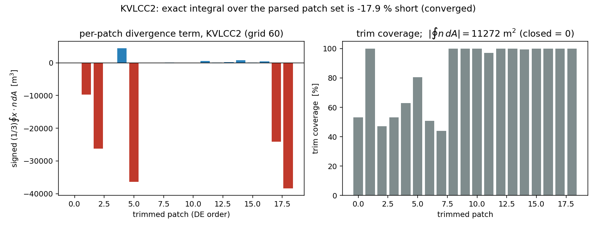

# KVLCC2: an exact integral over the parsed patch set is still 17.9 % short

**Anchor**: `GAP-CAD-T2-PARAM-SERIES`（自找活，验证欠账方向）· **Domain**: CAD / fleet geometry
**Artifact**: `artifacts/baseline_fleet/kvlcc2_divergence.json`（由工具生成，本文所有数字取自该文件）
**Tool**: `tools/baseline_fleet/kvlcc2_divergence_probe.py`
**Reproduce**: `python tools/baseline_fleet/kvlcc2_divergence_probe.py --iges <kvlcc2.igs> --grid 60`

## 1. 案例与动机

KVLCC2 是 `benchmarks/verified/fleet_refs/` 里唯一仍然 `WITHHELD` 的丰满船型：公开
∇ = 312 622 m³（Lpp 320 m · B 58 m · T 20.8 m · Cb 0.8098，SIMMAN 基准值）。
`docs/kvlcc2_frame_policy.md` 把该船的失败定位到「半宽场（half-breadth field）估计器」，
并把下一步写成一句可执行的处方：

> *"a field estimator whose error is monotone in the cell size (area-weighted binning plus an
> explicit hull/not-hull mask from the trim loops), not more sampling of the same kind."*

本文直接检验这条处方：**把估计器从回路里彻底拿掉**。KVLCC2 的 IGES 是 19 片 trim 后的
B 样条补片（38 个 type-144 实体去重后 19 个不同基面），既然补片集本身近似封闭，就可以用
散度定理 `V = (1/3) ∮ x·n dA` 直接积分，不需要任何 (x, z) 栅格、不需要插值、不需要
`max`-binning。若处方正确，去掉估计器后误差应当消失。

## 2. 方法

1. **积分核先自证**：同一积分核算单位球，体积误差 −0.114 %（球面三角化误差量级），
   封闭残差 `|∮n dA| = 0.258`（对 4π 面积即 2 %，纯三角化）。所以下面测到的残差属于
   补片集，不属于求积。
2. **逐片三角化**：每片基面在参数域上取 (grid+1)² 个节点，仅保留 (u, v) 单元中心落在
   trim 环内（even-odd 法则）的单元，每单元两个三角形；累计 `(1/3)x·n dA`。
3. **封闭性诊断**：对整片集累加 `∮ n dA`——封闭且定向一致的曲面该矢量恒为 0，非零残差
   就是「缺掉的那块边界」的矢量面积；同时给出每片的 `trim_coverage`（trim 保留面积/整片
   面积）与重复片分组。
4. **收敛**：每片参数网格 30 / 60 / 120 三档，看积分是否随网格移动。

## 3. 结果

| 每片参数网格 | ∇ 半船（m³） | ∇ 全船（m³） | vs 312 622 m³ | 半船湿表面积（m²） |
|---|---|---|---|---|
| 30 | −128 545.8 | 257 091.6 | **−17.76 %** | 21 484.8 |
| 60 | −128 328.5 | 256 656.9 | **−17.90 %** | 21 461.7 |
| 120 | −128 491.6 | 256 983.3 | **−17.80 %** | 21 482.5 |

**积分是收敛的**（三档互差 0.14 %，不再随网格单调漂移），而且收敛到的是 **−17.9 %**——
即公式与网格都不是问题，缺的是曲面本身。

封闭性诊断（grid = 60）：

| 量 | 值 | 封闭曲面应为 |
|---|---|---|
| `∮ n dA`（m²） | (861.6, −5 123.1, **+10 003.3**) | (0, 0, 0) |
| `|∮ n dA|` | 11 271.9 m² | 0 |
| 重复片分组 | `[0, 3]`（同面积、同体积到 1e-6） | 每片唯一 |
| 半船湿表面积（含重复） | 21 461.7 m² | — |
| 半船湿表面积（去重） | 16 327.3 m² | — |

残差三方向恰好是**三个盖面**的量级：z 向 10 003 m² ≈ 设计水线片两份之和
（5 142.4 × 2 = 10 284.8 m²，即补片 0 与补片 3 是同一张水线面存了两遍），
y 向 −5 123 m² ≈ 中纵剖面盖面（Lpp·T 量级 6 656 m²）缺失/反向，
x 向 862 m² 为小缺口。也就是说：**补片集不是一个定向一致、封闭的半船壳**，
水线面盖被重复存储且与船壳的法向不相抵。

左：每片的有符号散度项（正负号混杂本身就是定向不一致的指纹）；右：trim 保留率与整片集的封闭残差。
图由 `artifacts/baseline_fleet/kvlcc2_divergence.json` 程序化绘制，无手抄数字。

## 4. 结论：处方被证伪，欠账要改判

| 主张 | 判定 |
|---|---|
| 「KVLCC2 场路线的 30 % 缺口由半宽场估计器造成，换成面积加权的单调估计器即可收敛」 | **FALSIFIED**：同一补片集上做精确、收敛的面积加权积分，误差仍为 −17.9 % |
| 「解析补片集是一个可积的封闭半船壳」 | **FALSIFIED**：`|∮n dA| = 11 272 m²` ≠ 0，且水线盖重复两份 |
| 「重复片不影响面积消费者」 | **FALSIFIED**：湿表面积 21 462 → 16 327 m²（−24 %），任何面积求和都会多算 31 % |
| 「KVLCC2 可对照公开 ∇」 | 仍 **WITHHELD**，但原因从「估计器」改判为「补片集定向/盖面缺失」，且现在有可量化的验收指标 |

对后续开发的价值：这条诊断把一个「再调参数」的死循环，换成一个**有判据的几何修补任务**——
先把 `∮ n dA` 打到 0（判据：`|∮ n dA| / 湿面积 < 1 %`），再谈 ∇ 的 3 % 判据。

## 5. 注意点与局限

* **本体不自带资产**：IGES 字节属于出版方材料，不入库；工具接受 `--iges` 路径，产物 JSON
  记录文件名与网格，读者需自备同一份文件（`assets/geometry_registry.json` 记 sha256）。
* **重复判据**是「掩膜面积 + 有符号体积均相等」，对完全相同基面的重复有效；近似重复
  （容差内的两片）不会被识别，这是保守选择。
* **封闭残差不是体积误差**：`∮n dA ≠ 0` 只证明壳不封闭；把体积误差定量归因到某一盖面
  需要补上盖面重积分（下一步，见 §6）。
* 湿表面积 16 327 m²（半船，去重）与 KVLCC2 公开湿表面积同量级但未逐项对标（公开值口径
  含附体，本工具只积船壳补片），故不作 <3 % 声明。
* 三角化用「单元中心 even-odd」而非精确裁剪，边界单元误差为 O(单元)，已在 §3 三档网格上
  证明其对体积的影响 <0.15 %。

## 6. 下一步（建议新账目）

`GAP-CAD-T1-KVLCC2-SHELL`：补片去重 + 盖面补全（水线面、中纵剖面、艉封）与定向一致性判定，
量化验收 = `|∮n dA| / 湿面积 < 1 %` **且** ∇ vs 312 622 m³ 误差 < 3 %；量具即本工具。