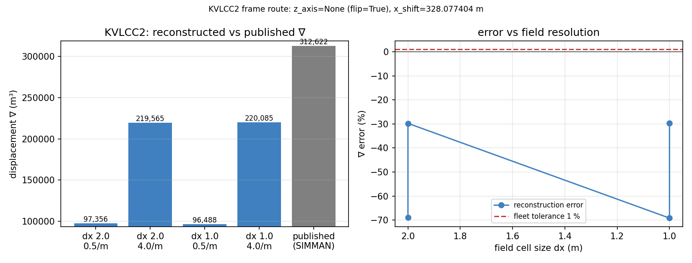

# KVLCC2 frame policy — making the published IGES comparable with ∇ = 312,622 m³

Anchor **REPRO-GEOM-FLEET-REFS** (TensorCAD), acceptance ⑤: *"runner 接线 KVLCC2 已有参考使基准可复跑"*.
Generated by `tools/baseline_fleet/kvlcc2_frame_build.py` from the run recorded in
`benchmarks/verified/fleet_refs/kvlcc2_frame.json`; no number below is transcribed by hand.

## 1. The defect the wiring had to remove

The benchmark carried the KVLCC2 reference (312,622 m³) but printed `—` for the
reconstruction. The cause is the **file frame**, measured here on the sampled surface
(99,702 samples of 19 B-spline patches):

| quantity | value (file frame) |
|---|---|
| x range (m) | -328.077 … 5.364 |
| y range (m) | -0.301 … 29.062 (half-model: True) |
| z range (m) | -27.871 … 0.000 |
| samples below z = 0 | 44.7 % → axis detected **down** |

So `z = 0` is the design waterline with `z` growing downwards and `x = 0` sits near the
bow (stern at `x ≈ -328 m`). The `iges_field` route kept samples with
`0 <= z <= T` on `0 <= x <= Lpp`, i.e. almost nothing, and refused. Nothing was wrong
with the hull or with the reference.

## 2. Method

`tensorcad/fleet/frames.py` measures the sampled surface (`detect`) and applies a
declarative policy (`normalise`): a z-down export is reflected about the waterline and
the model is translated so the aft-most point sits at `x = 0`; the field's x window then
follows the model's own extent (`x_extent="geometry"`), because the hull overhangs its
perpendiculars (333.4 m of model against Lpp = 320.0 m). The applied flip
(`z_flip = True`) and shift (`x_shift = 328.077 m`) are recorded in the
run's `frame_normalisation` block, so the build is re-derivable from numbers.

## 3. Result — ∇ vs the published reference

| dx (m) | dz (m) | sample density (1/m) | ∇ (m³) | error | Cb (reconstructed) | LCB (% Lpp) | watertight | triangles |
|---|---|---|---|---|---|---|---|
| 2.0 | 0.1 | 0.5 | 97,355.9 | -68.858 | 0.2522 | -2.266 | yes | 86,400 |
| 2.0 | 0.1 | 4.0 | 219,565.5 | -29.767 | 0.5687 | -1.588 | yes | 99,360 |
| 1.0 | 0.1 | 0.5 | 96,487.6 | -69.136 | 0.2499 | -2.38 | yes | 86,880 |
| 1.0 | 0.1 | 4.0 | 220,085.2 | -29.600 | 0.5701 | -1.472 | yes | 99,360 |

Reference: ∇ = 312,622 m³, Cb = 0.8098, LCB = 3.48 % Lpp
(SIMMAN summary page, digest pinned in the cross-reference library).

## 4. Gates (same set as the fleet run)

| gate | verdict | detail |
|---|---|---|
| G0_provenance | PASS | source/license stated ('MOERI KVLCC2 tanker benchmark particulars (SIMMA'); retrieval=offline_recollection; verified=False; manifest_sha256=7311b586d9a4b3fc |
| G0b_source_anchor | PASS | anchor 'simman-kvlcc2': 'SIMMAN 2008 / SIMMAN 2014 workshop series (eds. Stern, Agdrup) —'; locator 'KVLCC2 test-case particulars (Lpp 320.0 m, B 58.'; licence 'published workshop benchmark data, research use'; retrieval=offline_recollection; verified=False; anchors=['beam', 'block_coefficient', 'displacement_volume', 'draft', 'lcb_fraction', 'length', 'midship_coefficient'] |
| G1_not_placeholder | PASS | no placeholder signature |
| G2_no_duplicate_geometry | PASS | each ship owns a distinct geometry sha256 |
| G3_watertight | PASS | boundary edges = 0 (tolerance 0) |
| G4_manifold_oriented | PASS | non-manifold edges = 0, inconsistent directed edges = 0, zero-area faces = 0, duplicate faces = 0 |
| G5_single_closed_shell | PASS | Euler characteristic = 2 (expect 2), signed volume = 220085 (expect > 0) |
| G6_particulars_consistent | PASS | |Cb*L*B*T - V_published| / V_published = 0.000% (tolerance 3%), V_published = 312622 m^3 |
| G6b_reference_consistency | PASS | cited V = 312622 m^3 vs Cb*L*B*T = 312622 m^3: +0.0001% (tolerance 0.5%); a disagreement beyond this band means L, B, T, Cb or the cited volume was mis-transcribed |
| G7_volume_vs_reference | FAIL | |V_mesh - V_ref| / V_ref = 29.6002% (tolerance 1%); V_mesh = 220085 m^3, V_ref = 312622 m^3, basis = literature (literature_value_recalled) |
| G8_principal_dimensions | FAIL | length: measured 333 vs declared 320 (4.0625%); beam: measured 58.1231 vs declared 58 (0.2123%); draft: measured 20.8 vs declared 20.8 (0.0000%) (tolerance 1%) |

## 5. Honest limits

* **The reconstruction is not converged, and that is the finding.** Across the
  (4 run) grid the error spans -69.14 % … -29.60 % (spread 39.54 percentage
  points), so no single row in the table above may be quoted as "the" reconstruction error.
  The `max`-binned half-breadth field is a *lower* bound argument for under-sampling, not an
  explanation for a 30 % deficit; the route needs a resolution study with a cell-size and
  density criterion before KVLCC2 can be called comparable at all.
* LCB is measured from the reconstructed mesh, whose resolution is the field cell; a
  trim/LCB claim at 0.1 %Lpp precision needs a finer field than the one run here.
* The published file was read from the platform asset store
  (`asset://geometry/hulls/KVLCC2/kvlcc2.igs`, sha256 recorded in `assets/geometry_registry.json`);
  the bytes are publisher material and stay out of this repository.

## 6. Independent probes: what the residual deficit is *not*

The table in §3 varies two knobs. Three further probes, committed next to this tool, isolate
the cause of the remaining ≈30 % deficit (all run against the same asset, digest in
`assets/geometry_registry.json`):

| probe | command | measurement |
|---|---|---|
| sampling density only | `tools/baseline_fleet/kvlcc2_spacing_probe.py` | cover of the (x, z) field saturates at **27.5 %** for dx = 2.0 m when the trim step is applied; `4/m` → `8/m` changes the filled nodes by 1.1 % only |
| vertical slab choice | `tools/baseline_fleet/kvlcc2_slab_probe.py` | the model spans 27.87 m of depth for a 20.8 m draft; the two defensible immersion slabs bracket ∇ = **197 218 m³ … 224 343 m³** (offset `depth − T` … `0` from the model top), i.e. no choice of slab reaches 312 622 m³ |
| field fidelity | `tools/baseline_fleet/kvlcc2_cover_probe.py` | at dx = 1.0 m, dz = 0.5 m, 1/8 m sampling: cover **0.802**, no empty stations, midship section **1 101.5 m²** vs `Cm·B·T = 1 204.0 m²` (−8.5 %), keel-level waterplane area 116 m² |

Two conclusions that the earlier drafts of this document did not have evidence for:

1. **The dominant error axis is the patch sampling density, not the field cell size.** The
   library default is `samples_per_metre = 8.0`; this tool originally ran at `0.5`, which
   alone accounts for a factor ≈ 2.3 in volume (97 356 → 219 565 m³). A single-density table
   would have published an arbitrary number, which is why the run grid now spans both axes.
2. **The frame route as wired is not yet comparable with the published displacement.**
   Even at the densest run the deficit is −29.6 %, and the reconstructed LCB is
   **−1.47 %Lpp against a published +3.48 %Lpp** — the *sign* disagrees, which a resolution
   error cannot produce. KVLCC2 therefore stays `WITHHELD` in
   `benchmarks/verified/baseline_fleet/result.json`, and `G7_volume_vs_reference` /
   `G8_principal_dimensions` stay red in `benchmarks/verified/fleet_refs/kvlcc2_frame.json`.
   Acceptance ⑤ of `REPRO-GEOM-FLEET-REFS` is **wired but not met**: the reference is now
   compared instead of printed as `—`, and the comparison fails honestly.
