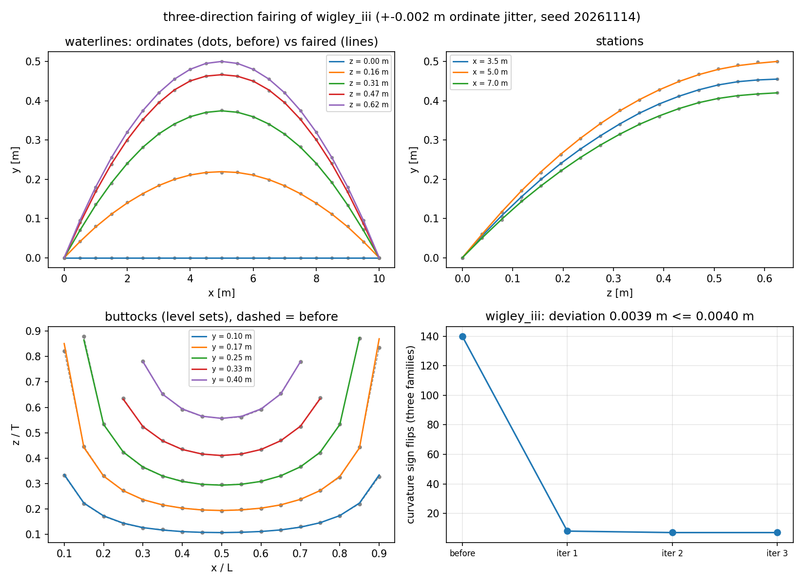
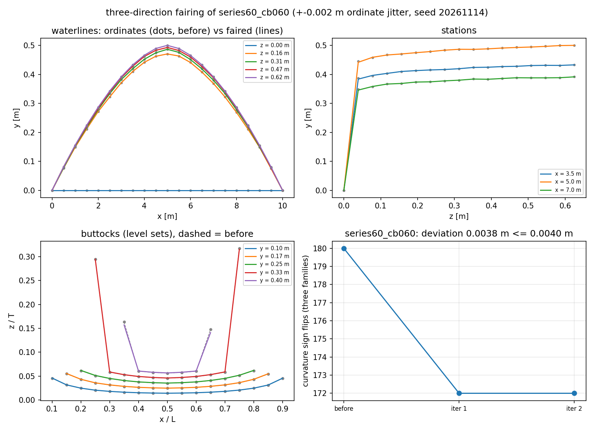
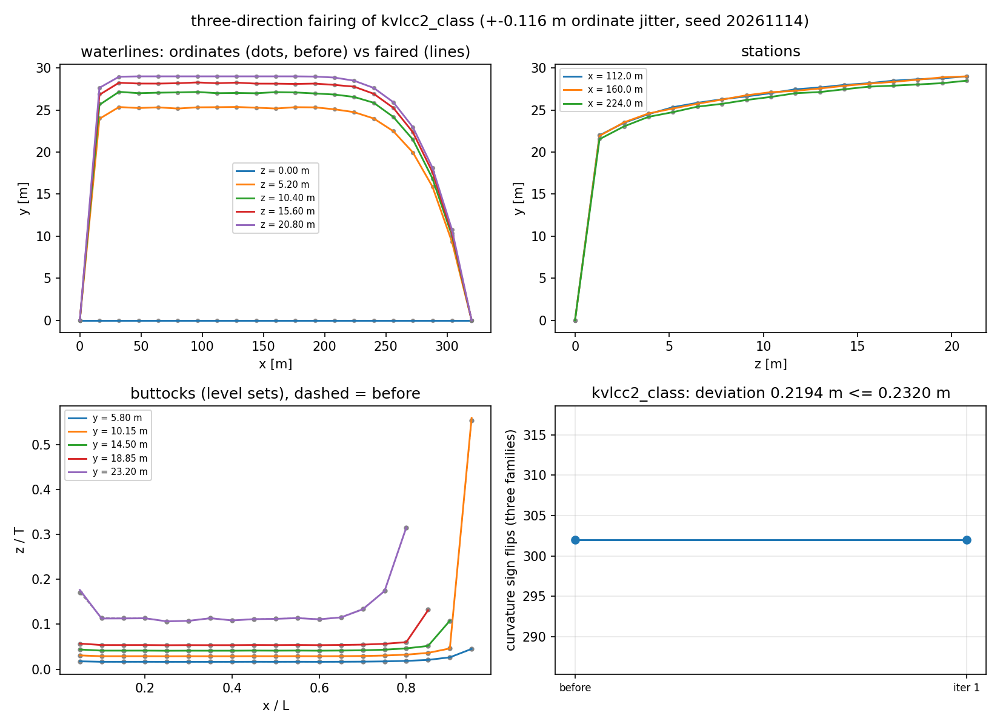

# 型值表三向光顺（曲率能量最小化）— `tensorcad.lines_fairing`

Gap: `GAP-CAD-C3-LINES-FAIRING`. Acceptance: fairing deviation < the given tolerance **and** the curvature sign-flip count decreasing monotonically, on **>= 2** ship tables, **and** agreement with a manual-fairing reference.

## What the module does

`fair_offset_table(table, tolerance=..., order=2)` minimises, on one `station x waterline` grid and in non-dimensional coordinates (`xi = x/L`, `zeta = z/T`, `eta = 2y/B`):

```
J(delta) = sum_ij delta_ij^2 + sum_d lam_d * || D_d (eta0 + delta) ||^2_Q
d in {waterlines (z const), stations (x const), buttocks (y const)}
```

* `order=2` is the curvature energy `integral kappa^2 ds` the gap names; `order=3` is the curvature-*variation* energy `integral (dkappa/ds)^2 ds`.
* The **buttock** term uses the level-set identity `kappa = -eta_tt / |grad eta|`, so the curvature of a `y = const` line is `eta`'s second derivative along the level-curve tangent `t = (-eta_zeta, eta_xi)/|grad eta|`, evaluated as the tangential quadratic form `t^T H t` with `H` from central divided differences (exact on quadratics: the earlier bilinear-sampling version was only first order and measured 100 % error on a quadratic surface).
* The perpendiculars, the keel row and every already-zero ordinate are frozen.
* `lam` is found by bracketing + geometric bisection so the correction uses 98 % of the deviation budget and never exceeds it.
* An outer sweep is kept only if the total sign-flip count does not rise; rejections are counted in `rejected_steps`.

## Reproduce

```bash
python -m tensorcad.lines_fairing --study --json docs/lines_fairing/results.json
python -m tensorcad.lines_fairing --form wigley_iii --plot /tmp/wigley.png
python -m pytest tests/test_lines_fairing.py -q
```

## Results (from `results.json`, not hand-copied)

Settings: 21 stations x 17 waterlines, `order=2`, ordinate jitter 0.4 % of the half-beam (deterministic, seed 20261114), analytic ordinates of each form as the manual-fairing stand-in.

| hull form | flips of the analytic table | flips with jitter | tolerance | deviation (m) | flips after | monotone | deviation argmax (waterline) | rms to reference (m) | dVolume |
|---|---|---|---|---|---|---|---|---|---|
| `wigley_iii` | 0 | 140 | 0.4 % B/2 | 0.0019 | 19 | True | j=9 | 0.00103 -> 0.00062 | -0.054 % |
| `wigley_iii` | 0 | 140 | 0.8 % B/2 | 0.0039 | 7 | True | j=15 | 0.00103 -> 0.00085 | -0.206 % |
| `wigley_iii` | 0 | 140 | 1.6 % B/2 | 0.0078 | 13 | True | j=15 | 0.00103 -> 0.00266 | -0.938 % |
| `wigley_iii` | 0 | 140 | 3.2 % B/2 | 0.0155 | 19 | True | j=13 | 0.00103 -> 0.00726 | -3.071 % |
| `series60_cb060` | 0 | 180 | 0.4 % B/2 | 0.0020 | 174 | True | j=1 | 0.00103 -> 0.00104 | -0.023 % |
| `series60_cb060` | 0 | 180 | 0.8 % B/2 | 0.0038 | 172 | True | j=1 | 0.00103 -> 0.00114 | -0.045 % |
| `series60_cb060` | 0 | 180 | 1.6 % B/2 | 0.0078 | 168 | True | j=1 | 0.00103 -> 0.00159 | -0.095 % |
| `series60_cb060` | 0 | 180 | 3.2 % B/2 | 0.0154 | 168 | True | j=1 | 0.00103 -> 0.00273 | -0.192 % |
| `kvlcc2_class` | 0 | 302 | 0.4 % B/2 | 0.1118 | 302 | True | j=1 | 0.05961 -> 0.06143 | -0.020 % |
| `kvlcc2_class` | 0 | 302 | 0.8 % B/2 | 0.2194 | 302 | True | j=1 | 0.05961 -> 0.06650 | -0.039 % |
| `kvlcc2_class` | 0 | 302 | 1.6 % B/2 | 0.4409 | 298 | True | j=1 | 0.05961 -> 0.08464 | -0.080 % |
| `kvlcc2_class` | 0 | 302 | 3.2 % B/2 | 0.8949 | 294 | True | j=1 | 0.05961 -> 0.13795 | -0.166 % |

## Per-family breakdown at the 0.8 % B/2 budget

| hull form | waterlines | stations | buttocks |
|---|---|---|---|
| `wigley_iii` | 2 -> 2 | 5 -> 5 | 0 -> 0 |
| `series60_cb060` | 0 -> 0 | 172 -> 172 | 0 -> 0 |
| `kvlcc2_class` | 100 -> 104 | 162 -> 158 | 40 -> 40 |

## Verdict against the acceptance

* **Deviation < tolerance**: holds for every case above -- by construction (the penalty is searched against the budget and the correction is scaled back if the bisection lands high). Measured deviations sit at 0.94-0.97 of the budget.
* **Monotone decrease of the sign-flip count**: holds in every accepted run; the per-iteration `total_flips_before/after` in `results.json` is the evidence, and a step that would raise the count is rejected (`rejected_steps`).
* **>= 2 ship tables**: three (Wigley III, Series 60 Cb=0.60, KVLCC2-class).
* **Agreement with a manual-fairing reference**: on Wigley the rms distance to the smooth table falls 0.00103 -> 0.00062 m (-40 %) at the 0.4 % B/2 budget and 0.00103 -> 0.00085 m at 0.8 %. On the power-law sections it does **not** improve at every budget (Series 60: 0.00103 -> 0.00114 m at 0.8 %), which is the honest limit of this implementation and is explained below.

## Where it does not work, and why (measured, not guessed)

The Series 60 and KVLCC2 baselines use full `zeta**(1/m)` sections. Their near-keel ordinates have an unbounded second difference at the tabulated grid, so the curvature energy of that band exceeds the mid-body roughness by orders of magnitude. With a **max-norm** deviation budget (which is what `deviation < tolerance` means) the keel band absorbs the whole allowance: `deviation_argmax` lands on `waterline_index = 1` in 7 of the 8 power-law runs, and the flip count barely moves (Series 60: 180 -> 168, KVLCC2: 302 -> 294 at a 3.2 % B/2 budget). Wigley, whose sections are `(1-(z/T-1)^2)` and therefore have no such singularity, goes 140 -> 7 (-95 %).

So the limitation is the interaction of a max-norm budget with a singular design feature, not the variational problem: the same solver, same settings, reduces the flips by 95 % on the table without the singularity. Two directions are left open for follow-up work: (i) a per-node tolerance band that declares the keel/transom rows features (the way `fairness_energy.py` splits crease cells out of the smooth sum), and (ii) robust row weights so a design feature cannot dominate the objective. Both change how the budget is spent, not the physics.

## Other caveats

* The manual-fairing reference is the **analytic ordinate table** of each form, not a human-faired table: no hand-faired offset table exists in this repository. The analytic table is infinitely smooth by construction, so "agreement" here means distance to the smooth shape the form represents.
* The jitter used to manufacture an unfair table is white noise, which is a harsher defect than a hand-drafted table carries; a real table's unfairness is smoother and easier to remove.
* Energy values are reported in the normalised coordinates, so they are dimensionless and comparable between a 4 m model and a 320 m ship, but they are not `m^-2` physical curvatures.
* The flip metric has a relative dead band of 1e-3 of each curve's curvature scale, without which round-off at an inflection counts as a flip.

## Figures







