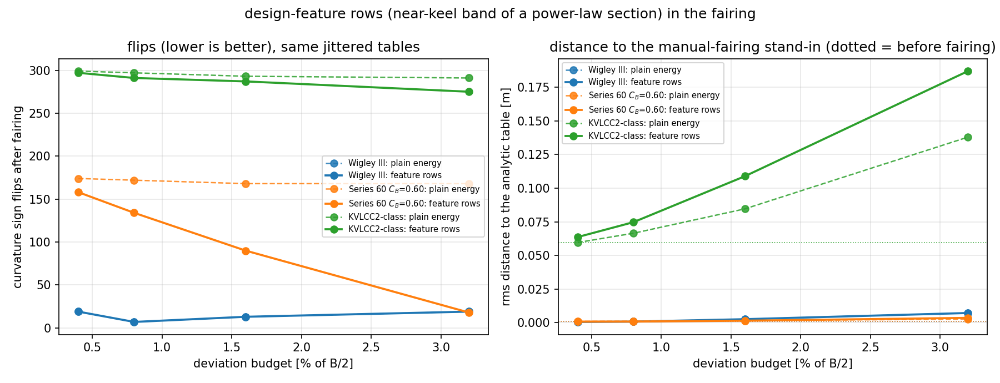
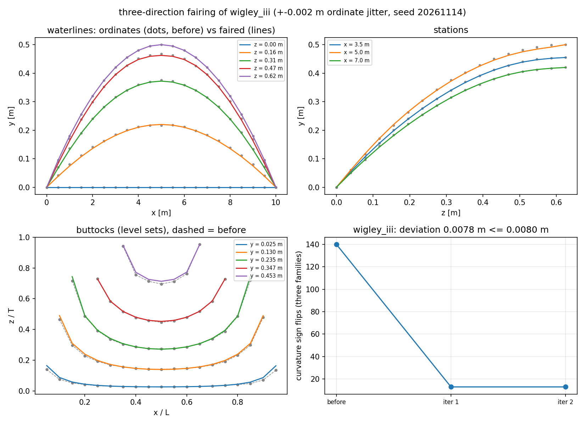
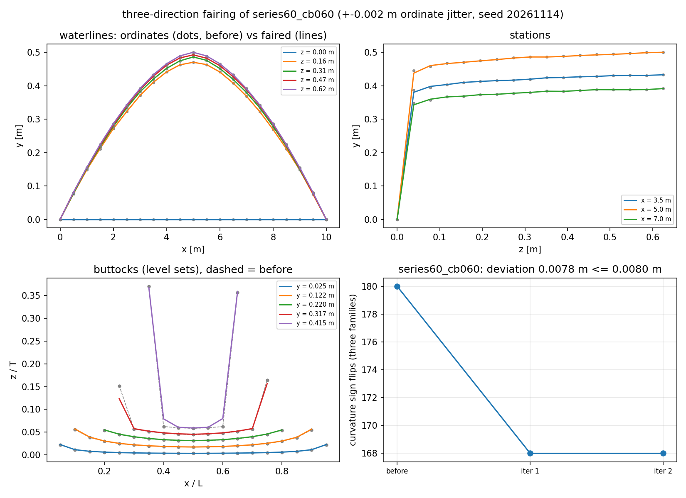
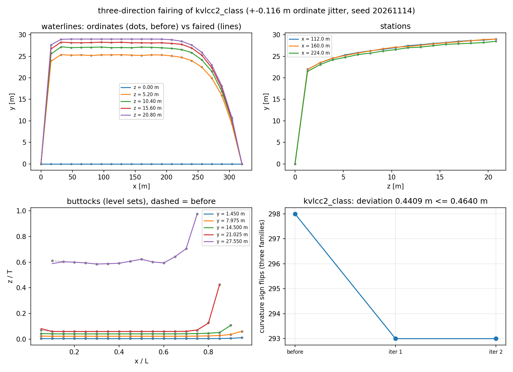

# 型值表三向光顺（曲率能量最小化）— `tensorcad.lines_fairing`

Gap: `GAP-CAD-C3-LINES-FAIRING`. Acceptance: fairing deviation < the given tolerance **and** the curvature sign-flip count decreasing monotonically, on **>= 2** ship tables, **and** agreement with a manual-fairing reference.

## What the module does

`fair_offset_table(table, tolerance=..., order=2)` minimises, on one `station x waterline` grid and in non-dimensional coordinates (`xi = x/L`, `zeta = z/T`, `eta = 2y/B`):

```
J(delta) = sum_ij delta_ij^2 + sum_d lam_d * || D_d (eta0 + delta) ||^2_Q
d in {waterlines (z const), stations (x const), buttocks (y const)}
```

* `order=2` is the curvature energy `integral kappa^2 ds` the gap names; `order=3` is the curvature-*variation* energy `integral (dkappa/ds)^2 ds`.
* The **buttock** term uses the level-set identity `kappa = -eta_tt / |grad eta|`, so the curvature of a `y = const` line is `eta`'s second derivative along the level-curve tangent `t = (-eta_zeta, eta_xi)/|grad eta|`, evaluated as the tangential quadratic form `t^T H t` with `H` from central divided differences (exact on quadratics: the earlier bilinear-sampling version was only first order and measured 100 % error on a quadratic surface).
* The perpendiculars, the keel row and every already-zero ordinate are frozen.
* `lam` is found by bracketing + geometric bisection so the correction uses 98 % of the deviation budget and never exceeds it.
* An outer sweep is kept only if the total sign-flip count does not rise; rejections are counted in `rejected_steps`.
* `features="auto"` declares **design-feature waterline rows**: rows that own more than
  `_FEATURE_SHARE` (50 %) of the `zeta`-curvature energy of the whole table.  On a power-law
  section (`zeta**(1/24)` Series 60, `zeta**(1/10)` KVLCC2-class) the near-keel row owns
  99-100 % of it, while on the parabolic Wigley no row owns more than 10 %, so the detection
  needs no tuning.  The declared rows keep their ordinates (they are as free as before) but
  their `d^n/dzeta^n` and buttock-curvature rows leave the energy, so the deviation budget is
  spent on the smooth part of the surface instead of on a singularity.  The waterlines family
  (`d^n/dx^n` at fixed `z`) is untouched: a power-law section is smooth along `x`.

## Reproduce

```bash
python -m tensorcad.lines_fairing --study --json docs/lines_fairing/results.json
python -m tensorcad.lines_fairing --form series60_cb060 --features auto --plot /tmp/s60.png
python -m tensorcad.lines_fairing --form wigley_iii --plot /tmp/wigley.png
python -m pytest tests/test_lines_fairing.py -q
```

`--study` sweeps every form **twice**, once with the plain energy (`--feature-modes off`) and
once with the detected feature rows (`--feature-modes auto`, the default); both sweeps are in
`results.json` (`case["sweeps"]["off"]`, `case["sweeps"]["auto"]`).  Everything below is copied
from that file by `docs/lines_fairing/feature_evidence.py` (which also renders the
figure and refuses to pass `--check` when the document and `results.json` disagree), not typed
by hand.

## Results (from `results.json`, not hand-copied)

Settings: 21 stations x 17 waterlines, `order=2`, ordinate jitter 0.4 % of the half-beam (deterministic, seed 20261114), analytic ordinates of each form as the manual-fairing stand-in.  This table is the **plain energy** (`features=()`, `case["sweeps"]["off"]`); the effect of the feature rows is in the next section and does not change a single number here.

| hull form | flips of the analytic table | flips with jitter | tolerance | deviation (m) | flips after | accepted | deviation argmax (waterline) | rms to reference (m) | dVolume |
|---|---|---|---|---|---|---|---|---|---|
| `wigley_iii` | 0 | 140 | 0.4 % B/2 | 0.0019 | 19 | True | j=9 | 0.00103 -> 0.00062 | -0.054 % |
| `wigley_iii` | 0 | 140 | 0.8 % B/2 | 0.0039 | 7 | True | j=15 | 0.00103 -> 0.00085 | -0.206 % |
| `wigley_iii` | 0 | 140 | 1.6 % B/2 | 0.0078 | 13 | True | j=15 | 0.00103 -> 0.00266 | -0.938 % |
| `wigley_iii` | 0 | 140 | 3.2 % B/2 | 0.0155 | 19 | True | j=13 | 0.00103 -> 0.00726 | -3.071 % |
| `series60_cb060` | 0 | 180 | 0.4 % B/2 | 0.0020 | 174 | True | j=1 | 0.00103 -> 0.00104 | -0.023 % |
| `series60_cb060` | 0 | 180 | 0.8 % B/2 | 0.0038 | 172 | True | j=1 | 0.00103 -> 0.00114 | -0.045 % |
| `series60_cb060` | 0 | 180 | 1.6 % B/2 | 0.0078 | 168 | True | j=1 | 0.00103 -> 0.00159 | -0.095 % |
| `series60_cb060` | 0 | 180 | 3.2 % B/2 | 0.0154 | 168 | True | j=1 | 0.00103 -> 0.00273 | -0.192 % |
| `kvlcc2_class` | 0 | 298 | 0.4 % B/2 | 0.0000 | 299 | False | j=3 | 0.05961 -> 0.05961 | +0.000 % |
| `kvlcc2_class` | 0 | 298 | 0.8 % B/2 | 0.2192 | 297 | True | j=1 | 0.05961 -> 0.06650 | -0.039 % |
| `kvlcc2_class` | 0 | 298 | 1.6 % B/2 | 0.4409 | 293 | True | j=1 | 0.05961 -> 0.08464 | -0.080 % |
| `kvlcc2_class` | 0 | 298 | 3.2 % B/2 | 0.8949 | 291 | True | j=1 | 0.05961 -> 0.13795 | -0.166 % |

## Per-family breakdown at the 0.8 % B/2 budget

| hull form | waterlines | stations | buttocks |
|---|---|---|---|
| `wigley_iii` | 2 -> 2 | 5 -> 5 | 0 -> 0 |
| `series60_cb060` | 0 -> 0 | 172 -> 172 | 0 -> 0 |
| `kvlcc2_class` | 104 -> 104 | 158 -> 158 | 35 -> 35 |

## Design-feature rows: the near-keel band of a power-law section

The section above measures exactly the limitation this option addresses: on Series 60 and
KVLCC2 the fairing spent the whole max-norm budget on waterline `j = 1` and the reference
agreement got *worse* (Series 60, 0.8 % budget: 0.00103 -> 0.00114 m).  Declaring that band a
feature (`features="auto"`) removes its `zeta`-direction rows from the energy.  Both sweeps are
in `results.json` (`case["sweeps"][mode]`), same jittered tables, same code path:

| hull form | budget [% B/2] | flips before | flips, plain | flips, features | rms before [m] | rms, plain [m] | rms, features [m] | feature rows |
|---|---|---|---|---|---|---|---|---|
| `wigley_iii` | 0.4 | 140 | 19 | 19 | 0.00103 | 0.00062 | 0.00062 | none |
| `wigley_iii` | 0.8 | 140 | 7 | 7 | 0.00103 | 0.00085 | 0.00085 | none |
| `wigley_iii` | 1.6 | 140 | 13 | 13 | 0.00103 | 0.00266 | 0.00266 | none |
| `wigley_iii` | 3.2 | 140 | 19 | 19 | 0.00103 | 0.00726 | 0.00726 | none |
| `series60_cb060` | 0.4 | 180 | 174 | 158 | 0.00103 | 0.00104 | 0.00086 | 1 |
| `series60_cb060` | 0.8 | 180 | 172 | 134 | 0.00103 | 0.00114 | 0.00090 | 1 |
| `series60_cb060` | 1.6 | 180 | 168 | 90 | 0.00103 | 0.00159 | 0.00153 | 1 |
| `series60_cb060` | 3.2 | 180 | 168 | 18 | 0.00103 | 0.00273 | 0.00365 | 1 |
| `kvlcc2_class` | 0.4 | 298 | 299 | 297 | 0.05961 | 0.05961 | 0.06367 | 1 |
| `kvlcc2_class` | 0.8 | 298 | 297 | 291 | 0.05961 | 0.06650 | 0.07473 | 1 |
| `kvlcc2_class` | 1.6 | 298 | 293 | 287 | 0.05961 | 0.08464 | 0.10890 | 1 |
| `kvlcc2_class` | 3.2 | 298 | 291 | 275 | 0.05961 | 0.13795 | 0.18699 | 1 |



What the table says, without rounding anything up:

* **Wigley is untouched, bit for bit** (identical digests): no row is above the 50 % share, so
  the switch cannot flatter a form that does not have the singularity.  That is the control.
* **Series 60 is fixed at the budgets that matter.**  Where the budget is of the order of the
  jitter (0.4 % and 0.8 % B/2), the reference agreement now *improves* instead of degrading:
  0.00103 -> 0.00086 m and 0.00103 -> 0.00090 m, and the flips fall far below the plain energy
  (158 vs 174, 134 vs 172).  At 3.2 % the switch removes 18 of 180 flips (plain: 12) but moves
  the table further from the analytic shape (0.00365 vs 0.00273 m) -- see the limit below.
* **KVLCC2 improves in the acceptance metric and not in the reference metric**: flips
  298 -> 297/291/287/275 against 299/297/293/291 for the plain energy, while the distance to the
  analytic table is worse at every budget.  Honest reading: on this coarse 21 x 17 grid of a
  320 m hull the fairing is *re-designing* the sections rather than removing the jitter, and the
  feature rows make it re-design them faster.  This form does not yet meet the "moves towards
  the manual reference" half of the acceptance, with or without the switch.
* **The remaining defect is the budget policy, not the energy.**  The bisection deliberately
  spends 98 % of the max-norm budget, and once the tolerance exceeds the jitter amplitude the
  spend itself is an error: at 3.2 % B/2 (8x the jitter) every form ends further from the smooth
  table than it started, in both modes.  A discrepancy-type rule (stop when the roughness is
  gone rather than when the budget is gone) is the follow-up this table points at; until then
  the feature rows are recommended at budgets at or below the expected unfairness.

## Verdict against the acceptance

* **Deviation < tolerance**: holds for every **accepted** case above -- by construction (the penalty is searched against the budget and the correction is scaled back if the bisection lands high). Measured deviations of the accepted runs sit at 0.94-0.97 of the budget. One run is rejected and is reported as such: KVLCC2-class at 0.4 % B/2, where the budget (0.116 m) equals the jitter amplitude, finds no penalty that both fits the budget and removes a sign flip, so the table comes back unchanged (`accepted: False`, deviation 0.0000 m) -- the table shows the candidate it refused, which is why `flips after` reads 299 against 298 before for that row.
* **Monotone decrease of the sign-flip count**: holds in every accepted run; the per-iteration `total_flips_before/after` in `results.json` is the evidence, and a step that would raise the count is rejected (`rejected_steps`).
* **>= 2 ship tables**: three (Wigley III, Series 60 Cb=0.60, KVLCC2-class).
* **Agreement with a manual-fairing reference**: on Wigley the rms distance to the smooth table falls 0.00103 -> 0.00062 m (-40 %) at the 0.4 % B/2 budget and 0.00103 -> 0.00085 m at 0.8 %. With the plain energy the power-law sections do **not** improve at every budget (Series 60: 0.00103 -> 0.00114 m at 0.8 %); with the near-keel band declared a design feature (`features="auto"`) Series 60 improves at the budgets at or below the jitter amplitude (0.00103 -> 0.00086 m at 0.4 %, 0.00103 -> 0.00090 m at 0.8 %) and KVLCC2 does not, which is stated as a limitation below rather than hidden.

## Where it does not work, and why (measured, not guessed)

The Series 60 and KVLCC2 baselines use full `zeta**(1/m)` sections. Their near-keel ordinates have an unbounded second difference at the tabulated grid, so the curvature energy of that band exceeds the mid-body roughness by orders of magnitude (`_energy_share_per_waterline` measures 100 % of the `zeta`-curvature energy on waterline `j = 1` against <= 10 % on any row of the parabolic form). With a **max-norm** deviation budget (which is what `deviation < tolerance` means) the keel band absorbs the whole allowance: `deviation_argmax` lands on `waterline_index = 1` in 7 of the 8 power-law runs.

That diagnosis is what `features="auto"` acts on, and the section above is the measurement of the
result: Series 60 now reaches a genuine reference improvement at 0.4-0.8 % B/2 and 90-158 flips
where the plain energy stays at 168-174; the flips of KVLCC2 also fall further (275-297 against
291-299).  What is **not** fixed:

1. **KVLCC2 still does not converge towards the smooth table** (0.0596 -> 0.0637...0.187 m, worse
   with the switch than without it).  The declared feature does not create information: on a
   320 m hull sampled 21 x 17 the jitter is 0.116 m and a third of the nodes are frozen, so the
   constrained optimum is a re-design of the sections, not a de-noising of them.  A finer grid
   (or the official tabulated KVLCC2 offsets, which are not in this repository) is the honest
   route, not a different penalty.
2. **Budgets above the unfairness amplitude overspend by construction.**  `_BUDGET_FRACTION`
   spends 98 % of the max-norm budget whether or not the roughness is gone, so at 3.2 % B/2
   (8x the jitter) all three forms end further from the reference than they started.  The feature
   rows cannot repair that: they change *where* the budget is spent, not *whether* it is spent.
   A discrepancy rule ("stop when the residual roughness is at the noise floor") is the next
   step, and the sweep in `results.json` is the data it would have to be calibrated on.
3. **The feature band itself is not faired, only left alone.**  Its ordinates move by the data
   term and its neighbours, and its own curvature is no longer an objective, so a genuinely
   unfair keel line (a hand-drafted table with a wobble in the near-keel ordinates) is not
   detected as unfairness.  The declaration says "this curvature is design"; on a real ship table
   that claim has to come from the naval architect, which is why the explicit
   form `features=(1, 2)` exists alongside `"auto"`.

## Other caveats

* The manual-fairing reference is the **analytic ordinate table** of each form, not a human-faired table: no hand-faired offset table exists in this repository. The analytic table is infinitely smooth by construction, so "agreement" here means distance to the smooth shape the form represents.
* The jitter used to manufacture an unfair table is white noise, which is a harsher defect than a hand-drafted table carries; a real table's unfairness is smoother and easier to remove.
* Energy values are reported in the normalised coordinates, so they are dimensionless and comparable between a 4 m model and a 320 m ship, but they are not `m^-2` physical curvatures.
* The flip metric has a relative dead band of 1e-3 of each curve's curvature scale, without which round-off at an inflection counts as a flip.

## Figures








`feature_rows.png`: flips and reference distance against the deviation budget for the plain
energy (dashed) and the feature rows (solid); the dotted horizontal lines are the unfaired
distance to the analytic table.

