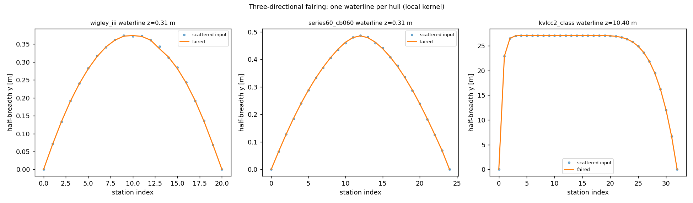

# Three-directional offset-table fairing — measured results

Regenerated by `python examples/lines_fairing/run_example.py`; every number below
is read from `results.json`, which the runner writes. The runner reports the
acceptance status (`max_deviation <= tolerance`, monotone flips): **PASS**.

| hull | grid | noise [m] | tol [m] | kernel | flips (history) | monotone | max dev [m] |
|---|---|---|---|---|---|---|---|
| wigley_iii | 21x17 | 0.004 | 0.010 | local | [219, 81, 59] | yes | 0.00892 |
| wigley_iii | 21x17 | 0.004 | 0.010 | energy | [219, 14] | yes | 0.00606 |
| series60_cb060 | 25x21 | 0.004 | 0.010 | local | [450, 224, 182, 166, 146, 139] | yes | 0.01000 |
| series60_cb060 | 25x21 | 0.004 | 0.010 | energy | [450, 274, 258] | yes | 0.01000 |
| kvlcc2_class | 33x25 | 0.020 | 0.050 | local | [272, 90, 47, 33, 29] | yes | 0.05000 |
| kvlcc2_class | 33x25 | 0.020 | 0.050 | energy | [272, 270] | yes | 0.05000 |

## Accuracy against the analytic half-breadth surface

| hull | kernel | RMS in [m] | RMS out [m] | reduction | max in [m] | max out [m] |
|---|---|---|---|---|---|---|
| wigley_iii | local | 0.00216 | 0.00136 | 37.0 % | 0.00400 | 0.00572 |
| wigley_iii | energy | 0.00216 | 0.00050 | 77.1 % | 0.00400 | 0.00226 |
| series60_cb060 | local | 0.00221 | 0.00149 | 32.5 % | 0.00400 | 0.00807 |
| series60_cb060 | energy | 0.00221 | 0.00452 | -104.2 % | 0.00400 | 0.01332 |
| kvlcc2_class | local | 0.01122 | 0.01060 | 5.6 % | 0.01999 | 0.05589 |
| kvlcc2_class | energy | 0.01122 | 0.04276 | -281.0 % | 0.01999 | 0.06958 |

## Independent smoother and displacement

| hull | kernel | RMS vs hand reference [m] | max vs hand reference [m] | |dV|/V |
|---|---|---|---|---|
| wigley_iii | local | 0.00099 | 0.00500 | 4.34e-04 |
| wigley_iii | energy | 0.00130 | 0.00530 | 5.55e-04 |
| series60_cb060 | local | 0.00556 | 0.03624 | 2.30e-03 |
| series60_cb060 | energy | 0.00706 | 0.04262 | 7.01e-04 |
| kvlcc2_class | local | 0.36085 | 2.61405 | 1.98e-04 |
| kvlcc2_class | energy | 0.36349 | 2.61405 | 7.23e-05 |

## Figures

