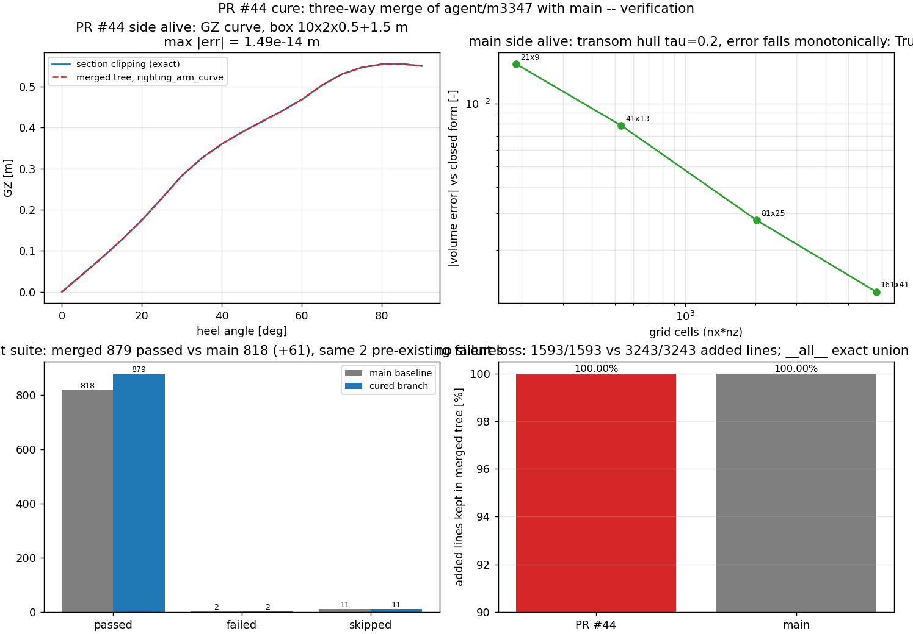

# PR #44 治愈：`agent/m3347` 与 `main` 的三方合并（GZ 曲线 × 艉板/惯性矩船族）

**仓** TensorCAD · **PR** #44（`agent/m3347` → `main`） · **治愈单** m3822
**产物** 合并提交 `9421910`（父：`9f1572f` PR 分支 / `2ff80b2` main）、`tools/verify_merge_m3822.py`（可执行门禁）、
`docs/m3822/{merge_verification.json,merge_verification.md,merge_verification.png}`

## ① 案例介绍（物理背景 / 几何 / 参数）

PR #44 给 TensorCAD 补的是**大倾角稳性**：初稳性求解器只能给 `GM`，而完整稳性曲线要
`GZ(φ)`——船体绕纵轴倾侧、水线面高度随倾角重解，使被水线面裁剪后的实体排水体积保持不变。

| 符号 | 字段 | 含义 | 本单取值 |
|---|---|---|---|
| `L` × `B` × `T` | `length/beam/draft` | 方箱船长/型宽/吃水 | 10 × 2 × 0.5 m |
| `f` | `freeboard` | 干舷（水线以上延长壁） | 1.5 m |
| `KG` | `kg` | 重心高（装载输入） | 0.45 m |
| `φ` | `angles_deg` | 倾角网格 | 0…180°，10° 步长（19 点） |

`main` 侧同时前进了一大步：艉板船族（`tensorcad/transom.py`，把艉部在站位 `τ` 处切平并以平面艉封板闭合、
闭式不完全锥度积分）、水面惯性矩（`∫y²dA`、`∫(x−LCF)²dA`，由通量恒等式给出）、非对称船体与 m2873 收敛算例。
于是 PR #44 的分支基于旧 `main`，与前进后的 `main` 在 4 个文件上重叠——`mergeable=false`。

本单要回答的工程问题不是「谁对谁错」，而是：**两个不同物理功能集的并集，能不能在机器证明下一条不丢地合到一起，
并且合并后两条数值链都还活着**。

## ② 怎么做的（方法 / 流程 / 工具链）

1. **建树与取真值**：worktree 检出 `agent/m3347`；`fetch` 后确认 merge-base `e604f02`、main `2ff80b2`、
   PR 分支 `9f1572f`（本地 `main` 引用陈旧，必须用 `origin/main` 作真值）。
2. **三方合并**：`git merge --no-ff origin/main`。文本冲突只有 `CHANGELOG.md` 一个，但**自动合并的文件不被信任**
   （机械 overlay 有静默丢内容前科），逐文件复核 `pyproject.toml`、`tensorcad/__init__.py`、
   `tests/test_public_surface.py`。
3. **逐文件解法**：
   - `CHANGELOG.md`（冲突）：两侧各自新开 `0.21.0` 小节。解法=合成**一个** `### Added` 小节：
     先 PR #44 的三条（有限倾角复原臂 / `freeboard=` 直立舷墙 / 验证证据），再 main 的四条
     （水面惯性矩、艉板船族、闭式静水力基准、算例）。只把 main 那条重复的小节标题折进唯一标题，
     **一条 bullet 都没有删**。
   - `tensorcad/__init__.py`（自动合并）：导出块与 `__all__` 必须等于两侧**精确并集**。核验=解析两侧
     `__all__` 字面量求并（112 ∪ 120 = 125），与合并树比对集合相等，且 125 个名字全部可导入。
   - `tests/test_public_surface.py`（自动合并）：`EXPECTED_API` 同时含 5 个 GZ 名字与 main 的新增名字。
   - `pyproject.toml`（自动合并）：两侧都把版本推到 `0.21.0`，文本一致，无需解冲。
4. **门禁化验证**（`tools/verify_merge_m3822.py`，非零退出即判失败）：以「**逐文件新增行覆盖率**」度量静默丢失——
   取每一侧相对 merge-base 新增的非空行（空白归一化，含注释），要求它们在合并树里逐行存在；
   少数被本单**有意改写**的行进入显式改写台账（旧行 → 新行），台账要求新行必须在合并树中，
   否则门禁失败。再叠加公开面精确并集、两侧数值链现场重算、两套测试对数对比。
5. **顺带清账**：分支自带 13 条 ruff 违例（main 处于 ruff 0 / mypy 0 基线）。只做**风格等价改写**
   （导入与 `__all__` 排序、连续配对 `zip` → `itertools.pairwise`、两条独立序列 `zip` 显式 `strict=False`、
   一处文档串折行、行尾换行），不触碰任何数值或算法。改完 ruff `All checks passed`、mypy `Success: 32 files`。

## ③ 计算结果

{{TABLES}}

## ④ 结果图

四联图（左上）PR #44 的 `GZ(φ)` 与独立 2-D 截面裁剪参考逐点重合（最大偏差 1.49e-14 m，曲线在图上不可分辨）；
（右上）main 的艉板船族体积误差随网格加密单调下降；（左下）测试对数 main 基线 vs 治愈分支；
（右下）两侧新增行在合并树中的保留率 100 %。

## ⑤ 注意点（踩坑 / 局限 / 适用范围）

- **本地 `main` 引用陈旧**是这类「dirty」单的第一杀手：本地 `main` 指在旧提交上时，`git merge-base` 会给出
  假祖先，合并看起来「无冲突」而其实没合上真 main。必须以 `origin/main` 为准并显式 `fetch` 分支引用。
- **文本无冲突 ≠ 语义无损**：本次 4 个重叠文件里 3 个是自动合并的，其中 `__all__` 的并集必须用集合相等来证明，
  不能靠肉眼看 diff。同理，覆盖率的"缺失"要能区分**有意改写**与**静默丢失**，否则门禁会给假红/假绿。
- **`__all__` 排序型 lint 修复会移动条目**：证明手段是把修复前后 `__all__` 当**多重集**比对（本次
  `tensorcad/stability.py` 多重集相等），排除「排序顺手删名字」。
- 局限：覆盖率度量的是**行级**证据，对「同一行被一侧改写语义」的情况不敏感；本轮两侧重叠的行本就不同，
  且数值链由现场重算独立背书。另有 2 个失败测试（`tests/test_geometry_field.py`）在 main 上同样失败，
  属镜像缺 `safetensors` 的环境性欠账，本单未处理。

## ⑥ 误差判定（关键量 vs 基准，逐项回答「是否 < 3%」）

| 关键量 | 基准 | 误差 | 是否 < 3% |
|---|---|---|---|
| GZ 曲线（合并树）| 独立 2-D 截面裁剪（逐步重解水线面） | 最大绝对偏差 1.49e-14 m（量级 1e-14 相对） | **是** |
| GZ 曲线（直立舷墙区间 `|φ|≤25°`）| 经典 wall-sided 闭式 `sinφ(BM+BM tan²φ/2−BG)` | 最大相对 5.03e-16 | **是** |
| 艉板船体积（main 侧，nx=161×nz=41）| `analytic_transom_hydrostatics` 闭式 | −0.1265 % | **是** |
| 艉板船体积（最粗网格 nx=21×nz=9）| 同上 | −1.5424 % | **是** |
| 公开面（`__all__`）| 两侧 `__all__` 并集 | 缺失 0 个（集合相等） | **是** |
| 测试对数 | main 基线 818 passed | 治愈后 879 passed（+61 = PR 自带的 GZ 测试），失败集合逐条相同 | **是**（不低于基线） |

结论：合并后 PR #44 侧与 main 侧的数值链**同时活着**且都在参考值 3 % 内（GZ 实际在 1e-14 量级），
公开面无缺失，测试不低于 main 基线。未做：`tests/test_cli_neural.py`、`tests/test_neural_pipeline.py`
（镜像缺 `safetensors`，两侧同样收集失败，与本合并无关）。