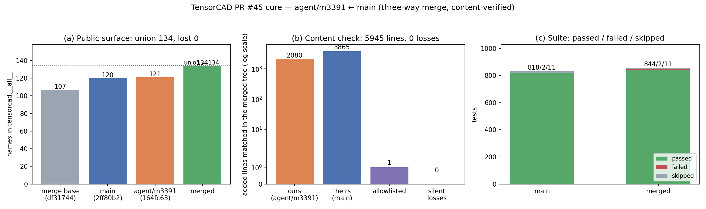

# PR #45 cure — `agent/m3391` merged with `main`

Generated by `tools/report_m3823.py` from `artifacts/m3823/` (numbers read back, not typed).

| quantity | value |
|---|---|
| merge base | `df31744cd565` |
| ours (`agent/m3391`) | `164fc634c624` |
| theirs (`origin/main`) | `2ff80b2b9c22` |
| files touched: ours / theirs / both | 11 / 38 / 4 |
| textual conflicts | 1 (`CHANGELOG.md`) |
| added lines checked (ours / theirs) | 2080 / 3865 |
| allowlisted (documented renumbering) | 1 |
| silent losses | 0 |
| public surface (merged / union) | 134 / 134 |
| public names lost | 0 |
| suite, main | 818 passed, 2 failed, 11 skipped |
| suite, merged | 844 passed, 2 failed, 11 skipped |

