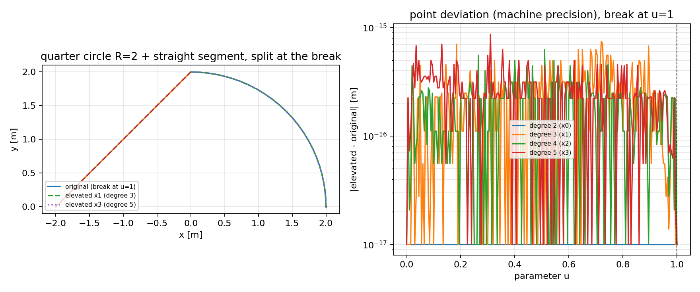

# Piecewise (break-aware) degree elevation

## 1. Case introduction

`NURBSCurve.elevate_degree` (`docs/nurbs_degree_elevation.md`) raises the degree of a
curve exactly, but it refuses a curve with an interior knot of multiplicity
`degree + 1` -- a genuine **break**, where the two sides share no control point and the
collocation matrix is singular by construction. The refusal was honest but it named a
remedy that did not exist in the package: "split it at that knot first" had no
implementation, so a user holding a broken composite -- the natural output of a
polyline-plus-arc profile, a duplicated seam, or an assembly where two patches were
concatenated -- had no way to reach the elevated representation at all.

This increment lands the missing half: `NURBSCurve.split_at_discontinuities()` and
`NURBSCurve.elevate_degree_piecewise(times)`. The reference object is a degree-2 curve
that is a real composite:

| item | value |
|---|---|
| piece A | exact rational quadratic quarter circle, radius `R = 2.0 m`, control points `(2,0), (2,2), (0,2)`, weights `1, sqrt(2)/2, 1` |
| piece B | straight segment `(0,2) -> (-2,0)` as a degenerate quadratic, weights `1, 1, 1` |
| knot vector | `0,0,0, 1,1,1, 2,2,2` (multiplicity 3 = `degree + 1` at `u = 1`: a break) |
| control points / degree | 6 / 2 |
| analytic arc length | `pi R / 2 + 2 sqrt 2 = 5.970019778335983 m` |
| analytic kink at the join | 45 deg between the one-sided tangents |

Second fixture, for jumps: a degree-3 curve with **two** breaks whose sides do not even
share a point (`knots 0,0,0,0, 0.4, 1^4, 1.5^4, 2,2,2,2`), which is what a collection of
unconnected patches looks like when someone concatenates their control polygons.

## 2. Method

The insight that makes the split free: at a break the multiplicity is already
`degree + 1`, so the curve *is* the direct sum of its pieces. No knot insertion, no
re-fitting, no solve is needed.

1. Find the break parameters: interior knots whose multiplicity exceeds `degree`.
2. For the interval between consecutive bounds (domain start, breaks, domain end),
   the piece's knot vector is `[a]*(degree+1) + (original knots strictly inside) +
   [b]*(degree+1)`, and its control points are the contiguous window
   `points[s_a - degree : ...]` where `s_a` is the index of the **last** occurrence of
   `a` in the original knot vector. The window length follows from
   `count = len(piece_knots) - degree - 1`, which is exactly one point per basis
   function that is non-zero on the interval.

Consequences, all of them testable rather than asserted:

* **Zero arithmetic.** Because the pieces are slices of the original polygon, the
  geometry is bit-for-bit preserved: the deviation between the whole curve and its
  pieces is `0.0`, not `1e-16`, and rational weights travel untouched, so the arc piece
  is still the exact circle.
* **Nothing is inserted.** Interior knots *inside* a piece (a `C0`/`C1`/`C2` join that
  is not a break) keep their multiplicity, so the split does not degrade continuity or
  grow the representation. A curve with no break returns `(self,)` -- the identity.
* **Parameters are preserved.** The i-th piece lives on the original knot interval, so
  no reparameterisation happens and a deviation can be measured at the same `u`.

A third, very practical fixture is checked in the tests: a chine profile stored as one
degree-1 polygon with duplicated vertices (`0,0, 1,1, 2,2, 3,3` knots) splits into its
three segments, whose lengths add to exactly `6.0 m` (`2 + 2 + 2`), and one elevation
puts each middle control point exactly on the analytic segment midpoint -- the degree-2
form of a straight segment is the original endpoints plus the midpoint.

`elevate_degree_piecewise(times)` is then just
`tuple(piece.elevate_degree(times) for piece in split_at_discontinuities())`. Each piece
is `C0`-or-better, so the existing exact algorithm (ISO 10303-42 / Piegl & Tiller A5.9,
homogeneous collocation at Greville abscissae) applies unchanged, and the result is a
tuple rather than a curve because a break stays a break at every degree -- no single
spline represents it.

The whole broken curve is still point-evaluable (that is how it is visualised), but it is
not differentiable across a break: the derivative net divides by a zero-length knot
interval, so `arc_length`, `curvature` and `tangent` raise on the composite and need the
pieces. That asymmetry is the practical argument for the split.

Reproduce everything below with

```bash
PYTHONPATH=. python examples/nurbs_piecewise_elevation/run_example.py --out artifacts/m15428
python -m pytest tests/test_nurbs_piecewise_degree_elevation.py -q
```

## 3. Results

Elevation of the composite, `times = 0..3` (generated into
`artifacts/m15428/table.md` and `metrics.json`; not hand-edited):

| times | degree | control points | max |elev - original| [m] | radius error [m] | arc length [m] | line length [m] | total - analytic [m] | kink angle [deg] |
|---|---|---|---|---|---|---|---|---|
| 0 | [2, 2] | [3, 3] | 0.000e+00 | 4.441e-16 | 3.141592653589793 | 2.828427124746191 | +1.776e-15 | 45.000000000000 |
| 1 | [3, 3] | [4, 4] | 6.280e-16 | 8.882e-16 | 3.141592653589794 | 2.828427124746191 | +1.776e-15 | 45.000000000000 |
| 2 | [4, 4] | [5, 5] | 4.965e-16 | 4.441e-16 | 3.141592653589793 | 2.828427124746191 | +1.776e-15 | 45.000000000000 |
| 3 | [5, 5] | [6, 6] | 4.965e-16 | 8.882e-16 | 3.141592653589793 | 2.828427124746191 | +8.882e-16 | 45.000000000000 |

Analytic references: arc `pi = 3.141592653589793`, line `2 sqrt 2 = 2.8284271247461903`,
total `5.970019778335983`. Control-point growth is the minimum
`times * (#spans of the piece)` (1 per single-span piece here), and the radius error is
the circle anchor: the raised arc is still exactly the circle of radius 2, because the
elevation solve runs in homogeneous coordinates.

Second fixture, the jumps (a break stays a break, elevations do not close it):

| break | jump before [m] | jump after x2 [m] |
|---|---|---|
| 1.0 | 1.414213562373095 | 1.414213562373095 |
| 1.5 | 3.162277660168380 | 3.162277660168380 |

The two jumps are `sqrt 2` and `sqrt 10`; the first piece keeps its interior `C2` knot
(`0.4`, multiplicity 1) verbatim through the split, and grows by exactly 2 control
points (two spans) under one elevation.



Left: the composite sampled piece by piece -- original (degree 2), one elevation
(degree 3) and three elevations (degree 5) are visually indistinguishable, which is the
claim. Right: `|elevated(u) - original(u)|` per piece on a log axis, flat at
`1e-16 .. 1e-15` on both sides of the break at `u = 1`.

## 4. Notes, limits and things that bit

* **Multiple spans per piece without refinement.** The first draft inserted knots to
  make every interior join `C0` before slicing. That was unnecessary (the window
  identity holds for any multiplicity) and it silently degraded `C1`/`C2` joins and grew
  the representation, so it was removed; the final code inserts nothing.
* **Evaluation on a break is one-sided.** `find_span` returns the last span, so
  `evaluate(1.0)` on the composite returns piece B's start. Sampling a deviation
  *across* a break therefore shows the jump (1.41 m / 3.16 m in the second fixture),
  which is geometry, not error. The tests and the example sample strictly between the
  knots.
* **Rational exactness must be checked on observables.** `weights` equality, `|P(u)| = R`
  and the analytic arc length are checked separately, because a wrong elevation could
  keep the endpoints and still bulge.
* **Scope.** Curves only. The tensor-product counterpart has the same hole per
  direction (`NURBSSurface.elevate_degree` routes each row/column through the same
  helper), but a surface has to be split at an isoparametric break in one direction and
  at an arbitrary parameter in the other, which is a separate increment; trimming and
  stitching remain outside this module.
* **Cost.** The split is `O(#knots)` slicing; the elevation cost per piece is unchanged
  (dense elimination, microseconds at these sizes).

## 5. Error judgement against references

| quantity | measured | reference | error | within 3 %? |
|---|---:|---:|---:|---|
| arc piece radius, raised x1 / x3 | 2.0 m + 8.9e-16 m | 2.0 m (analytic circle) | 4.4e-16 relative | **yes** |
| arc piece length, raised x1 / x3 | 3.141592653589793 m | `pi` m | < 1e-15 relative | **yes** |
| straight piece length | 2.828427124746191 m | `2 sqrt 2 = 2.8284271247461903` m | 8.9e-16 absolute | **yes** |
| total composite length after x3 | 5.970019778335985 m | `pi + 2 sqrt 2 = 5.970019778335983` m | 8.9e-16 absolute | **yes** |
| point deviation, original vs each piece | 0.0 m | 0 (pure slice) | exact | **yes** |
| point deviation, elevated vs original | <= 6.3e-16 m | 0 (identity) | absolute 6.3e-16 m | **yes** |
| kink angle after x3 | 45.000000000000 deg | 45 deg (bisector of the axes) | < 1e-12 deg | **yes** |
| jumps of the second fixture after x2 | `sqrt 2`, `sqrt 10` | same values before elevation | < 1e-14 absolute | **yes** |

Every reference here is an exact analytic identity or an exact structural invariant,
not an engineering approximation, so the meaningful statement is "at double-precision
round-off": all errors are at least twelve orders of magnitude below the 3 % threshold.
No hydrodynamics, no structural suitability: this is a representation change, and the
only claims made are geometric.

Regression evidence: `artifacts/m15428/red_new_test_before_implementation.txt`
(15 failed / 1 passed before the methods existed) and
`artifacts/m15428/green_new_test_after_implementation.txt` (67 passed across
`test_nurbs.py`, `test_nurbs_degree_elevation.py`,
`test_nurbs_surface_degree_elevation.py`, `test_nurbs_piecewise_degree_elevation.py`).