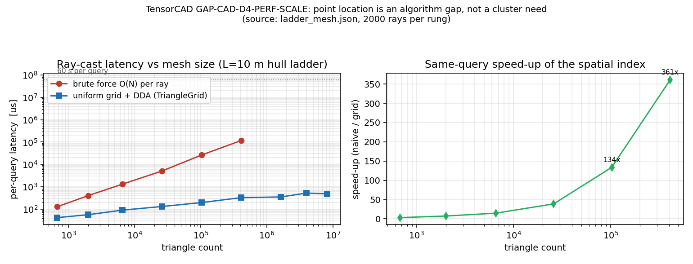

# TensorCAD 大几何性能基准（GAP-CAD-D4-PERF-SCALE）—— 回归门与口径手册

> **测量报告已迁移到 `docs/perf_scale_10m.md`**：10⁶–10⁷ 三角面实测、空间索引加速、
> 指数门、集群判据修订都在那里。本文件只保留一条窄职责——`tensorcad.perf_benchmark`
> 的**回归门口径**（基线在哪、阈值多少、`not_run` 与 pass 的区别），并记录 v0.2.0 版
> 文档的五处**勘误**（§5）。本文件所有数字由 `tensorcad.perf_evidence` 从受版本控制的
> JSON 渲染，`python scripts/perf_benchmark_doc.py --check` 在漂移时失败。
> v0.4.0 新增 §9：墙钟门的**噪声口径**（重复取样、两侧同估计量、`noise` 第三态、
> 工作量口径可比性），实测证据在 `docs/perf_gate_noise.md`。

**版本**: 0.4.0（取代 0.3.0）
**日期**: 2026-11-15
**锚点**: `GAP-CAD-D4-PERF-SCALE`
**模块**: `tensorcad/perf_benchmark.py`
**回归基线**: `benchmarks/perf_scale/baseline.json`
**后继文档**: `docs/perf_scale_10m.md`

---

## 1. 这个模块做什么

`tensorcad.perf_benchmark` 在本仓库里有**两个**不同用途，混用会得出错误结论：

| 用途 | 回答的问题 | 证据形态 |
|---|---|---|
| 回归门（CI） | 某个几何操作**变慢了吗**？ | `benchmarks/perf_scale/baseline.json` 秒数 + 2× 阈值 / 指数门 |
| 规模测量 | 某个规模**要多久、要不要集群**？ | `benchmarks/perf_scale/artifacts/ladder_mesh.json` 等工件 |

回归门本身也分两级，两者互补、不可互相替代：

1. **墙钟门（2×）**：`ratio = measured_seconds / baseline_seconds > factor → RED`。
   只看 quick 阶梯（≤2.6×10⁴ 三角面），成本秒级，适合每次提交跑。
2. **指数门（`scaling_*`）**：在**同一（子任务, 体数）分组内**拟合 `log(秒)` vs
   `log(规模)` 的斜率，超上限即 RED。是**尺度不变量**——把 O(N) 通道改成 O(N²)，
   小阶梯也会给出指数 ≈2 而 RED；反之 2× 墙钟门在小网格上完全看不见复杂度退化。
   规模点数不足时报 `status=not_run`，**不是 pass**。

被测子任务（同一阶梯上依次测）：

| 子任务 | 操作 | 复杂度 | 备注 |
|---|---|---|---|
| `load` | `hull.generate_hull` 参数化船体生成 | O(N) Python 循环 | 每档只生成一次（缓存上限见 §4） |
| `point_locate` | `_RayCaster` 逐三角遍历 | O(N·Q) | 暴力参考实现；超阈值标 `not_run` |
| `point_locate_accel` | `spatial_index.TriangleGrid`（均匀网格 + DDA） | 近 O(cells·Q) | 工程路径 |
| `voxelize` | `voxel.to_voxel_grid` SDF 采样 | O(G³) NumPy | 按分辨率成阶梯 |
| `volume` | `mesh.total_signed_volume` 散度定理 | O(N) | 与解析体积对表 |

## 2. 基线在哪，怎么跑

**基线必须写在 `benchmarks/` 下**，因为 `runs/` 不被版本控制、且合并门禁会把 `runs/`
从分支里滤掉：基线写在那儿，`main` 上永远拿不到它，回归门就是空转（v0.2.0 的实际情况，
见 §5 第 1 条）。

```bash
# 快速冒烟 + 回归门（约 15 s，CI 口径）
python -m tensorcad.perf_benchmark --quick \
    --baseline benchmarks/perf_scale/baseline.json

# 重建 quick 基线（3 轮取每键最慢，抑制共享机负载噪声）
python scripts/build_perf_baseline.py

# 全阶梯测量到 8.2e6 三角面（分钟级，经计算调度递交）
python -m tensorcad.perf_benchmark --full --output benchmarks/perf_scale/artifacts/ladder_mesh.json

# 10⁶–10⁷ 多体三点阶梯（指数门数据）
python scripts/perf_scale_10m.py --bases "641:161,1281:321,2001:501" --copies 2,3 \
    --output benchmarks/perf_scale/ladder_fleet_10m_3pt.json

# 校验本文档的表格与基线文件一致
python scripts/perf_benchmark_doc.py --check
```

退出码：全部门通过 → 0；任一门 RED → 1。**没有门被判过**（`gates_checked == 0`）时
CLI 打印 "This is NOT a pass."，`verdict` 为 `not_run`——不要把它读成绿色。

## 3. 回归基线（程序化渲染）

下表由 `benchmarks/perf_scale/baseline.json` 渲染；门键用
`tensorcad.perf_benchmark.measurement_key()` 生成，与运行时查表用的是**同一函数**；
RED 阈值列用模块的 `DEFAULT_GATE_FACTOR`，不是手写的 `2`。

<!-- perf-evidence:baseline-gate-table begin -->
| 门键 | 规模 | 基线秒 | RED 阈值 2× | 基线吞吐 |
|---|---:|---:|---:|---:|
| `load:21x9` | 三角面 678 | 0.0178 | 0.0355 | 38,153 tri/s |
| `load:41x13` | 三角面 1,998 | 0.0521 | 0.1041 | 38,372 tri/s |
| `load:81x21` | 三角面 6,558 | 0.1805 | 0.3611 | 36,325 tri/s |
| `load:161x41` | 三角面 25,918 | 0.7658 | 1.5316 | 33,844 tri/s |
| `point_locate:21x9` | 三角面 678 | 0.1279 | 0.2558 | 7,818 query/s |
| `point_locate:41x13` | 三角面 1,998 | 0.4009 | 0.8019 | 2,494 query/s |
| `point_locate:81x21` | 三角面 6,558 | 1.2764 | 2.5528 | 784 query/s |
| `point_locate:161x41` | 三角面 25,918 | 4.9927 | 9.9854 | 200 query/s |
| `point_locate_accel:21x9` | 三角面 678 | 0.0395 | 0.0789 | 25,344 query/s |
| `point_locate_accel:41x13` | 三角面 1,998 | 0.0530 | 0.1061 | 18,853 query/s |
| `point_locate_accel:81x21` | 三角面 6,558 | 0.0855 | 0.1710 | 11,696 query/s |
| `point_locate_accel:161x41` | 三角面 25,918 | 0.1265 | 0.2530 | 7,904 query/s |
| `volume:21x9` | 三角面 678 | 0.0003 | 0.0005 | 2,499,457 tri/s |
| `volume:41x13` | 三角面 1,998 | 0.0009 | 0.0018 | 2,277,079 tri/s |
| `volume:81x21` | 三角面 6,558 | 0.0030 | 0.0060 | 2,191,414 tri/s |
| `volume:161x41` | 三角面 25,918 | 0.0115 | 0.0230 | 2,250,006 tri/s |
| `voxelize:32x0` | 体素 32,768 | 0.1812 | 0.3623 | 180,878 cell/s |
| `voxelize:48x0` | 体素 110,592 | 0.5742 | 1.1484 | 192,604 cell/s |
| `voxelize:64x0` | 体素 262,144 | 1.6205 | 3.2410 | 161,770 cell/s |
| `voxelize:96x0` | 体素 884,736 | 5.2575 | 10.5150 | 168,281 cell/s |
| `obj_read:21x9` | 规模 678 | 0.0024 | 0.0048 | 285,309 |
| `obj_write:21x9` | 规模 678 | 0.0017 | 0.0034 | 403,305 |
| `obj_read:41x13` | 规模 1,998 | 0.0073 | 0.0147 | 272,509 |
| `obj_write:41x13` | 规模 1,998 | 0.0045 | 0.0091 | 439,826 |
| `obj_read:81x21` | 规模 6,558 | 0.0242 | 0.0484 | 271,262 |
| `obj_write:81x21` | 规模 6,558 | 0.0142 | 0.0284 | 461,290 |
| `obj_read:161x41` | 规模 25,918 | 0.0964 | 0.1928 | 268,874 |
| `obj_write:161x41` | 规模 25,918 | 0.0604 | 0.1207 | 429,415 |

基线记录 28 条；环境 `machine=loongarch64`、`cpu_count=128`、`python=3.11.6`；口径：min of 3 runs per (subtask, nx, nz) key - the same estimator the wall-clock gate applies to its own repeats (docs/perf_benchmark.md §9)
<!-- perf-evidence:baseline-gate-table end -->

**读法**：一份实测取值 `s`，与同键基线秒 `b` 比较，`s/b > factor` 即 RED。环境
（`machine`/`platform`）不一致时模块**拒绝比较**，给出 `regression_environment` 门且
`status=not_run`——跨机秒数不可比，宁可不判也不误判（`cpu_count`/`python` 差异只写进
detail，不影响判定）。

**注意**：基线文件里 `gates` 是空数组、`passed` 字段不代表任何一个门被判过——它只是
一份"基线秒"快照。判绿以运行时 `--baseline` 的输出（`verdict`/`gates_checked`）为准。

## 4. 代码事实（程序化渲染）

文档里出现的阈值/阶梯若靠手抄就会漂。下表直接读 `tensorcad.perf_benchmark` 的常量，
改代码不重渲染即测试失败。

<!-- perf-evidence:code-facts-table begin -->
| 常量（`tensorcad.perf_benchmark`） | 值 | 作用 |
|---|---|---|
| `CLUSTER_THRESHOLD` | 5,000,000 | 朴素路径的单次规模告警线（三角面）；不是实测集群边界 |
| `DEFAULT_GATE_FACTOR` | 2 | 墙钟回归门 RED 阈值（`--regression-factor` 的默认值） |
| `DEFAULT_MAX_NAIVE_TRIANGLES` | 300,000 | 超过即跳过 O(N·Q) 暴力参考，标 `not_run` |
| `MIN_SCALING_POINTS` | 3 | 规模点数不足则指数门 `not_run`（不是 pass） |
| `MESH_CACHE_SIZE` | 2 | 阶梯每档只生成一次网格的缓存上限 |
| `DEFAULT_LADDER` | 21×9 → 41×13 → 81×21 → 161×41 → 321×81 → 641×161 → 1281×321 → 2001×501 → 4001×513 | full 阶梯（顶端受 `HullParameters` 上限约束） |
| `QUICK_LADDER` | 21×9 → 41×13 → 81×21 → 161×41 | quick 阶梯，即 CI 基线覆盖的范围 |
| `VOXEL_LADDER` | 32³ → 48³ → 64³ → 96³ → 128³ → 192³ → 256³ → 384³ | 体素阶梯 |
| `SCALING_LIMITS` | `fleet_assemble`≤1.5; `load`≤1.5; `obj_read`≤1.5; `obj_write`≤1.5; `point_locate`≤1.5; `point_locate_accel`≤0.8; `volume`≤1.5; `voxelize`≤1.5 | 指数门上限（log(秒) vs log(规模) 最小二乘斜率） |
<!-- perf-evidence:code-facts-table end -->

## 5. v0.2.0 勘误（本版新增）

v0.2.0 的几处结论在后续实测中被推翻或被发现不可复现；保留原文会误导读者，故逐条改正。
每条都给出**可执行的证据**，不是编辑意见。

| # | v0.2.0 原说法 | 事实 | 本版怎么改 | 证据 |
|---|---|---|---|---|
| 1 | "使用保存的基线 `runs/perf_baseline.json` 进行回归检查，**13 个门全部通过**" | 该文件**不在仓库里**（`runs/` 未提交，且被合并门禁过滤），干净检出无法复现；`main` 上的回归门因此一直拿不到基线 | 基线迁到 `benchmarks/perf_scale/baseline.json`；§3 表格从该文件渲染；测试断言文档不再引用 `runs/` 下的基线 | `git ls-files runs` 为空；`test_perf_benchmark_doc_retracted_paths_only_in_erratum` |
| 2 | §5 集群建议："`point_locate` > 100k 三角 → 用集群" | **算法缺口，不是机器缺口**：同一查询集经均匀网格索引在 4.1×10⁵ 档快三个数量级，12.0×10⁶ 三角面 2000 条射线 1.25 s（单节点） | 集群判据改由 `docs/perf_scale_10m.md` §5/§9.4 的实测给出；本文件 §6 曲线即其证据 | `benchmarks/perf_scale/artifacts/ladder_mesh.json`、`ladder_fleet_10m.json` |
| 3 | 结果图指向 `artifacts/perf_benchmark/scaling.png`、`throughput.png` | 这两个文件**不在 git 里**（`artifacts/` 被合并门禁过滤，仓库只提交过 `artifacts/m3768/*`），任何干净检出上都是断链 | 换成本文件 §6 的 `docs/perf_benchmark/figures/point_locate_latency.png`，由 `scripts/gen_perf_benchmark_doc_figure.py` 从工件渲染 | `test_perf_benchmark_doc_figure_is_committed_png` |
| 4 | 阶梯把 `2001×501`（"~4.0M 三角"）列为"极限" | `HullParameters` 上限是 `nx ≤ 4001`、`nz ≤ 513`，单体最大 **8,199,998** 三角面；10⁷ 带只能靠多体装配到达 | 阶梯顶改为 `4001×513`；§4 表的 `DEFAULT_LADDER` 由代码渲染 | `docs/perf_scale_10m.md` §6 第 1 条 |
| 5 | 手写"模块 612 行 / 15 个测试"等计数 | 计数随每次提交漂移，手写必然过期，且无证据价值 | 不再写行数/测试数；凡阈值与阶梯一律由 §4 表从代码渲染 | `test_perf_benchmark_doc_tables_match_sources` |

## 6. 结果图



*左：每条射线的延迟（µs）vs 三角面数，log-log。暴力路径（红）斜率 ≈1，即 O(N)；
均匀网格路径（蓝）近水平——它随**网格规模**几乎不涨，代价转移到了建索引的
`build_seconds`。右：同一查询集上的加速比。数据来自
`benchmarks/perf_scale/artifacts/ladder_mesh.json`（每档 2000 条射线），由
`scripts/gen_perf_benchmark_doc_figure.py` 渲染，手改无效。*

这是本文件的唯一图：本任务没有需要云图展示的物理场量（纯性能测量），故不伪造场量云图。

## 7. 工件索引（每条路径都在干净检出中存在）

| 工件 | 路径 | 作用 |
|---|---|---|
| 基准模块 | `tensorcad/perf_benchmark.py` | 阶梯、子任务、墙钟门、指数门、CLI |
| 证据渲染 | `tensorcad/perf_evidence.py` | 工件 → markdown 表（本文档与 `docs/perf_scale_10m.md` 共用） |
| 回归基线 | `benchmarks/perf_scale/baseline.json` | quick 阶梯基线秒（3 轮取最慢） |
| 基线构建 | `scripts/build_perf_baseline.py` | 重建上一行 |
| 文档校验 | `scripts/perf_benchmark_doc.py` | `--check` / `--write` 本文档的两张表 |
| 图渲染 | `scripts/gen_perf_benchmark_doc_figure.py` | 生成 §6 的 png |
| 测量工件 | `benchmarks/perf_scale/artifacts/ladder_mesh.json` | 全阶梯网格子任务实测 |
| 测量工件 | `benchmarks/perf_scale/artifacts/ladder_voxel.json` | 全阶梯体素化实测 |
| 10⁶–10⁷ 工件 | `benchmarks/perf_scale/ladder_fleet_10m_3pt.json` | 多体三点阶梯（指数门数据） |
| 图 | `docs/perf_benchmark/figures/point_locate_latency.png` | §6 |
| 测试 | `tests/test_perf_benchmark.py` | 门语义、环境闸门、阶梯、文档绑定 |

## 8. 局限（诚实记录）

1. **墙钟基线只覆盖 quick 阶梯**（≤2.6×10⁴ 三角面）。10⁶ 带不设 2× 墙钟门：共享机上
   load1 波动 10–20%，噪声大于信号；10⁶–10⁷ 带的守护是**指数门 + 工件绑定**。
2. **`peak_rss_mb` 是进程高水位**（`ru_maxrss`），不能读作"这一档的峰值"——同进程里
   前面档位撑起来的峰值会留在后面。"这一档要多少 RAM"读 `mesh_mb` + `index_bytes`
   + `rss_mb`。
3. **指数门是无置信区间的多点最小二乘**。3 个规模点时只声明"没有观察到超限增长"，
   不声明精确指数值；`not_run` 表示"没判"，不是"通过"。
4. **测量数据来自共享节点**，绝对秒数不可跨作业逐档相减，只比同工件内部的比值与数量级。
5. **本文件不测量导入式网格**（STEP/IGES/STL 路径）；阶梯全部由参数化生成器产生，
   10⁷ 带是多体装配规模而非单网格。

## 9. 墙钟门的噪声口径（v0.4.0）

v0.3 §5 的结论是「闸门机制成立，但全绿只在安静机器上可复现」——共享机上连测三次，
每次都出现 RED，**且 RED 落在不同行**。v0.4 不动阈值（放宽 2× 会把真回归放过去），
改的是**测量与判据**。实测与逐键量化见 `docs/perf_gate_noise.md`（由
`scripts/perf_gate_noise_repro.py` 从 JSON 工件渲染），本节只写规则。

### 9.1 三个改动

| # | 改动 | 为什么 |
|---|---|---|
| 1 | 短测量重复取样：基线 < `NOISE_BUDGET_SECONDS`(0.5 s) 的键重复 `NOISE_REPEATS`(3) 次，单键累计受 `NOISE_REPEAT_SECONDS`(1.0 s) 约束 | 0.03–0.2 s 的档在共享机上的抖动大于信号；重复是唯一不放松阈值的办法 |
| 2 | **两侧同估计量**：基线也取 `min` of N（v0.1–v0.3 是 `max` of 3） | 只改测量侧会让估计量不对称：基线被负载抬高多少，门就瞎多少 |
| 3 | **拒绝不可比**：`point_locate*` 记录 `n_queries`，查询数不同判 `not_run` 并给原因 | 旧基线是 500 条射线，文档的 CI 命令跑 1000 条，键上凭空多出 ~2× |

改动 2 和 3 是**缺陷修复而非调参**：逐键量化显示旧基线（`max` of 3，500 射线）
把「2× = RED」的实际阈值抬高到 **2.3×–4.2×**（28 键中 21 键），并且对
`point_locate*` 8 键另有约 2× 的口径偏差——同代码同查询数实测比值 1.89–2.13×。

### 9.2 判定语义

* `measured` + 通过 / 不通过：best-of-N 与基线同口径比较，比值 > `DEFAULT_GATE_FACTOR` 判 RED。
  **重复之后仍超限 = RED**（不是噪声）。
* `noise`：仅当同一份代码、同一次运行的重复观测**跨越阈值**且离散度 ≥
  `NOISE_SPREAD_LIMIT`(1.5×) 时成立——数据不足以判定。`noise` **不是 pass**
  （`PerfBenchmarkResult.verdict == "inconclusive"`），也**不是 RED**（不进 RED 清单）。
* `not_run`：工作量不可比、无基线、规模点不足。**不是 pass**。

CLI 退出码三态：`0` = 全部门判定为绿且无 abstain；`1` = 有 RED；`2` = 只有
`noise`/参数错误——「本机判不出来，别读成绿色」。

### 9.3 复现

```bash
# 闸门（默认 --repeats auto：只重复短测量）
python -m tensorcad.perf_benchmark --quick --baseline benchmarks/perf_scale/baseline.json

# 重建基线（估计量必须与门一致；--policy 默认 min）
python scripts/build_perf_baseline.py --runs 3 --policy min \
    --subtasks load,point_locate,point_locate_accel,voxelize,volume,obj_write,obj_read

# 噪声口径的实测证据（约 2 min，两次协议 × N 次运行）
python scripts/perf_gate_noise_repro.py --runs 2        # 渲染 docs/perf_gate_noise.md
python scripts/perf_gate_noise_repro.py --check         # 漂移校验
```

### 9.4 仍然成立的局限

* 重复只针对**短测量**：10 s 档不重复，它的 2× 判定靠单发，仍受负载影响。
* `noise` 只解决「同代码重复跨越阈值」这一种不可判定；机器整体慢 2×（换节点、
  CPU 降频）不会显示为 `noise`，而是显示为 RED——跨架构拒比（`not_run`）拦的是另一类。
* §8 第 1 条的欠账不变：10⁶ 带没有自动 RED 判定。
