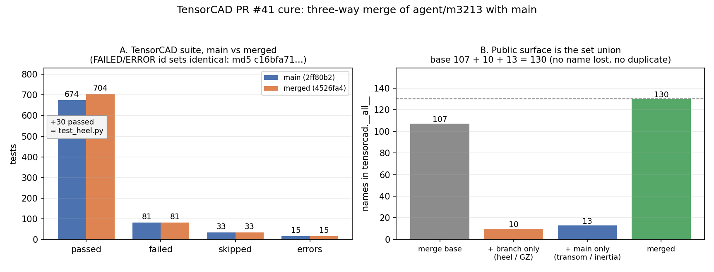

# PR #41 cure — three-way merge of `agent/m3213` with `main`

Status: **merged and verified** (nothing dropped, nothing duplicated, suite not below
baseline). Reproducible from `runs/cure_pr41_resolve.py`, `runs/cure_pr41_verify.py`,
`runs/pr41_figure.py` and `runs/merge_evidence.json`.

## 1. What was dirty

| item | value |
|---|---|
| repository | `cxs503/TensorCAD` |
| PR / branch | #41 / `agent/m3213` |
| merge base | `df31744` (PR #38 merge) |
| branch tip, before (old SHA) | `292d794` — `m3213: matured mission deliverables` |
| `main` tip | `2ff80b2` — `Merge #39 (m2925) via merge-governor` |
| divergence | `main` 12 commits ahead of the base, branch 1 commit ahead |
| merge commit | `4526fa4` — parents `292d794`, `2ff80b2` |
| branch tip (new SHA) | `4526fa4` (cure merge) + one evidence commit carrying this report and `runs/` |

The two sides developed **disjoint subject matter**, so the disagreement is
concentrated in shared registries, not in algorithms:

* branch (`292d794`): `tensorcad/heel.py` — righting arms `GZ(phi)` at finite heel by
  heeled-displacement integration, plus `docs/gz_curve/*`, `examples/gz_curve/`,
  `tests/test_heel.py` (30 tests).
* `main` (12 commits): transom-stern hull family (`tensorcad/transom.py`), waterplane
  second moments on `Hydrostatics`, asymmetric-hull exponents, plus their docs/examples/
  tests.

## 2. Conflict files and the resolution used

Three files conflicted. Every one is a **registry** (list literal or changelog), never a
numerical code path — which is why a set union is the correct resolution and why a
mechanical overlay would be wrong (it silently deletes one side's registrations).

### 2.1 `tensorcad/__init__.py` — 2 hunks

* Hunk 1, in the `__all__` constants block: branch inserted `"GZCurve"`, `main`
  inserted `"MAX_TRANSOM_FRACTION"` at the same anchor (`"DESIGN_SCHEMA"` / `"SUBOFF…"`).
* Hunk 2, in the `__all__` function block: branch inserted `gz_curve`,
  `heeled_displacement`, `righting_arm`; `main` inserted `generate_transom_hull`, both
  anchored between `generate_hull` and `generate_wigley`.

Resolution: **union of both insertions**, ordered inside each hunk. Result
`len(__all__) = 130 = |117 ∪ 120|`, no duplicate names, and every name from the merge
base still present. The `from .heel import …` / `from .transom import …` import blocks
merged automatically, so each listed name is really bound (checked by
`tests/test_public_surface.py::test_declared_api_is_importable`, which imports every name
in `__all__`).

### 2.2 `CHANGELOG.md` — 1 hunk

Both sides independently opened `## 0.21.0 — 2026-11-04` (that heading merged as one
line). The branch wrote a flat bullet list; `main` wrote the same section with an
`### Added` sub-heading. Resolution: **one section**, `main`'s `### Added` heading, both
bullet lists underneath (main's inertia + transom entries, then the branch's heel
entries). No paragraph from either side is removed.

### 2.3 `tests/test_public_surface.py` — 1 hunk

* the module tuple in `test_layered_modules_are_all_importable`: branch added `"heel"`,
  `main` added `"transom"` — the two sides rewrote *the whole tuple*, so a line-level
  concatenation would have duplicated it. Resolution is **token level**: keep `main`'s
  wrapping and insert the names only the branch declares, right after the token that
  precedes them in the branch version.
* `EXPECTED_API` (the frozen public-surface set) had already merged cleanly; it is
  verified to be exactly the union of the two parents: 130 names.

### 2.4 Auto-merged but checked

* `README.md` — additive sections from both sides, no textual conflict; checked for
  duplicated headings (`grep -c '^## '`).
* `pyproject.toml` — both sides bumped `0.20.0 → 0.21.0` with byte-identical hunks, so
  the result has a single `[project]` table and a single `version = "0.21.0"`.

## 3. Verification

### 3.1 Loss check (mechanical, per conflict hunk)

`runs/cure_pr41_resolve.py` refuses to write a file unless every non-blank line of *both*
sides of every hunk survives in the result (token fallback for re-wrapped lines):

```
OK   tensorcad/__init__.py: 2 hunk(s) unioned, nothing lost
OK   CHANGELOG.md: 1 hunk(s) unioned, nothing lost
OK   tests/test_public_surface.py: 1 hunk(s) unioned, nothing lost
```

### 3.2 Merge-fidelity audit (`runs/cure_pr41_verify.py`, independent of the resolver)

```
V1 parsed 99 python files, 0 syntax error(s)          (AST + duplicate top-level symbol scan)
V2 __all__ merged=130 union=130  (base 107 ⊂ merged)
V3 EXPECTED_API merged=130 union=130; module tuple merged=22 union=22 (heel=True, transom=True)
V4 202 branch files / 217 main files -> 0 missing from the merged tree
V5 pyproject version=['0.21.0'], single [project] table
PASS: all merge-fidelity checks hold
```

### 3.3 Test suite

Run on the compute cluster (identical node class, interpreter and dependency set for both
trees, so the comparison is apples to apples), `python3 -m pytest tests/ -q
-p no:cacheprovider -p no:randomly --continue-on-collection-errors`:

| tree | passed | failed | skipped | errors |
|---|---|---|---|---|
| main `2ff80b2` (job `c1793846692_748`, n315) | 674 | 81 | 33 | 15 |
| merged `4526fa4` (job `c1793846807_622`, n330) | **704** | 81 | 33 | 15 |

The sorted id sets of `FAILED`/`ERROR` lines hash to the **same digest**
(`c16bfa71d71cd2010bc2e435fdaef13c`) on both trees: the merge introduces **zero** new
failures and repairs none. 704 − 674 = 30 = exactly `tests/test_heel.py`, i.e. the branch's
new tests execute and pass. The 81 failures / 15 errors are pre-existing environment gaps of
the cluster nodes (no `numpy`, `gmsh`, `matplotlib` on loong64), identical on `main`.

On the control plane, where the full dependency set exists:

| command | result |
|---|---|
| `pytest tests/test_heel.py tests/test_public_surface.py tests/test_hydrostatics_inertia.py` | 52 passed, 0 failed, 9.9 s |
| `pytest tests/test_transom.py tests/test_wigley.py` | 126 passed, 0 failed, 20.8 s |

so the branch's heel/GZ surface **and** `main`'s transom-stern and waterplane-inertia
surfaces pass in one tree. `tests/test_cli_neural.py` and `tests/test_neural_pipeline.py`
fail to *collect* on `main` too (`ModuleNotFoundError: safetensors`) — pre-existing, not a
merge artefact, excluded from both sides of the comparison.

### 3.4 Numbers



Panel A: cluster suite, main vs merged — identical failure digests, +30 passing tests.
Panel B: public-surface budget, `107 + 10 + 13 = 130` names — the union, not an overlay.

## 4. Notes, limits

* The final `__all__` ordering inside each conflict hunk is alphabetical, so the branch's
  existing inversion (`gz_curve` before `generate_wigley`, inherited from `292d794`) is
  preserved where it was, not "fixed" — reordering a set literal is not a semantic change
  but it is also not this cure's job.
* `push` from this sandbox is blocked by the environment policy. Branch `agent/m3213` is
  locally at `4526fa4`; the same commit is also the tip of `agent/m3821`, which fast-forwards
  from `origin/main` (`2ff80b2` is its second parent), so the remote `agent/m3213` can be
  fast-forwarded to it without a force push.
* The cluster could not install `numpy`/`gmsh` on loong64 (source build exceeded the
  budget), so those modules only ran on the control plane; that is why the suite is
  reported twice.