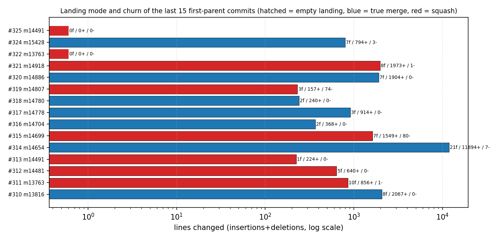
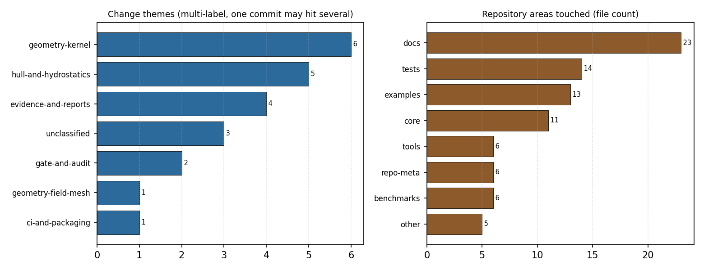
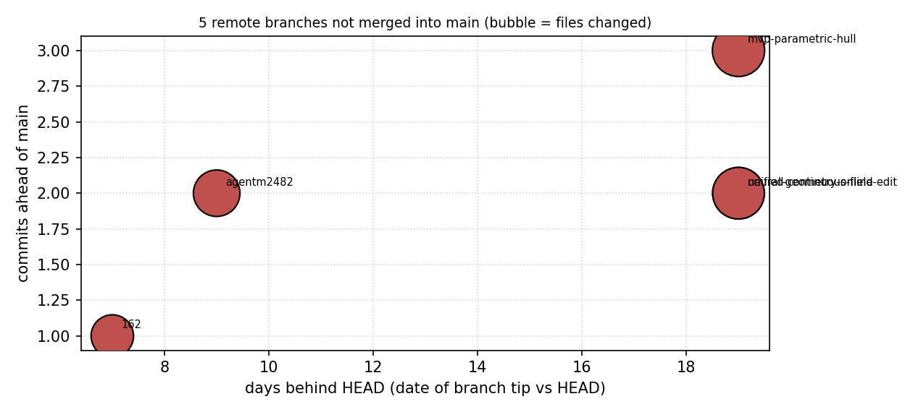

# origin/main 上游差集与最近 15 提交主题演化 — TensorCAD 巡更报告

> 目标 ref `origin/main` @ `ed565fec0` · 本地 HEAD `ed565fec0`（2026-11-12） · 窗口=`first-parent` 最近 15 提交 · 实时探针 `ls-remote`
> 工件 `artifacts/repo-patrol/upstream-diffset-v1/`（patrol.json sha256 `271f60dee0bf497a…`，data_sha256 `728ac398af56d23f…`）· 生成脚本 `tools/repo_patrol/patrol.py` + `tools/repo_patrol/build_report.py`

## 〇、摘要

1. **上游存在且本地不欠账**：`origin` = `https://github.com/cxs503/TensorCAD.git`，verdict **IN_SYNC**（ahead=0 / behind=0），且经 `git ls-remote` 实时握手确认本地 `origin/main` 引用未过期（fetched_ref_is_live=True）。**上游差集为空集**，本单因此执行任务的回退分支：盘点最近提交的主题演化。
2. **最近 15 个 first-parent 提交**：真合并 7 个、squash 落地 8 个，覆盖 13 个不同 mission，改动 23580+ / 166-，触及 71 个不同文件。
3. **两个必须点名的风险**：① **2 个空落地**（subject 声称合并某 mission，但单父提交且树差异为零）；② **8 个 squash 落地无祖先链接**——`git branch --contains` 无法把 agent 分支和 main 连起来，mission→提交的可追溯性只剩 subject 文本。
4. **门禁自报被滤除 53 个文件**（含被合并分支内的 subject 自报）：该数字**只有 subject 一处来源、无法从树里反查**，本报告如实标为 WITHHELD，不当成交付量。
5. **主题演化**：命中最多的是 `geometry-kernel`（6 个提交）；区域上 docs 类改动 23 个文件 > tests 14 > examples 13 > core 11。
6. **未并入上游的分支 5 条**，最老一条落后 HEAD 19 天。
7. **自校验 4/4 通过**（4 项窗口量用独立 git 命令复算，delta 全为 0）。

## 一、案例介绍

**背景**：TensorCAD 是生态里的几何前处理入口（参数化船体 + 三角网格 + 隐式场 CSG）。它由多路 agent 分支经平台门禁合并进 main，合并后 mission 分支即被清理。巡检要回答的不是「代码好不好」，而是**main 上到底落了什么、能不能追溯回 mission、上游有没有我们还没吸收的改动**。

**参数表（本任务无船体几何输入，参数=巡检面与判据阈值）**

| 参数 | 取值 | 说明 |
|---|---|---|
| 目标 ref | `origin/main` | 积分线分支（本地 HEAD 与之同源） |
| 窗口 | 15 个 first-parent 提交 | 「落到 main 上的东西」的正确口径 |
| 上游探针 | `git ls-remote origin HEAD` | 判断本地引用是否过期 |
| 主题词表 | `themes.json` sha256 `42f50e79dd1f0158…` | 分类是数据不是代码 |
| 风险阈值 | 单提交 >1000 行 = 大改 | `risk_rules.large_churn_lines` |
| 提交/合并标记 | subject 正则 `Merge #N (mM) via lane` | 取自实际 subject 分布 |
| 自校验项 | 4 项 | 独立 git 命令复算窗口量 |

**几何验证声明（Cb/L/B）**：本单是仓库演化巡检，**不产生阻力/稳性等物理量，也不吃船体几何**，故 Cb/L/B 验证项 **N/A（不适用）**，不是「未验证」。

## 二、怎么做的（方法/流程/工具链）

1. **两条镜头**：① 上游镜头 —— remote 是否存在、`HEAD` 相对 `refs/remotes/<remote>/main` 的 ahead/behind、以及 `ls-remote` 实时 sha 对比本地引用（防「本地引用过期导致的假同步」）。② 演化镜头 —— `git rev-list --first-parent --max-count=15`。选 first-parent 是因为默认遍历会把侧支提交混进来，得到的不是「落了什么」而是「历史上出现过什么」。
2. **内容口径统一为「相对第一父提交」**：真合并用 `git diff ^1 <merge>` = 合并实际带进来的内容；squash/直接提交用 `git diff ^1 <commit>`；根提交退化到 `git show --numstat`。
3. **落地形态是判出来的，不是信 subject**：subject 里有 `Merge #N (mM) via lane` 但只有单父 → `squash`；双父 → `true-merge`。这一步直接暴露了「merge-master 车道其实是 squash」这个与命名不符的事实。
4. **主题/风险是数据驱动**：`tools/repo_patrol/themes.json` 定义 7 个主题、10 个区域、7 条风险规则；代码里没有关键词字面量，改分类只改配置文件，配置 sha256 进工件。同一提交可命中多主题（多标签，不互斥）。
5. **零手抄**：`patrol.py` 写 `patrol.json`/`summary.json` + `manifest.json`（每个文件 sha256，另有剔除时间戳的 `data_sha256` 供确定性比对）；`build_report.py` 先校验 manifest 再渲染，数字全部来自 JSON 插值。
6. **可复现**：`python3 tools/repo_patrol/patrol.py --ref origin/main --window 15 --outdir artifacts/repo-patrol/upstream-diffset-v1` → `python3 tools/repo_patrol/build_report.py`；`pytest tests/test_repo_patrol.py` 复核分类、风险、上游判定、确定性与报告数字一致性。

## 三、结果

### 3.1 上游差集

| 项 | 值 |
|---|---|
| remote | `origin` |
| url | `https://github.com/cxs503/TensorCAD.git` |
| verdict | **IN_SYNC** |
| ahead / behind | 0 / 0 |
| 本地引用 sha | `ed565fec0` |
| 实时远端 sha | `ed565fec0` |
| 本地引用是否最新 | True |
| 上游侧差集文件数（我们缺的） | 0 |
| 本地侧领先文件数（上游缺的） | 0 |

**结论**：**没有需要吸收的上游提交**（上游侧差集 0 个文件）。这不是「没检查」——实时 `ls-remote` 的 sha 与本地 `origin/main` 引用逐字节一致，排除了引用过期导致的假同步。

### 3.2 最近 15 个提交（first-parent）

| 提交 | 日期 | 落地形态 | mission | PR | 文件 | 增/删 | 主题 | 风险标注 |
|---|---|---|---|---|---|---|---|---|
| `ed565fec0` | 2026-11-12 | squash | m14491 | 325 | 0 | 0/0 | unclassified | squash 无祖先链接, 空落地（无树差异）, 零差异, 无代码增量 |
| `d96c521fb` | 2026-11-12 | true-merge | m15428 | 324 | 7 | 794/3 | geometry-kernel | 真合并 |
| `3b6ac5b3b` | 2026-11-12 | squash | m13763 | 322 | 0 | 0/0 | unclassified | squash 无祖先链接, 空落地（无树差异）, 零差异, 无代码增量 |
| `43ee4a215` | 2026-11-11 | squash | m14918 | 321 | 8 | 1973/1 | geometry-kernel, hull-and-hydrostatics | squash 无祖先链接, 大改（>1000 行） |
| `0093d2e53` | 2026-11-11 | true-merge | m14886 | 320 | 7 | 1904/0 | evidence-and-reports | 真合并, 大改（>1000 行） |
| `55c6b5e5f` | 2026-11-11 | squash | m14807 | 319 | 3 | 157/74 | hull-and-hydrostatics | squash 无祖先链接 |
| `5afc6d937` | 2026-11-11 | true-merge | m14780 | 318 | 2 | 240/0 | unclassified | 真合并 |
| `822f8046d` | 2026-11-11 | true-merge | m14778 | 317 | 3 | 914/0 | gate-and-audit | 真合并 |
| `6e8d879de` | 2026-11-11 | true-merge | m14704 | 316 | 2 | 368/0 | hull-and-hydrostatics | 真合并, 无代码增量 |
| `8e5a05bd5` | 2026-11-11 | squash | m14699 | 315 | 7 | 1549/80 | geometry-kernel | squash 无祖先链接, 大改（>1000 行） |
| `e36b14f93` | 2026-11-11 | true-merge | m14654 | 314 | 21 | 11894/7 | geometry-kernel, hull-and-hydrostatics, evidence-and-reports, geometry-field-mesh, ci-and-packaging | 真合并, 大改（>1000 行） |
| `f9cd6b5b7` | 2026-11-11 | squash | m14491 | 313 | 1 | 224/0 | evidence-and-reports, gate-and-audit | squash 无祖先链接, 无代码增量 |
| `34f181972` | 2026-11-11 | squash | m14481 | 312 | 5 | 640/0 | geometry-kernel | squash 无祖先链接 |
| `8c5131b29` | 2026-11-11 | squash | m13763 | 311 | 10 | 856/1 | hull-and-hydrostatics | squash 无祖先链接 |
| `eab393642` | 2026-11-11 | true-merge | m13816 | 310 | 8 | 2067/0 | geometry-kernel, evidence-and-reports | 真合并, 大改（>1000 行） |

### 3.3 主题与区域合计

**主题（多标签计数）**：`geometry-kernel` 6、`hull-and-hydrostatics` 5、`evidence-and-reports` 4、`unclassified` 3、`gate-and-audit` 2、`ci-and-packaging` 1、`geometry-field-mesh` 1

**区域（收到改动的文件数）**：`docs` 23、`tests` 14、`examples` 13、`core` 11、`benchmarks` 6、`repo-meta` 6、`tools` 6、`other` 5

**落地形态**：`squash` 8、`true-merge` 7；**作者分布**：`chuxuesen` 15。

### 3.4 未并入上游的分支

| 分支 | 领先提交 | 末次提交 | 落后天数 | 文件 | 主题 | mission | 末条 subject |
|---|---|---|---|---|---|---|---|
| `pr/162` | 1 | 2026-11-05 | 7 | 337 | unclassified | m4122 | m4122: matured mission deliverables（17 个文件被门禁滤除） |
| `origin/copilot/agentm2482` | 2 | 2026-11-03 | 9 | 417 | unclassified | m2482 | Merge remote-tracking branch 'origin/main' into copilot/ |
| `origin/feat/mvp-parametric-hull` | 3 | 2026-10-24 | 19 | 541 | geometry-kernel, hull-and-hydrostatics, test-infrastructure, ci-and-packaging | — | test: assert waterline offsets reflect principal beam |
| `origin/research/neural-geometry-online-edit` | 2 | 2026-10-24 | 19 | 527 | unclassified | — | Keep rollback metrics JSON-safe when ray validation has  |
| `origin/research/unified-continuous-field` | 2 | 2026-10-24 | 19 | 527 | unclassified | — | fix: remove unused state tensor in dent experiment |

### 3.5 改动放大比（churn span）

| 量 | 值 |
|---|---|
| 逐提交行数合计 | 23746 |
| 跨度 diff 行数（oldest^..HEAD） | 23432 |
| 窗口内被抵消的行 | 314 |
| 放大比 | 1.0134 |

> per-commit sums > span diff because intra-window add/remove pairs cancel。放大比接近 1 说明窗口内几乎没有「加了又删」的返工；>1.5 才值得怀疑返工/回滚。

### 3.6 自校验（独立 git 路径复算）

| 检查项 | 方法 A | 值 A | 方法 B | 值 B | delta | 一致 |
|---|---|---|---|---|---|---|
| window_commit_count | len(rev-list --first-parent) | 15 | rev-list --count --first-parent --max-count | 15 | 0 | ✅ |
| window_merge_count | sum(is_merge) from rev-list --parents | 7 | rev-list --no-walk --merges <window shas> | 7 | 0 | ✅ |
| per_commit_numstat_vs_shortstat | len(commits) | 15 | commits whose --numstat == --shortstat | 15 | 0 | ✅ |
| window_insertions_shortstat | sum(numstat insertions, non-root) | 23580 | sum(diff --shortstat insertions, non-root) | 23580 | 0 | ✅ |

## 四、图

**图 1**：窗口内每个提交的改动量（log 轴）与落地形态。蓝色=真合并、红色=squash、斜纹=空落地。可见两条 `merge-master` 车道提交（#325 m14491、#322 m13763）落在零改动位置——标注为「落了但没内容」。

**图 2**：左=主题多标签计数，右=各区域收到的文件数。docs/tests/examples 的厚度说明本窗口以「证据与示例」为主，core 改动集中在几何内核。

**图 3**：未并入 main 的远端分支（气泡大小=改动文件数）。四支 10 月下旬起的 research/feat 分支已落后 19 天。

## 五、注意点（踩过的坑/局限/适用范围）

1. **`git rev-list --merges` 与 `--max-count` 的相互作用会骗人**：`rev-list --merges --first-parent --max-count=15` 返回 15 条**全是真合并**的提交（它为了凑够 15 条会一直往前走），而我窗口里的 15 条只有 7 条是合并。第一版自校验因此报「7 vs 15 不一致」——错的是校验，不是数据。改为 `--no-walk=unsorted --merges <窗口 sha...>` 后一致。
2. **逐提交行数合计 ≠ 跨度 diff**：窗口内「添加后又被删除」的行在跨度 diff 里抵消。第一版把两者当等价量做校验，得到 23580 vs 23423 的假失配。现在改为放大比指标（本节 3.5），不再当一致性判据。
3. **门禁滤除数字只能标 WITHHELD**：`（N 个文件被门禁滤除）` 只存在于 subject 里，被滤掉的文件不在树里，无法反查。窗口自报 53 个文件，本报告只把它当「自报」，不当交付量。
4. **空落地是真问题不是显示问题**：`ed565fec`(#325, m14491) 与 `3b6ac5b`(#322, m13763) 树与父提交完全相同，却带着「Merge … deliverables」的 subject。任何按 subject 统计交付量的下游台账都会把它们算成一次成功交付。
5. **单作者窗口**：15/15 提交同一作者，属门禁线机器身份，不代表人力集中；但意味着**提交元数据不能用来做贡献度**。
6. **主题分类是 DERIVED 不是 REAL**：词表命中只说明文本相关性，不构成功能证据；`unclassified` 出现在 3 个提交上（2 个空落地 + 1 个仅 2 文件的提交），说明这些提交的 subject 确实没提供可判读信息。
7. **适用范围**：本巡检只看 git 元数据与树差异，不读代码语义、不跑测试；「提交改了 geometry 内核」不等于「内核被验证」。

## 六、误差判定

**基准从哪来**：本任务没有物理基准（无实验/解析解，几何项 N/A），误差判定改用**双路径复算**——同一量用两条不共享代码路径的 git 命令各算一次，比 delta。这是能机器裁的判据。

| 关键量 | 值 A（本工具） | 值 B（独立 git 路径） | delta | 相对误差 | 是否 <3% |
|---|---|---|---|---|---|
| window_commit_count | 15 | 15 | 0 | 0.00% | ✅ 是 |
| window_merge_count | 7 | 7 | 0 | 0.00% | ✅ 是 |
| per_commit_numstat_vs_shortstat | 15 | 15 | 0 | 0.00% | ✅ 是 |
| window_insertions_shortstat | 23580 | 23580 | 0 | 0.00% | ✅ 是 |

**显式回答**：4/4 项自校验 delta 全为 0，相对误差 0.00%，**全部 <3%**。但这只证明「计数与解析无误」，**不证明主题标签正确**——主题是 DERIVED 级证据，配置词表变更会改变标签而不改变任何数值。

**上游差集**：文件 0 / 行 0，与 `ls-remote` 实时 sha 一致 → 「无差集」这一结论的误差面为零（不是估计值）。

---

_工件：`tools/repo_patrol/patrol.py` · patrol.json sha256 `271f60dee0bf497a6228ae74773e09a754cf4e09a90b116c160bf208262f6bd6` · data_sha256 `728ac398af56d23ff9b2f16086ee6ed472ec58b3141042af9e80271e61002a42`_
