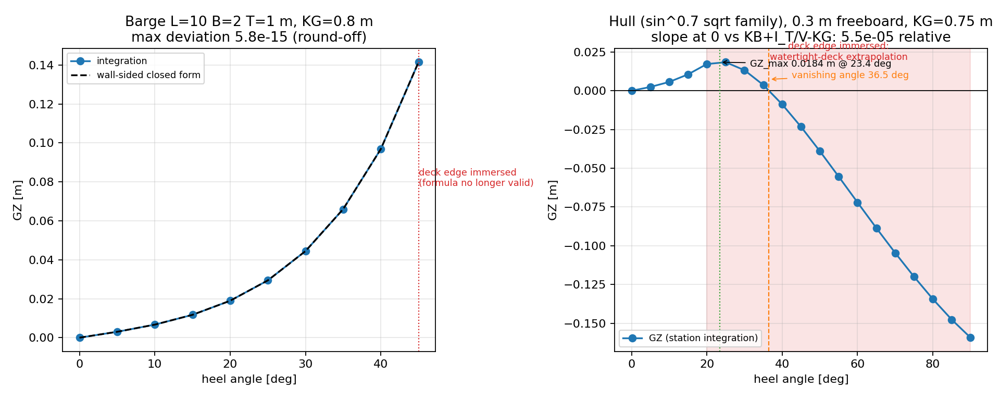

# Righting-arm curves: evidence

Generated by `examples/righting/run_example.py`; every number in this file was
written by the program, none was typed.

## 1. Case

| body | L [m] | B [m] | T [m] | freeboard [m] | KG [m] |
|---|--:|--:|--:|--:|--:|
| barge | 10.0 | 2.0 | 1.0 | 1.0 | 0.8 |
| hull (`sin^0.7 sqrt` family) | 10.0 | 2.0 | 1.0 | 0.300 | 0.75 |

## 2. Barge against the wall-sided closed form

| heel [deg] | GZ integration [m] | GZ closed form [m] | relative | volume [m^3] |
|--:|--:|--:|--:|--:|
| 0.0 | 0.000000000 | 0.000000000 | 0.00e+00 | 20.000000 |
| 5.0 | 0.003016377 | 0.003016377 | 7.19e-16 | 20.000000 |
| 10.0 | 0.006688094 | 0.006688094 | 2.59e-16 | 20.000000 |
| 15.0 | 0.011724363 | 0.011724363 | 5.77e-15 | 20.000000 |
| 20.0 | 0.018952153 | 0.018952153 | 1.46e-15 | 20.000000 |
| 25.0 | 0.029403161 | 0.029403161 | 1.18e-15 | 20.000000 |
| 30.0 | 0.044444444 | 0.044444444 | 7.81e-16 | 20.000000 |
| 35.0 | 0.065989070 | 0.065989070 | 4.21e-16 | 20.000000 |
| 40.0 | 0.096856115 | 0.096856115 | 8.60e-16 | 20.000000 |
| 45.0 | 0.141421356 | 0.141421356 | 1.96e-16 | 20.000000 |

GM = 0.033333 m; slope from the curve = 0.033333331 m (relative error 5.82e-08).

## 3. Hull curve

| heel [deg] | GZ [m] | y_B [m] | z_B [m] | deck immersion |
|--:|--:|--:|--:|--:|
| 0.0 | 0.000000 | 0.000000 | -0.575691 | 0.00 |
| 5.0 | 0.002453 | 0.030839 | -0.574342 | 0.00 |
| 10.0 | 0.005691 | 0.062239 | -0.570198 | 0.00 |
| 15.0 | 0.010576 | 0.094807 | -0.562962 | 0.00 |
| 20.0 | 0.017250 | 0.128411 | -0.552370 | 0.36 |
| 25.0 | 0.018418 | 0.156015 | -0.540993 | 0.58 |
| 30.0 | 0.013253 | 0.177019 | -0.530101 | 0.68 |
| 35.0 | 0.003711 | 0.193382 | -0.519707 | 0.75 |
| 40.0 | -0.008788 | 0.206446 | -0.509705 | 0.80 |
| 45.0 | -0.023257 | 0.217084 | -0.499974 | 0.85 |
| 50.0 | -0.038978 | 0.225864 | -0.490405 | 0.88 |
| 55.0 | -0.055383 | 0.233178 | -0.480883 | 0.90 |
| 60.0 | -0.072046 | 0.239267 | -0.471333 | 0.93 |
| 65.0 | -0.088580 | 0.244305 | -0.461658 | 0.95 |
| 70.0 | -0.104615 | 0.248413 | -0.451744 | 0.95 |
| 75.0 | -0.119964 | 0.251608 | -0.441614 | 0.98 |
| 80.0 | -0.134410 | 0.253904 | -0.431254 | 0.98 |
| 85.0 | -0.147634 | 0.255313 | -0.420535 | 1.00 |
| 90.0 | -0.159299 | 0.255799 | -0.409299 | 1.00 |

## 4. Convergence with the station grid

| intervals | volume [m^3] | GZ_max [m] | vanishing angle [deg] |
|--:|--:|--:|--:|
| 40 | 5.431943267 | 0.018414 | 36.474 |
| 80 | 5.424815667 | 0.018418 | 36.485 |
| 160 | 5.424815667 | 0.018418 | 36.485 |

## 5. Claims

| claim | measured | limit | unit | passed |
|---|--:|--:|---|:--:|
| barge GZ matches the wall-sided closed form (0-45 deg) | 5.770e-15 | 1e-09 | relative | yes |
| barge dGZ/dphi at 0 recovers KB + BM - KG | 5.820e-08 | 1e-06 | relative | yes |
| barge deck-edge immersion occurs at the classic angle | 0.000e+00 | 1e-09 | deg | yes |
| station-area volume equals the closed-surface volume | 0.000e+00 | 1e-09 | relative | yes |
| hull dGZ/dphi at 0 recovers KB + I_T/V - KG | 5.546e-05 | 2e-03 | relative | yes |
| hull curve is grid-converged (40 vs 80 intervals) | 2.159e-04 | 5e-03 | relative | yes |
| hull curve vanishing angle is grid-converged (40 vs 80 intervals) | 2.852e-04 | 1e-02 | relative | yes |
| zero-freeboard hull is rejected rather than answered | 0.000e+00 | 0e+00 | bool | yes |

