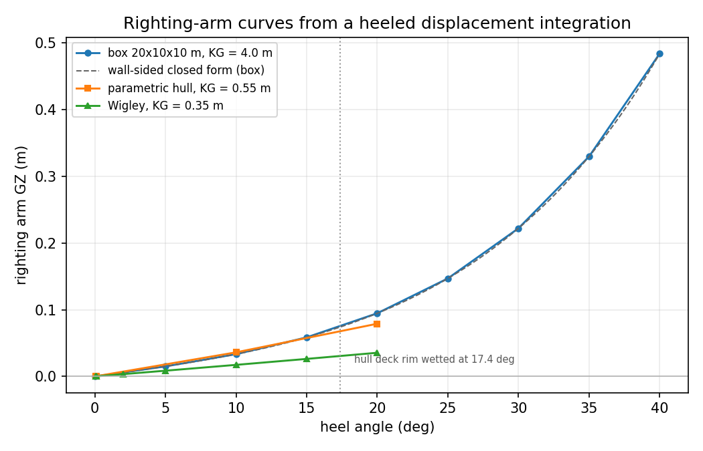
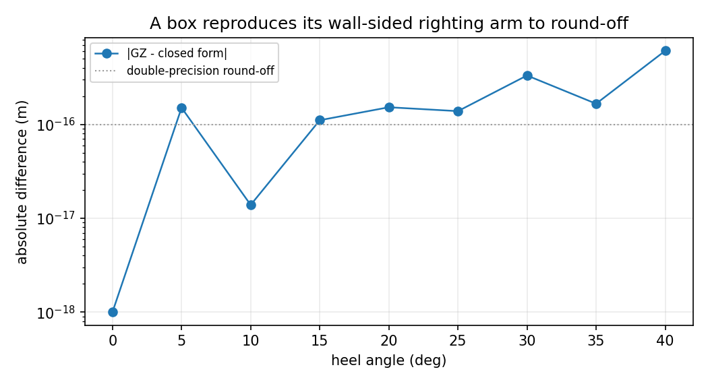
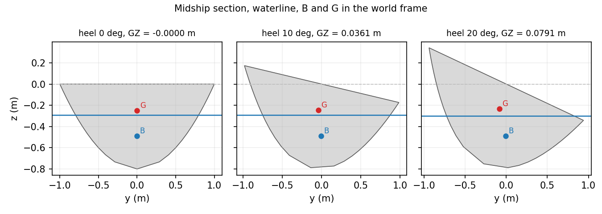

# Righting arms: GZ(phi) measured against closed forms

Generated by `python examples/righting_arm/run_example.py` on TensorCAD 0.20.0. Every number below is read from the `results.json` of the
same run; the script exits non-zero if a claim fails, so this page cannot decouple
from the code.

## 1. A box against the wall-sided formula

Rectangular box 20 x 10 m, depth 10 m, draft 5 m, KG = 4 m above the keel (GM = 0.166667 m, BM = 1.666667 m, KB = 2.500000 m).

| heel (deg) | GZ integrated (m) | closed form (m) | difference (m) | waterline z (m) |
|---:|---:|---:|---:|---:|
| 0.0 | 0.000000000000 | 0.000000000000 | +0.00e+00 | -5.000000000 |
| 5.0 | 0.015081884841 | 0.015081884841 | +1.51e-16 | -5.000000000 |
| 10.0 | 0.033440472059 | 0.033440472059 | +1.39e-17 | -5.000000000 |
| 15.0 | 0.058621817002 | 0.058621817002 | +1.11e-16 | -5.000000000 |
| 20.0 | 0.094760765407 | 0.094760765407 | -1.53e-16 | -5.000000000 |
| 25.0 | 0.147015803382 | 0.147015803382 | +1.39e-16 | -5.000000000 |
| 30.0 | 0.222222222222 | 0.222222222222 | -3.33e-16 | -5.000000000 |
| 35.0 | 0.329945350354 | 0.329945350354 | -1.67e-16 | -5.000000000 |
| 40.0 | 0.484280572721 | 0.484280572721 | +6.11e-16 | -5.000000000 |

The residual is round-off: a box is exactly representable, so the only error the
clipped-polyhedron integral can make is in the last bits of the trapezoid-free
tetrahedron sum. Any real error in the method would show up here at 1e-3, not 1e-16.

## 2. Negative GM: the range of stability is a root

Same box with KG = 4.366667 m, i.e. GM = -0.200000 m. The wall-sided arm vanishes where
`tan(phi) = sqrt(-2 GM / BM)`, and the integration has to find the same zero.

| quantity | value |
|---|---:|
| vanishing angle, closed form | 26.100138782 deg |
| vanishing angle, integrated | 26.100138782 deg |
| area under GZ 0-25 deg, closed form | -0.010667020927 m*rad |
| area under GZ 0-25 deg, integrated | -0.010663322211 m*rad |

`vanishing_angle_deg` is `None` for this body on purpose: a curve that starts
non-positive has no range of stability to end, and its zero is the angle of loll.
Relabelling it as a vanishing angle would be the kind of quiet wrong answer this
module refuses to give.

## 3. The parametric hull

| quantity | value |
|---|---:|
| mesh | 41 x 13 (1998 faces) |
| enclosed volume at the design waterline | 7.446554 m^3 |
| displacement scanned | 3.750000 m^3 |
| floating draft at that displacement | 0.503400 m |
| KG | 0.550000 m |
| GZ'(0) from the curve | 0.199667903 m/rad |
| KB + BM - KG, BM from the waterplane moment | 0.199667903 m/rad |
| analytic GM of the family at that draft | 0.187399845 m/rad |
| maximum GZ in the scan | 0.079063 m at 20.0 deg |
| deck rim first wetted at | 17.364 deg |

The first two agree to metacentric precision because they are the same identity
measured two ways: a three-dimensional heeled volume integral on one side, a
two-dimensional waterplane moment on the other. The third column is the analytic
surface the sampled hull approximates, so the gap between it and the curve is the
mesh's own chord error and nothing else.

**The deck-rim limit is the honest part of this table.** The generated hull is
capped at its design waterline, so above that heel the water is over a rim the
geometry does not model. The curve is reported, and the limit is reported with it,
rather than the arm being extrapolated over a freeboard that does not exist.

### Refinement, same displacement

| resolution | faces | GZ'(0) (m/rad) | GZ at 10 deg (m) | error vs analytic GM |
|---|---:|---:|---:|---:|
| 41 x 13 | 1998 | 0.199667903 | 0.036149536 | +6.55e-02 |
| 161 x 41 | 25918 | 0.189595816 | 0.034354805 | +1.17e-02 |

| resolution | displacement (m^3) | draft (m) | GZ'(0) (m/rad) | analytic GM (m/rad) | relative error |
|---|---:|---:|---:|---:|---:|
| 41 x 13 | 5.5000 | 0.649832 | 0.285524091 | 0.275258870 | +3.73e-02 |
| 161 x 41 | 5.5000 | 0.649832 | 0.277018864 | 0.275258870 | +6.39e-03 |

The second table is the one a wrong draft-scaling law would break: the same law,
at a displacement 47 % higher, on both grids.

## 4. The Wigley hull

| quantity | value |
|---|---:|
| faces | 1998 |
| displacement scanned | 1.385611 m^3 |
| KG | 0.350000 m |
| GZ'(0) | 0.098898718 m/rad |
| KB + BM - KG | 0.098898718 m/rad |
| maximum GZ in the scan | 0.035531 m |

## 5. Claims

| claim | measured | reference | relative error | tolerance | passed |
|---|---:|---:|---:|---:|:--:|
| box GZ vs wall-sided closed form (max |difference|, 0-40 deg) | 0.000000000 | 0.000000000 | 6.106e-16 | 1.0e-09 | yes |
| box with MG = -0.2 m: angle where GZ = 0 vs sqrt(-2 GM / BM) | 26.100138782 | 26.100138782 | 6.806e-16 | 1.0e-06 | yes |
| box: area under GZ, 0-25 deg, vs integral of the closed form | -0.010663322 | -0.010667021 | 3.467e-04 | 1.0e-03 | yes |
| hull 41x13: GZ'(0) vs KB + BM - KG, BM from the waterplane moment | 0.199667903 | 0.199667903 | 3.368e-12 | 1.0e-06 | yes |
| hull 41x13: GZ'(0) vs the analytic GM of the family, light displacement | 0.199667903 | 0.187399845 | 6.546e-02 | 8.0e-02 | yes |
| hull 41x13: GZ'(0) vs the analytic GM of the family, deep displacement | 0.285524091 | 0.275258870 | 3.729e-02 | 8.0e-02 | yes |
| hull 41x13: GZ(0) = 0 | -0.000000000 | 0.000000000 | 3.618e-18 | 1.0e-12 | yes |
| hull 41x13: GZ(+10) = -GZ(-10) | 0.036149536 | 0.036149536 | 3.839e-16 | 1.0e-12 | yes |
| hull 41x13: the waterline descends monotonically as the body heels | 3.000000000 | 3.000000000 | 0.000e+00 | 0.0e+00 | yes |
| hull 161x41: GZ'(0) vs KB + BM - KG, BM from the waterplane moment | 0.189595816 | 0.189595816 | 3.258e-12 | 1.0e-06 | yes |
| hull 161x41: GZ'(0) vs the analytic GM of the family, light displacement | 0.189595816 | 0.187399845 | 1.172e-02 | 2.0e-02 | yes |
| hull 161x41: GZ'(0) vs the analytic GM of the family, deep displacement | 0.277018864 | 0.275258870 | 6.394e-03 | 2.0e-02 | yes |
| hull 161x41: GZ(0) = 0 | 0.000000000 | 0.000000000 | 3.724e-17 | 1.0e-12 | yes |
| hull 161x41: GZ(+10) = -GZ(-10) | 0.034354805 | 0.034354805 | 2.020e-15 | 1.0e-12 | yes |
| hull 161x41: the waterline descends monotonically as the body heels | 3.000000000 | 3.000000000 | 0.000e+00 | 0.0e+00 | yes |
| hull refinement: initial slope, [41, 13] vs [161, 41] | 0.199667903 | 0.189595816 | 5.312e-02 | 8.0e-02 | yes |
| hull refinement: GZ at 10 deg, [41, 13] vs [161, 41] | 0.036149536 | 0.034354805 | 5.224e-02 | 8.0e-02 | yes |
| Wigley: GZ'(0) vs KB + BM - KG, BM from the waterplane moment | 0.098898718 | 0.098898718 | 2.881e-12 | 1.0e-06 | yes |
| Wigley: GZ(+10) = -GZ(-10) | 0.017376893 | 0.017376893 | 1.997e-16 | 1.0e-12 | yes |

## 6. Figures

## 7. What this does not cover

* Free-surface correction: a tank property, not a hull property.
* Damage and flooded-compartment stability: the flooding is a mass model the
  geometry does not carry.
* Trim change with heel: a cross curve holds trim constant and so does this module.
* Any statutory criterion (IS Code 2008 intact stability, SOLAS): the arm is a
  number, not a compliance verdict.

