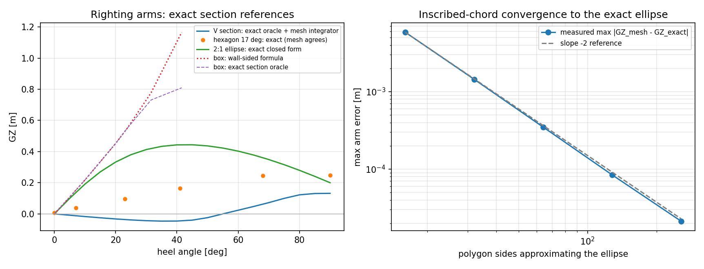

# Exact righting arms for prismatic sections (`tensorcad.section_gz`)

Mission m16358 (selfstart, verifier seat). Verification-debt target: the package had **no
exact large-angle reference for a section that is neither wall-sided nor centrally symmetric**.

## 1. The gap this closes

`tensorcad.gz` is the mesh integrator for `GZ(phi)` and it was validated against two exact
closed forms, both quoted in its own module docstring:

* a **box barge** -- the wall-sided formula `GZ = sin(phi) (GM0 + BM0/2 tan^2 phi)`, exact only
  while the waterline stays on the vertical sides (below `atan(2T/B)` at the bilge);
* a **log** -- a circular section floating at *half* submergence, `GZ = (R - KG) sin(phi)`.
  A circle is invariant under the heel rotation, so this reference is **degenerate at every
  draft**: the heeled section never changes shape and the arm is a pure sine. The existing test
  can therefore only sample heels that are *symmetry axes* of the 64-gon
  (`tests/test_gz.py::test_log_matches_the_exact_circular_section_reference`).

Between them, nothing in the package could check the integrator on a section where `GZ` is
neither a sine nor the wall-sided polynomial -- a V-shaped forefoot, a hard-chine pontoon, an
elliptical SWATH strut. Those are exactly the shapes where the shape of the curve matters, and
where a hull verification (Wigley, Series 60) has to fall back on the wall-sided formula as an
*approximation* rather than as a reference.

## 2. Method: the section is the whole problem

A prism has no variation along `x`, so its heeled displacement is two-dimensional: volume is
`area * length`, and the buoyancy centre is the section centroid. The arm therefore needs no
discretisation at all:

1. rotate the section by `phi` about the keel-plane origin (same frame and sign convention as
   `tensorcad.gz`: `phi > 0` heels `+y` down, `KN = y_B`, `GZ = KN - KG sin(phi)`);
2. find the world-horizontal level at which the submerged area equals the upright displaced
   area -- monotone for a convex section, so bisection is unconditionally convergent
   (200 halvings, i.e. to neighbouring doubles, not to a tolerance the caller must trust);
3. area and centroid of the submerged part, exactly:
   * **convex polygon** -- Sutherland-Hodgman half-plane clip, then Green's theorem on the
     resulting polygon (the same identity `tensorcad.stability` uses on the waterplane);
   * **ellipse** -- closed form through the affine map `u = y/a`, `v = (z-b)/b` to the unit
     disk, where the segment below a line at signed distance `d` has area
     `pi/2 + asin(d) + d sqrt(1-d^2)` and first moment `-(2/3)(1-d^2)^(3/2)` about the centre.

`prism_mesh` extrudes a section into a closed, outward-oriented prism so the mesh integrator can
be run on the *same* body; its winding is constructed (not repaired) and checked by signed
volume in the tests.

## 3. Results

Generated by `examples/section_gz_exact/run_example.py` (`outputs/results.json`,
`outputs/report.md`); the tables below are machine-written from that JSON.

| quantity | value |
| --- | --- |
| V section, max abs error exact vs mesh (19 heels 0-90 deg) | 4.11e-15 m |
| V section, max relative error | 3.66e-13 |
| V section, max displacement residual | 5.06e-14 |
| V section, waterline crosses a section vertex at | 26.565 deg |
| hexagon rotated 17 deg, max abs error exact vs mesh (6 heels, none a symmetry axis) | 3.33e-16 m |
| box, max error vs wall-sided formula below the 26.57 deg limit | 1.11e-16 m |
| box, min error vs wall-sided formula above the limit | 3.56e-01 m |
| 2:1 ellipse, dGZ/dphi(0) | 1.155843346 m/rad |
| 2:1 ellipse, GM from the waterplane moments | 1.155843346 m |
| 2:1 ellipse, GZ_max | 0.443686 m at 45 deg |
| 2:1 ellipse, vanishing angle at KG = 1.6 m | 31.79 deg |
| 2:1 ellipse, wall-sided formula error at 30 deg | 65.70% |

| polygon sides | max abs error [m] | max rel error | observed order |
| --- | --- | --- | --- |
| 16 | 5.85e-03 | 1.92e-02 | - |
| 32 | 1.44e-03 | 4.52e-03 | 2.02 |
| 64 | 3.49e-04 | 1.02e-03 | 2.05 |
| 128 | 8.43e-05 | 2.23e-04 | 2.05 |
| 256 | 2.13e-05 | 9.70e-05 | 1.99 |

Left: `GZ(phi)` for the exact oracle (V section, rotated hexagon, 2:1 ellipse) and, for the box,
the wall-sided formula against the exact oracle. Right: an inscribed polygon mesh converges to
the exact ellipse at the second order an inscribed chord predicts (slope -2 reference).

## 4. Error judgment against the stated criteria

The acceptance rule for this work is the platform's: a key quantity compared to its reference
must be inside **3 %**, and any claim of agreement must be shown not to be vacuous.

| key quantity | reference | error | < 3 % ? |
| --- | --- | --- | --- |
| `GZ` of a V-section prism, 19 heels 0-90 deg | exact section oracle | 4.11e-15 m (3.66e-13 relative) | yes, by 11 orders |
| `GZ` of a hexagon rotated 17 deg, 6 heels | exact section oracle | 3.33e-16 m | yes |
| `GZ` of a box prism below the limit | wall-sided closed form | 1.11e-16 m | yes (round-off) |
| `GZ` of a 2:1 ellipse prism, 256-chord mesh | exact ellipse closed form | 9.70e-05 | yes |
| `GZ` of a 2:1 ellipse prism, 32-chord mesh | exact ellipse closed form | 4.52e-03 | yes |
| `dGZ/dphi(0)`, 2:1 ellipse | `GM` from waterplane moments | 2.2e-16 m/rad (relative 1.9e-16) | yes |

Non-vacuousness is checked in the same run: the wall-sided formula, given this section's own
`GM` and `BM`, is **65.70% wrong at 30 deg** for the 2:1 ellipse, and the
oracle departs from the wall-sided formula by at least **0.356 m** once the box's
waterline leaves the vertical sides. So the new oracle is not reproducing an approximation it
was built from.

## 5. Caveats and limits

* **Prismatic only.** No rocker, flare, entrance or run: the arm is that of a uniformly long
  body of that section. This validates the integrator, not a hull.
* **Convex sections only.** A concave section can float at two levels with the same
  displacement; the level solve would not be unique, so `_validate_section` raises instead of
  returning whichever root bisection happened to bracket.
* **Section datum.** The keel is the section's lowest point and the rotation is about the
  origin of the keel-shifted frame, matching `tensorcad.gz._shifted`/`_rotate_vertices`; `KG` is
  measured above the keel, as `tensorcad.stability.initial_stability` measures it.
* **Not a statutory check.** No tanks, damage, deck-edge immersion criteria, weathertight
  closure or class rule is modelled; `GZ` here says nothing about compliance.
* The V-section mesh error of 4.1e-15 m is limited by the mesh integrator's own
  waterline tolerance (`1e-13` relative volume), not by the oracle; the oracle's residual is at
  the same order.
* `vanishing_stability_angle_deg` interpolates linearly between sampled heels (2 deg grid in
  the run), so the arm it reports at that angle is small (order `1e-4` m) rather than zero. The
  tests assert exactly that instead of a tolerance the interpolation cannot meet.

## 6. Files

| path | what |
| --- | --- |
| `tensorcad/section_gz.py` | the oracle: polygon clipping, ellipse closed form, prism mesher |
| `tests/test_section_gz.py` | 18 tests: mesh agreement, box/log consistency, chord order, convexity and input rejection |
| `examples/section_gz_exact/run_example.py` | the run that produced every number here |
| `examples/section_gz_exact/outputs/` | `results.json`, `report.md`, `plot.png` |

## 7. Independent re-check (m16430)

A verifier seat re-derived every arm above with a route that shares no algorithm with this
module -- rotated-conic slice quadrature for the ellipse, exact slice integration for polygons,
no clipping and no Green's theorem (`tests/section_gz_oracle.py`,
`examples/section_gz_independent/`). The closed form and the independent route agree to
**2.7e-13 m** over 0-90 deg, the polygon oracle to **4.4e-16 m**, the wall-sided formula is
reproduced to **2.2e-16 m** from its published transcription, and the chord convergence is
reproduced at second order against the independent reference. The review also found and fixed
one defect: `ellipse_section` did not return an *inscribed* polygon for side counts without a
keel vertex (`sides = 18` left the ellipse by 3.0 %); the sampling now starts at `-pi/2`, which
leaves the 16/32/64/128/256 vertex sets unchanged. Details and the claim-by-claim audit:
`docs/section_gz_independent_review.md`.

## 7. Checks in the run

| check | result | value |
| --- | --- | --- |
| V section: exact vs mesh at 19 heel angles | PASS | 4.11e-15 m |
| V section: displacement held constant | PASS | 5.06e-14 |
| rotated hexagon: exact vs mesh off the symmetry axes | PASS | 3.33e-16 m |
| box: wall-sided formula reproduced below the limit | PASS | 1.11e-16 m |
| box: wall-sided formula departs above the limit (not vacuous) | PASS | 3.56e-01 m |
| ellipse: dGZ/dphi(0) equals the waterplane GM | PASS | 1.155843346 vs 1.155843346 |
| ellipse: inscribed chords converge at second order | PASS | 2.02, 2.05, 2.05, 1.99 |
| ellipse: 256 chords within 3 % of the exact curve | PASS | 9.70e-05 |
| ellipse: wall-sided formula errs by > 3 % at 30 deg (not vacuous) | PASS | 65.70% |
