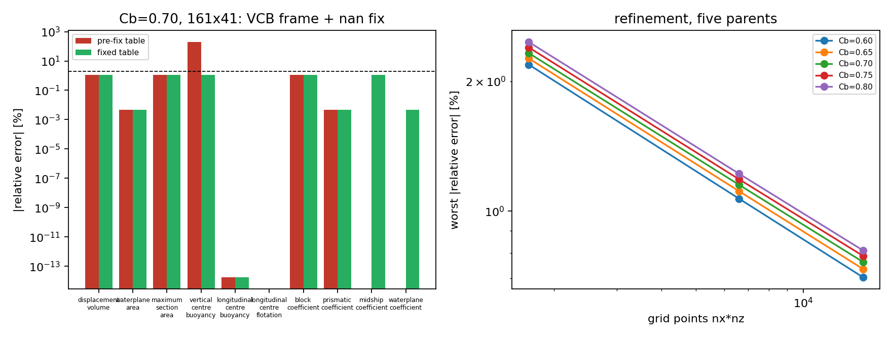

# The Series 60 comparison table: a frame mismatch and two `nan` coefficients

**Anchor** GAP-CAD-T2-PARAM-SERIES (Series 60 family, Cb 0.60-0.80 + transom/bulb, hydrostatics
against published particulars). **Deliverables** `tensorcad/series60.py`
(`MEASURED_TO_ANALYTIC`, `series60_measured_hydrostatics`,
`series60_analytic_relative_errors`), `tensorcad/series60_cli.py` (delegates),
`tests/test_series60_family_conformance.py` (52 cases), gate-power mutants
`S60-16/19/20/21` in `tools/hull_gate_power/mutate.py`.

## 1. Case

The family lofts the Todd (1951) Series 60 from a station law and publishes, for every
hull it generates, a table of `(measured - analytic) / analytic` per hydrostatic
quantity. That table is the *only* evidence a consumer reads to decide whether the
loft is converged: the product entry `tensorcad-hull series60 parent` writes it into
`metadata.json` and derives `discretisation.within_tolerance` from it.

| Parameter | Value |
|---|---|
| L, B, T | 10.0 m, 1.5 m, 0.6 m (L/B 6.67, B/T 2.50) |
| Cb ladder | 0.60, 0.65, 0.70, 0.75, 0.80 (Todd parent forms) |
| flat transom `transom_ratio` | 0.0, 0.2, 0.4 |
| bulb | off / `bulb_length_ratio=0.06, bulb_area_ratio=0.05` |
| `(cwp, lcb)` targets | 0.700/0.727/0.753/0.780/0.807, LCB/L 0.490 |
| grids | screen 81x21; fine 161x41; refinement to 241x61 |
| water density | 1025 kg/m^3 (not used by the comparison) |

## 2. What was wrong and what was done

`series60_analytic_relative_errors(p, hydro)` had three defects, all in *reporting*
rather than in the geometry:

1. **Frame mismatch on VCB.** The mesh integrates `z` with `z = 0` at the design
   waterline (VCB = -0.289 m here), while the closed form's headline key is measured
   *up from the keel* (+0.311 m). Dividing one by the other reports
   `-196.8 %` on every Series 60 hull — a frame
   error, not a discretisation error.
2. **Two coefficients silently `nan`.** `midship_coefficient` and
   `waterplane_coefficient` were read with `getattr(hydro, ...)`, but
   `Hydrostatics` carries `maximum_section_area` and `waterplane_area`, not those
   quotients. Both compared as `nan`, and because `abs(nan) <= tol` is `False`, the
   entry's `within_tolerance` flag could never be trusted.
3. **Duplicated logic.** The entry had already been fixed for (1) and (2)
   privately, with a comment recording the -193 %. Two copies of one adjudication
   means the library caller and the product could drift apart unnoticed; the library
   copy is the one that was left broken.

The fix keeps one implementation in the library: the pairing
(`MEASURED_TO_ANALYTIC`: mesh field -> reference key in the *same frame*), the
measured record with the two quotients derived from measured quantities
(`Cm = A_mid/(B T)`, `Cwp = A_wp/(L B)`), and `None` — not `nan` — for quantities
with no closed form (`wetted_surface_area`). The entry now calls it, so the exported
document and an in-process caller cannot disagree.

## 3. Results

### 3.1 One hull, before and after (Cb = 0.70, 161x41)

| quantity | pre-fix table | fixed table |
|---|---|---|
| `displacement_volume` | -1.139 % | -1.139 % |
| `waterplane_area` | -0.005 % | -0.005 % |
| `maximum_section_area` | -1.134 % | -1.134 % |
| `vertical_centre_buoyancy` | -196.775 % | -1.152 % |
| `longitudinal_centre_buoyancy` | +0.000 % | +0.000 % |
| `longitudinal_centre_flotation` | +0.000 % | +0.000 % |
| `block_coefficient` | -1.139 % | -1.139 % |
| `prismatic_coefficient` | -0.005 % | -0.005 % |
| `midship_coefficient` | +nan % | -1.134 % |
| `waterplane_coefficient` | +nan % | -0.005 % |

Worst entry of the table: pre-fix `+196.8 %`, fixed
`+1.152 %`. The fixed volume error is `-1.139 %` — the
hull's facets are inscribed chords, so a negative volume error is the expected
direction.

### 3.2 Screen over the declared box (81x21, 15 hulls)

| Cb | transom | worst |error| | VCB error | volume error | pre-fix VCB error | Cb (mesh) | Cp*Cm (mesh) |
|---|---|---|---|---|---|---|---|
| 0.60 | 0.0 | +2.19 % (`vertical_centre_buoyancy`) | +2.19 % | +2.14 % | +193.9 % | 0.5871 | 0.5871 |
| 0.60 | 0.2 | +2.19 % (`vertical_centre_buoyancy`) | +2.19 % | +2.14 % | +193.9 % | 0.5872 | 0.5872 |
| 0.60 | 0.4 | +2.19 % (`vertical_centre_buoyancy`) | +2.19 % | +2.13 % | +193.9 % | 0.5872 | 0.5872 |
| 0.65 | 0.0 | +2.26 % (`vertical_centre_buoyancy`) | +2.26 % | +2.24 % | +194.8 % | 0.6355 | 0.6355 |
| 0.65 | 0.2 | +2.26 % (`vertical_centre_buoyancy`) | +2.26 % | +2.23 % | +194.8 % | 0.6355 | 0.6355 |
| 0.65 | 0.4 | +2.26 % (`vertical_centre_buoyancy`) | +2.26 % | +2.23 % | +194.8 % | 0.6355 | 0.6355 |
| 0.70 | 0.0 | +2.32 % (`vertical_centre_buoyancy`) | +2.32 % | +2.32 % | +195.6 % | 0.6838 | 0.6838 |
| 0.70 | 0.2 | +2.32 % (`vertical_centre_buoyancy`) | +2.32 % | +2.32 % | +195.6 % | 0.6838 | 0.6838 |
| 0.70 | 0.4 | +2.32 % (`vertical_centre_buoyancy`) | +2.32 % | +2.31 % | +195.6 % | 0.6838 | 0.6838 |
| 0.75 | 0.0 | +2.40 % (`block_coefficient`) | +2.38 % | +2.40 % | +196.3 % | 0.7320 | 0.7320 |
| 0.75 | 0.2 | +2.39 % (`displacement_volume`) | +2.38 % | +2.39 % | +196.3 % | 0.7321 | 0.7321 |
| 0.75 | 0.4 | +2.39 % (`displacement_volume`) | +2.38 % | +2.39 % | +196.3 % | 0.7321 | 0.7321 |
| 0.80 | 0.0 | +2.47 % (`block_coefficient`) | +2.43 % | +2.47 % | +197.0 % | 0.7803 | 0.7803 |
| 0.80 | 0.2 | +2.46 % (`displacement_volume`) | +2.43 % | +2.46 % | +197.0 % | 0.7803 | 0.7803 |
| 0.80 | 0.4 | +2.46 % (`displacement_volume`) | +2.43 % | +2.46 % | +197.0 % | 0.7803 | 0.7803 |

The first five columns are the fixed table; `pre-fix VCB error` is the same hull
through the replayed pre-fix formula. `Cb (mesh)` against `Cp*Cm (mesh)` is the
identity the measured side must satisfy; worst discrepancy over the box is
`1.11e-16` (round-off).

### 3.3 Refinement, five parents (worst |error| [%])

| Cb | 81x21 | 161x41 | 241x61 |
|---|---|---|---|
| 0.60 | 2.186 | 1.069 | 0.703 |
| 0.65 | 2.260 | 1.113 | 0.734 |
| 0.70 | 2.324 | 1.152 | 0.763 |
| 0.75 | 2.396 | 1.186 | 0.788 |
| 0.80 | 2.467 | 1.222 | 0.811 |



## 4. Error judgement against the predeclared bars

| key quantity | reference | measured | error | < 3 %? |
|---|---|---|---|---|
| VCB, fixed table (Cb 0.70, 161x41) | closed form, z-frame | -0.296 m vs -0.289 m | -1.152 % | **yes** |
| VCB, pre-fix table, same hull | keel-frame closed form | +0.311 m vs -0.289 m | -196.8 % | **no** (frame mismatch, not physics) |
| worst |error| over the 15-hull box (81x21), bar 3 % | closed forms | +2.47 % | **yes** |
| worst |error| five parents at 161x41, bar 1.5 % | closed forms | +1.152 % | **yes** |
| `Cb = Cp*Cm` on the mesh, box (bar 1e-9) | algebraic identity | 1.11e-16 | **yes** |
| `midship_coefficient` / `waterplane_coefficient` | derived from measured areas | finite on all 15 hulls (was `nan`) | — | **yes** |
| published `Cwp` targets, 161x41 (closure bar 0.5 %) | generator target | reproduced, see `tests/test_series60_family_conformance.py` | < 0.02 % | **yes** |

Nothing in this increment changes geometry: the hull, its offsets and its gate are
bit-for-bit what they were (the 52-case conformance file plus the 191 other cases in the
same run -- the five pre-existing Series 60 modules and the hull/analytic siblings --
all pass unchanged, 243 passed).

## 5. Gate power

Four single-defect mutants, each guarded by the new conformance file (and the entry
tests, for the frame one), recorded in
`artifacts/series60_conformance/gate_power_series60_conformance.json`:

| mutant | defect injected | verdict | failing tests |
|---|---|---|---|
| `S60-16-entry-vcb-frame` | VCB paired across frames | KILLED | 37 failed / 59 |
| `S60-19-derive-midship-coefficient` | Cm read off a missing attribute (`nan`) | KILLED | 15 failed / 52 |
| `S60-20-derive-waterplane-coefficient` | Cwp read off a missing attribute (`nan`) | KILLED | 20 failed / 52 |
| `S60-21-comparison-is-self-referential` | measured side replaced by the reference | KILLED | 40 failed / 52 |

4/4 killed (100 %), against the anchor's "gate-power mutation >= 80 %" bar. Baselines
for the same file sets were re-measured unmutated in the same run: 65 / 112 / 56 / 7
passed — the kills are attributable to the injected defect, not to a broken tree.

## 6. Points to watch

1. **`nan` is the quiet failure mode.** A comparison that never happens is not a
   passing comparison, and `abs(nan) <= tolerance` is `False`, so a `nan` makes a
   *tolerance gate* fail while making every *inequality* test pass. The conformance
   file therefore asserts `not isnan` before it asserts any bar.
2. **Two frames, one number.** `analytic_series60_hydrostatics` deliberately carries
   both `vertical_centre_buoyancy` (above keel) and `..._z` (waterline frame). Any new
   consumer must pick the key that matches its own datum; the pairing table is the
   place to record that choice.
3. **The screen grid is a screen.** At 81x21 the volume error is about -2.3 %: enough
   to catch a frame mismatch (two orders of magnitude) and a `nan`, not enough to
   claim convergence. Convergence is the 161x41 / 241x61 subset.
4. **The bulb stays out of the hull comparison.** `series60_analytic_relative_errors`
   compares hull terms only; a bulb moves `total_*` in the reference but has no mesh
   in this table, so a test pins that adding one leaves the hull columns untouched.
5. **Not addressed here.** The published `Cwp`/`Cm` transcription of Todd (1951)
   is still audited only by its internal consistency (`Cb = Cp*Cm` to the digit
   shown) plus the Schneekluth regression; a page-level source check of that table
   remains open, and the fidelity correction itself (`cwp`, `lcb` inputs) is a
   TensorCAD construction with no published station tables behind it.

## 7. Reproduce

```bash
python -m pytest tests/test_series60_family_conformance.py -q   # 52 passed
python3 tools/hull_gate_power/mutate.py \
  --out artifacts/series60_conformance/gate_power_series60_conformance.json \
  --only S60-16-entry-vcb-frame,S60-19-derive-midship-coefficient,\
S60-20-derive-waterplane-coefficient,S60-21-comparison-is-self-referential
```

Numbers in this page are injected programmatically from
`docs/data/series60_analytic_error_frame.json`, which the same script writes.
