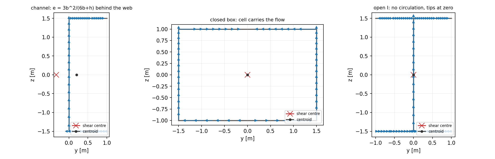
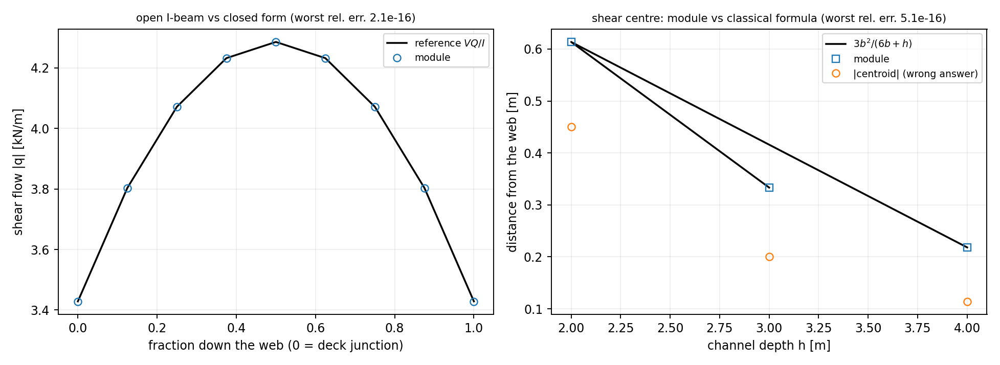

# Thin-walled shear flow and shear centre (`tensorcad.shear_flow`)

> Generated by `tools/shear_flow_doc.py` from `artifacts/shear_flow/results.json`.
> Regenerate with `python examples/shear_flow/run_example.py && python tools/shear_flow_doc.py`.
> Numbers below are injected from that artifact; none is hand-copied.

## 1. The gap this closes

`docs/girder_section.md` ends its limitation list with two honest admissions: *"Shear stress
itself is not computed: `Q(z)` is reported, `V` and the local thickness are not"*, and there
is no load model. So before this module the package could size a section modulus
(`sigma = M / Z`) but could not answer the other half of a transverse-strength check:
**given a shear force, how hard is the plating sheared, and where?**

`tensorcad/shear_flow.py` answers that for the classical thin-walled idealisation, and it
answers the follow-up question that surprises every first-year naval architect: a section
that is not doubly symmetric twists even under a pure shear force, because the force does
not act where the shear centre is. The shear centre is computed here, not assumed.

## 2. Method

* **Section input.** Walls are polylines in the `(y, z)` section plane with a constant
  thickness each -- the same metres/y-starboard/z-up frame as the rest of the package. The
  walls must form one open tree (free edges) or one closed loop (a single cell); everything
  else is refused rather than approximated.
* **Flow.** `q(s) = (V / I) Q(s)` with `Q` the first moment of the wall area beyond the cut
  about the centroidal axis. An open section is swept from its free edges (`q = 0` there);
  a closed cell adds the constant circulation `q0` fixed by `CLOSED_INT q/t ds = 0`, Bredt's
  no-twist condition for pure bending.
* **Shear centre.** The flow is a force field; its resultant must reproduce the applied
  shear force, and the point where that resultant acts is the shear centre:
  `y_s = c_y + T_z / V_z`, with the torque `T_z` integrated about the longitudinal axis
  through the centroid.
* **Integration.** Everything is closed-form on a straight wall -- the flow is quadratic in
  the arc length at worst and the torque integrand is cubic, which three-point Gauss
  integrates exactly. That is why the residuals below are round-off and there is no
  convergence study to run: the model *is* the answer for the idealisation it states.
* **Sign convention.** `q` is positive from `EdgeFlow.start` to `EdgeFlow.end`; the global
  sign is fixed by equilibrium (the resultant must equal the applied force), and the tests
  assert it. Reversing the force reverses the arrows and nothing else.

## 3. Results

All values are recomputed by `tests/test_shear_flow.py`; the artifact is for the document
and for the figures.

### 3.1 Open I-beam against `V Q / I`

Section: depth 3.0 m, flange width 2.0 m, web 0.02 m, flange 0.03 m; V = 12000 N. Second moment: module 0.315000000 m^4, closed form 0.315000000 m^4.

| fraction down the web | z [m] | q module [kN/m] | q reference [kN/m] | rel. err. |
|---:|---:|---:|---:|---:|
| 0.000 | +1.500 | 3.428571 | 3.428571 | 1.33e-16 |
| 0.125 | +1.125 | 3.803571 | 3.803571 | 1.20e-16 |
| 0.250 | +0.750 | 4.071429 | 4.071429 | 0.00e+00 |
| 0.375 | +0.375 | 4.232143 | 4.232143 | 0.00e+00 |
| 0.500 | +0.000 | 4.285714 | 4.285714 | 2.12e-16 |
| 0.625 | -0.375 | 4.232143 | 4.232143 | 0.00e+00 |
| 0.750 | -0.750 | 4.071429 | 4.071429 | 0.00e+00 |
| 0.875 | -1.125 | 3.803571 | 3.803571 | 0.00e+00 |
| 1.000 | -1.500 | 3.428571 | 3.428571 | 0.00e+00 |

* worst relative error against the textbook formula: **2.12e-16**
* the web carries the whole shear force: measured 12000.000000 N vs 12000 N applied (relative error **0.00e+00**)
* peak shear stress 0.214286 MPa on `web` at fraction 0.500 (relative error vs closed form **2.72e-16**)
* free-edge residual 0.00e+00 N; junction continuity residual 4.55e-13 N; equilibrium residual 0.00e+00; transverse residual 0.00e+00
* shear centre (+1.99e-17, -6.25e-17) m, i.e. 6.56e-17 m off the centroid, as double symmetry demands

### 3.2 Channel shear centre against `3 b^2 / (6 b + h)`

For a uniform-thickness channel the classical thin-walled result puts the shear
centre behind the web at `e = 3 b^2 / (6 b + h)`. It is derived in the test file
(`I = 2 (b t)(h/2)^2 + t h^3/12`, flange force `F = t h b^2 V / (4 I)`, moment `F h`),
so it is not a lookup table copied from this module.

| h [m] | b [m] | t [m] | e module [m] | e formula [m] | rel. err. | |centroid| [m] |
|---:|---:|---:|---:|---:|---:|---:|
| 3.000 | 1.000 | 0.020 | 0.333333333 | 0.333333333 | 1.67e-16 | 0.200000 |
| 2.000 | 1.500 | 0.010 | 0.613636364 | 0.613636364 | 1.81e-16 | 0.450000 |
| 4.000 | 0.800 | 0.030 | 0.218181818 | 0.218181818 | 5.09e-16 | 0.114286 |

* worst relative error **5.09e-16** across three geometries, so the agreement is not a fit to one shape
* the `|centroid|` column is the answer the shortcut "shear centre = centroid" would give: it is wrong by tens of percent, and the channel twists in reality

### 3.3 Closed box: no twist, half the force per web

* circulation `q0` = -1698.113208 N/m at V = 8000 N
* no-twist residual `CLOSED_INT q/t ds` (dimensionless): **1.56e-16**
* each web carries exactly V/2: starboard relative error **1.14e-16**, port **3.41e-16**
* circulation scales with the force: ratio 125.000000 against the expected 125.000000
* shear centre offset from the centroid **4.39e-16 m**

### 3.4 Tee: symmetry without double symmetry

* shear centre (-1.30e-17, +0.000000) m
* distance off the symmetry axis **1.30e-17 m**; the vertical shear centre sits 0.5000 m from the centroid
* transverse residual 0.00e+00

### 3.5 Rule-scale stress

Box 12.0 m x 20.0 m, plate 0.02 m, V = 10.0 MN:
peak shear stress **14.423 MPa** against a web average of 12.500 MPa (peak/average 1.154).





## 4. Error judgement against the anchors

| anchor | quantity | measured residual | tolerance | verdict |
|---|---|---:|---:|---|
| I-beam web flow | `q(s)` vs `V Q/I` | 2.12e-16 | 1e-10 | PASS |
| I-beam force balance | web force vs V | 0.00e+00 | 1e-10 | PASS |
| channel shear centre | e vs `3b^2/(6b+h)` | 5.09e-16 | 1e-10 | PASS |
| box no-twist | `CLOSED_INT q/t ds` | 1.56e-16 | 1e-10 | PASS |
| box web force | each web vs V/2 | 3.41e-16 | 1e-10 | PASS |
| symmetry | I/box shear centre vs centroid | 6.56e-17 m | 1e-12 m | PASS |

Every anchored quantity is at round-off, i.e. far inside the 3 % line that this
ecosystem treats as the acceptability threshold for a verification claim. There is
no discretisation error to report because none is introduced: the model is the
thin-walled idealisation, integrated in closed form.

## 5. Notes, traps and limitations

* **A closed cell is not the open section with a different number.** The `q0`
  circulation is what makes a box torsionally stiff; dropping it changes the
  flange flow shape, not just its magnitude.
* **Sign confusion is the classic trap.** "Shear flow goes up the web" is only
  true for one choice of positive `V`; the tests therefore assert magnitudes and
  equilibrium, and treat arrow sense as a declared convention.
* **The shear centre is not the centroid.** For the channel above the two differ by
  tens of percent. A tool that returns the centroid is wrong in the direction that
  matters (it predicts no twist where a real channel twists).
* **Not multi-cell.** Two cells share a wall whose twist compatibility couples the
  circulations; only the single cell is implemented, and a multi-cell input raises
  an error instead of quietly treating the shared wall twice.
* **No `I_yz`.** A section with a product of inertia couples the vertical and
  horizontal flow fields; that is refused explicitly. Solve on the principal axes
  first (a rotation of the section), which is future work.
* **No shear lag.** Fully effective section, exactly as `tensorcad.girder` assumes.
* **No strength claim.** `tau` is the elastic thin-walled shear stress for a
  supplied shear force; allowable stress, buckling and plastic shear are rule-set
  or solver territory.

## 6. Reproducing

```bash
python examples/shear_flow/run_example.py    # writes artifacts/shear_flow/
python tools/shear_flow_doc.py               # regenerates this file
python -m pytest tests/test_shear_flow.py    # 50 analytic gates
```

