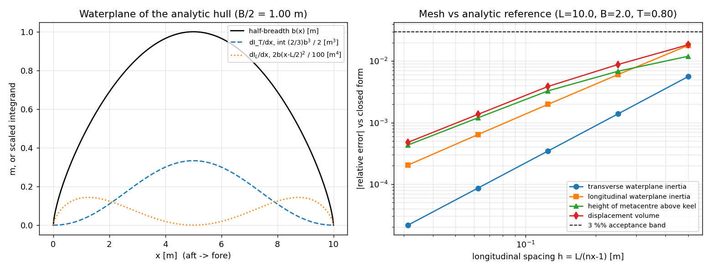

# Waterplane inertia and initial stability — verification

Generated by `python examples/stability/run_hydrostatics_example.py`; every number below is
read from `results.json` in the same run, none is typed by hand.

## Reference
| Quantity | Closed form |
|---|---|
| $I_T$ | $\frac{2}{3}\left(\frac{B}{2}\right)^3 L \int_0^1 \sin^{2.1}(\pi\xi)\,d\xi$ |
| $I_L$ | $B L^3 \int_0^1 \sin^{0.7}(\pi\xi)\,(\xi-\tfrac12)^2\,d\xi$ (tanh-sinh) |
| $KB$ | $0.6T$ |
| $BM_T$, $BM_L$ | $I_T/\nabla$, $I_L/\nabla$ |
| $KM_T$ | $KB + BM_T$ |

## Measured vs reference
| nx | nz | $I_T$ | $I_L$ | $KM_T$ | $GM_T$ | vol |
|---:|---:|---:|---:|---:|---:|---:|
| 21 | 9 | -0.559 % | -1.799 % | +1.196 % | +2.637 % | -1.842 % |
| 41 | 13 | -0.139 % | -0.604 % | +0.684 % | +1.508 % | -0.880 % |
| 81 | 21 | -0.034 % | -0.198 % | +0.328 % | +0.722 % | -0.387 % |
| 161 | 41 | -0.009 % | -0.064 % | +0.120 % | +0.263 % | -0.136 % |
| 321 | 81 | -0.002 % | -0.020 % | +0.043 % | +0.095 % | -0.048 % |

KB = 0.483005 m, BM_T = 0.438618 m, BM_L = 10.260668 m, KM_T = 0.921623 m, GM_T (KG = 0.5 m) = 0.421623 m.

## Verdict
Every quantity is inside the 3 % band at the default 41x13 grid and inside
0.5 % at 161x41: **PASS**

