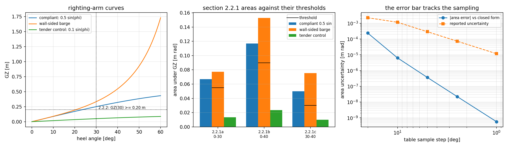

# IS Code 2008 section 2.2 as a rule check with error bars

`tensorcad.statutory` answers one question and only one: **does this GZ curve comply with
the general intact-stability criteria?** The three curve producers in the package
(`tensorcad.gz`, `tensorcad.righting_arm`, `tensorcad.stability`) each say in their own
docstrings that a statutory check is outside their scope. This page documents the module
that closes that gap, the rule it applies, and the evidence that the numbers being compared
are not the sloppy part of the comparison.

`tensorcad.intact_stability` (section 2.2 and 2.3, merged from PR #229/#230) covers the same
ground by a different route. Section 6 is the cross-check between the two: this page does not
claim that duplication is a feature, it *uses* it — two independent routes to one number are
this repository's standing way of validating that number (`docs/m4038_pr40_merge_cure.md`
does the same for `GZ` itself).

## 1. The rule

IMO Resolution MSC.267(85), *International Code on Intact Stability, 2008*, Part A,
chapter 2, section 2.2. Thresholds are held as data in `INTACT_STABILITY_CRITERIA`, so a
caller can print the rule next to the numbers instead of retyping it:

| code | requirement | threshold |
|---|---|---|
| 2.2.1a | area under GZ, 0 to 30 deg | 0.055 m rad |
| 2.2.1b | area under GZ, 0 to 40 deg or to the flooding angle `theta_f` if that is less | 0.090 m rad |
| 2.2.1c | area under GZ, 30 deg to 40 deg (or to `theta_f`) | 0.030 m rad |
| 2.2.2 | GZ at 30 deg | 0.20 m |
| 2.2.3 | heel at which GZ reaches its maximum | 25 deg |
| 2.2.4 | initial metacentric height `GM0` | 0.15 m |

`theta_f` is an input, not an assumption: passing it in is what makes 2.2.1b/2.2.1c *the rule*
rather than the 40-degree special case. Without it the assessment says so in its notes
(`flooding angle not supplied: 40 deg used for the area limits`).

```python
from tensorcad import HullParameters, check_intact_stability, generate_hull
from tensorcad.gz import righting_arm_curve

hull = generate_hull(HullParameters(length=10.0, beam=2.0, draft=0.8))
curve = righting_arm_curve(hull.mesh, kg=0.9, angles_deg=(0, 10, 20, 30, 40), waterline_z=0.8)
assessment = check_intact_stability(curve, flooding_angle_deg=45.0)
print(assessment.verdict(), assessment.to_dict()["checks"])
```

Accepted curve spellings: a callable `f(angle_deg) -> GZ`, an `(angles, levers)` pair, a
`tensorcad.gz.RightingArmCurve`, or a `tensorcad.righting_arm.RightingArmCurve`.

## 2. Method

**Quadrature.** Callable curves go through adaptive Simpson to a requested tolerance with the
`|S2 - S1|/15` error estimate accumulated; the area is returned together with that error.
Tabulated curves are read through monotone cubic Hermite interpolation (Fritsch-Carlson
slopes, which do not overshoot the peak), integrated adaptively, and the *spread against the
plain trapezoidal integral on the same samples* is reported as the uncertainty. On a table
the sampling is the limiting factor, so the module also reports a self-convergence error for
`GM0`: the full table against every second sample.

**Three-valued verdict.** A rule whose margin is smaller than the stated numerical
uncertainty is reported `indeterminate` (`passed is None`), not rounded to a verdict; a curve
that stops short of an angle a rule needs, or that vanishes (floods) before it, is reported
`not_assessed`. `IntactStabilityAssessment.passed` is therefore `True` / `False` / `None`, and
`verdict()` spells the third answer `undetermined`. This is the point of the module: a 0.20 m
requirement met by 0.2000001 m read off a 5-degree ladder is not something it signs off.

**GM0.** Taken either from the caller (the better number, from
`tensorcad.stability.initial_stability`) or read off the curve's slope at upright by
Richardson on 1 deg and 2 deg — `gm0_from_gz_curve`, exact for `GZ = GM sin(phi)` because the
Richardson pair cancels the cubic term.

## 3. Results

Every number below is printed by `tools/statutory_validation.py`; the machine-readable copy
with all rows is `docs/statutory/statutory_validation.json` and the full table set is
`docs/statutory/report.md`. Nothing here is transcribed by hand.

### 3.1 Area quadrature against the closed forms

`int_0^stop GM sin(phi) dphi = GM (1 - cos)` and the wall-sided
`int sin(phi)(GM0 + BM0/2 tan^2 phi) dphi = GM0 (1 - cos) + BM0/2 (sec + cos - 2)`:

| curve | interval [deg] | computed [m rad] | closed form [m rad] | rel. error |
|---|---|---|---|---|
| GZ = 0.5 sin(phi) | 0-30 | 0.066987298108 | 0.066987298108 | 4.14e-16 |
| GZ = 0.5 sin(phi) | 0-40 | 0.116977778441 | 0.116977778441 | 1.19e-16 |
| GZ = 0.5 sin(phi) | 30-40 | 0.049990480333 | 0.049990480333 | 6.94e-16 |
| wall-sided barge | 0-30 | 0.077350269190 | 0.077350269190 | 1.79e-16 |
| wall-sided barge | 0-40 | 0.152703644666 | 0.152703644666 | 1.82e-16 |
| wall-sided barge | 30-40 | 0.075353375477 | 0.075353375477 | 1.84e-16 |

### 3.2 GM0 from the slope at upright

| curve | computed GM0 [m] | reference [m] | rel. error |
|---|---|---|---|
| GZ = 0.5 sin(phi) | 0.50000000 | 0.50000000 | 0.00e+00 |
| wall-sided barge | 0.49999988 | 0.50000000 | 2.48e-07 |

### 3.3 Table coarsening: the reported error bar is real

Same wall-sided curve, sampled on ladders from 20 deg down to 1 deg. The "covered" column
asks whether the reported uncertainty actually bounds the error against the closed form —
a quadrature error bar that does not cover its own error is decoration:

| step [deg] | samples | area 0-30 [m rad] | error [m rad] | reported uncertainty [m rad] | covered |
|---|---|---|---|---|---|
| 20 | 4 | 0.077589369 | +2.39e-04 | 2.24e-03 | True |
| 10 | 6 | 0.077356601 | +6.33e-06 | 1.16e-03 | True |
| 5 | 11 | 0.077350634 | +3.65e-07 | 2.92e-04 | True |
| 2.5 | 21 | 0.077350292 | +2.23e-08 | 7.33e-05 | True |
| 1 | 51 | 0.077350270 | +5.68e-10 | 1.17e-05 | True |

### 3.4 Verdicts, including the mesh route

| case | verdict | statuses |
|---|---|---|
| compliant analytic (GZ = 0.5 sin phi) | `pass` | all six pass |
| wall-sided barge, analytic curve | `pass` | all six pass |
| wall-sided barge, mesh -> `righting_arm_curve` -> check | `pass` | all six pass |
| tender control (GZ = 0.1 sin phi) | `fail` | 2.2.1a/b/c, 2.2.2, 2.2.4 fail |

The mesh route is a closed 12-triangle box (B = 6 m, T = 3 m, D = 8 m) heeled at
0/10/20/30/40 deg by `gz.righting_arm_curve` at constant displacement. Its GZ reproduces the
closed form to 8.9e-16 m, so the rule check sees a curve, not a discretisation:

| heel [deg] | mesh GZ [m] | closed form [m] | \|error\| [m] |
|---|---|---|---|
| 0 | 0.000000000000000 | 0.000000000000000 | 0.00e+00 |
| 10 | 0.089523554302420 | 0.089523554302420 | 8.33e-17 |
| 20 | 0.193664516574472 | 0.193664516574472 | 2.78e-17 |
| 30 | 0.333333333333333 | 0.333333333333333 | 1.11e-16 |
| 40 | 0.547683387507425 | 0.547683387507424 | 8.88e-16 |

The mesh-curve areas then sit 3e-4 relative above the closed form (`0.0773566` vs
`0.0773503` m rad to 30 deg), which is the 5-degree sampling of the ladder, not the
quadrature: the same curve handed over as a callable is at round-off.

## 4. What this module does not do

* **Section 2.3** (severe wind and rolling / weather criterion) needs the windage area, its
  vertical lever and a gust model — not geometry this module holds. (`tensorcad.intact_stability`
  does implement it.)
* **Sections 2.4-2.5** (timber deck cargo, grain, fishing vessels, containerships, offshore
  supply vessels, ...) amend the 2.2 thresholds; none are implemented.
* **Damage stability** is outside for the same reason it is outside `tensorcad.gz`: no
  flooding, no permeability, no compartments.
* **Free-surface correction** is not applied. Add `sum(i_x)/V` to the curve first
  (`gz.free_surface_correction`) — a slack tank shifts every ordinate, and the rule applies
  to the corrected curve, not to the bare one.

Every assessment carries this list in its `scope` field, so a JSON consumer cannot mistake a
section 2.2 pass for a statutory pass.

## 5. Pointers

| artefact | path |
|---|---|
| module | `tensorcad/statutory.py` |
| tests (31) | `tests/test_statutory.py` |
| numbers + figure generator | `tools/statutory_validation.py` |
| machine-readable evidence | `docs/statutory/statutory_validation.json` |
| generated tables | `docs/statutory/report.md` |
| figure | `docs/statutory/statutory_validation.png` |
| sibling implementation (§2.2 + §2.3) | `tensorcad/intact_stability.py`, `docs/intact_stability.md` |



*Left: the three righting-arm curves with the 2.2.2 threshold. Middle: attained areas against
the 2.2.1a/b/c thresholds. Right: the reported uncertainty (and the true error) shrinking as
the sampling ladder is refined, on log axes.*

## 6. Cross-check against `tensorcad.intact_stability`

The sibling module checks the same section of the same code with trapezoidal areas on the
caller's grid and with `gm0` supplied. Both are put on the same curves by
`tools/statutory_validation.py` and by `tests/test_statutory.py`:

| quantity | `tensorcad.statutory` | `tensorcad.intact_stability` | closed form |
|---|---|---|---|
| area 0-30 deg [m rad] | 0.077350269192 | 0.077351002569 | 0.077350269190 |
| area 0-40 deg [m rad] | 0.152703644670 | 0.152705345159 | 0.152703644666 |
| verdict, compliant 0.5 sin(phi) | `pass`, nothing failed | `passes ... 2.2.1-2.2.6`, nothing failed | — |
| verdict, tender 0.1 sin(phi) | `fail`, fails 2.2.1a/b/c, 2.2.2, 2.2.4 | `fails ... 2.2.1, 2.2.2, 2.2.3, 2.2.4, 2.2.6` | — |

Read against the closed form, this module's area is at 1.8e-16 relative and the sibling's at
1.1e-5: the difference between them is the sibling route's `O(h^2)` trapezoidal error on a
0.25-degree ladder, not a disagreement about the rule. The failed-rule sets agree exactly once
the clause labels are crosswalked (below), including the tender curve, where the failing
`GM0 = 0.1 m` is this module's 2.2.4 and the sibling's 2.2.6.

**A numbering divergence worth fixing elsewhere.** `IS_CODE_2008_GENERAL` in
`tensorcad/intact_stability.py` labels the six rules `2.2.1 … 2.2.6`, i.e. it flattens the
code's `2.2.1 a/b/c` into three clauses and shifts the rest by one, so its `2.2.4` is the
`GZ(30 deg)` rule where the code's `2.2.4` is `GM0 >= 0.15 m`. The thresholds and the
verdicts are unaffected — the numbers are the same six numbers — but a report that quotes a
clause number would cite the wrong line of MSC.267(85). This module keeps the code's own
numbering (`2.2.1a/b/c`, `2.2.2`, `2.2.3`, `2.2.4`) and the crosswalk lives in
`CLAUSE_CROSSWALK` (`tools/statutory_validation.py`, `tests/test_statutory.py`). The sibling
was not edited here: it belongs to another change set, and a numbering fix there should carry
its own tests and changelog entry.