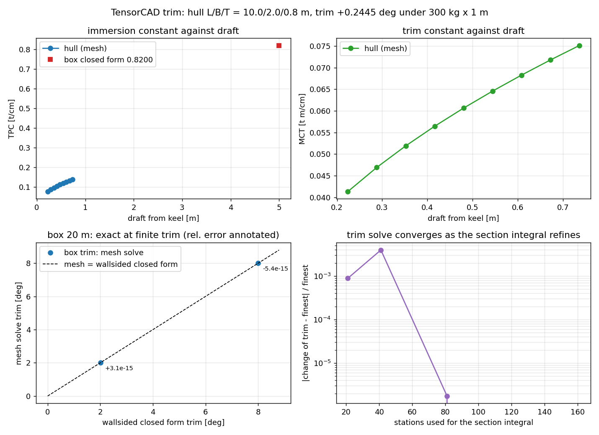

# Trim, TPC and MCT: the longitudinal side of hydrostatics

Everything else in TensorCAD locates buoyancy. This module prices it: how much
immersion costs (`TPC`), how much trim costs (`MCT`), and what a weight moved
along the hull actually does (`equilibrium_trim`).

## 1. What is added

| symbol | definition | implementation |
|---|---|---|
| `TPC` | tonnes per centimetre immersion, `rho * A_wp / 1e5` | `hydrostatic_particulars(...).tpc` |
| `MCT` | tonne-metres per centimetre of trim, `rho_t * I_L / (100 L)` | `.mct` |
| `LCB - LCF` | the lever the longitudinal weight distribution trims about | `.lcb_relative_to_lcf` |
| `hydrostatic_table` | draft against (V, LCB, LCF, KB, KM, TPC, MCT) | `hydrostatic_table(mesh, waterlines)` |
| trim condition | a hull floating at a trim angle with its volume held | `trimmed_hydrostatics`, `waterline_for_displacement` |
| trim equilibrium | the angle that conserves longitudinal moment | `equilibrium_trim` |
| box references | exact particulars and exact trim for a rectangular hull | `box_analytic_particulars`, `box_trim_tangent` |

Units: metres, m^3, kg; `TPC` in t/cm and `MCT` in t*m/cm, with `rho` in kg/m^3
throughout (`SEAWATER_DENSITY = 1025`).

## 2. Method: two routes that share no code

* **Section route** -- clip each station's outline at its own waterline
  (`bonjean.section_properties`), then integrate the areas in `x` with Simpson's
  rule for the volume, and the first moment for the LCB. This is the hand
  calculation, and it is what `volume`, `lcb` and `kb` come from.
* **Waterplane route** -- the plane section's own area and second moments
  (`stability.waterplane_moments`). `TPC` is built from the area, `MCT` and `BM_L`
  from the longitudinal second moment.

The two are compared below. A trim solve needs a few hundred sweeps, so the module
also carries `_SectionCutter`, an index from stations to the faces that can
straddle them; it reproduces the reference route to round-off
(`test_the_indexed_cutter_matches_the_reference_route`) and turns a sweep from
75 ms into 37 ms on the default hull.

Trim itself needs no solid clipping. At a fixed station, "below the tilted plane"
is still a half plane in `(y, z)`, so the same station clip is evaluated at
`z(x) = z_ref + (x - x_ref) tan(theta)`. Volume is then a conserved quantity, not a
linearised one, which is why the box reproduces the wallsided closed form at 8
degrees rather than only near zero.

## 3. Results

### 3.1 Box hull `L/B/T = 20/4/5` m: nine particulars against their closed forms

| quantity | mesh | closed form | relative error |
|---|---|---|---|
| displacement volume | 400.0 m^3 | 400.0 m^3 | 0.0 |
| LCB / LCF | 10.0 / 10.0 m | 10.0 / 10.0 m | 0.0 |
| KB | 2.5 m | 2.5 m | 0.0 |
| waterplane area | 80.0 m^2 | 80.0 m^2 | 0.0 |
| `I_T` | 106.666667 m^4 | `L B^3/12` | -1.3e-16 |
| `I_L` | 2666.666667 m^4 | `B L^3/12` | +5.1e-16 |
| `TPC` | 0.8200000 t/cm | `rho L B/1e5` | 0.0 |
| `MCT` | 1.3666667 t*m/cm | `rho_t B L^2/1200` | +4.9e-16 |

The station area of a box is linear in `x`, so Simpson is exact and the only error
left is the shoelace round-off.

### 3.2 Box hull: trim at finite angle

| moment | mesh trim | wallsided closed form | relative error |
|---|---|---|---|
| 24000 kg x 4 m | 2.0115127468 deg | 2.0115127435 deg | +3.1e-15 |
| 48000 kg x 8 m | 7.9970204491 deg | 7.9970204440 deg | -5.4e-15 |

Two centimetre routes at the second of these: `w d / MCT = 29.26829 cm` and
`100 L tan(theta) = 29.26829 cm`, agreeing to -2.0e-16. Doubling the weight and
halving the shift leaves the trim unchanged to 1e-9 (the answer is the moment,
not the weights).

### 3.3 Parametric hull `L/B/T = 10/2/0.8` m at a part-load waterline

| quantity | mesh | reference | relative error |
|---|---|---|---|
| volume at draft 0.640 m | 5.320602 m^3 | 5.375649 m^3 (`analytic_volume * (T'/T)^1.5`) | -1.02 % |
| `TPC` | 0.1288734 t/cm | 0.1290427 t/cm (`dV/dz` by finite difference) | -1.3e-3 |
| `MCT` at the design waterline | 0.0783168 t*m/cm | 0.0787924 t*m/cm (`waterplane_inertia_longitudinal`) | -6.0e-3 |
| trim, 300 kg x 1 m | 0.2456888 deg | 0.2454632 deg (small-angle `atan(w d / rho I_L)`) | -4.0e-3 |
| trim, 150 kg x -1 m (aft) | -0.1228422 deg | -0.1227322 deg | -4.0e-3 |

### 3.4 Change of trim against the section integral

| stations | change of trim (deg) | relative to 161 |
|---|---|---|
| 21 | 0.245688842 | +8.9e-4 |
| 41 | 0.244492462 | -4.0e-3 |
| 81 | 0.245469622 | -1.7e-6 |
| 161 | 0.245470051 | 0.0 |

21 and 81/161 agree to 0.09 %; the 41-station set is the outlier because it is the
default mesh's *ring* count, so every station plane falls on a vertex ring and the
clip near the stem is decided by the 1e-8 nudge. Practical rule: do not hand
`station_count` the mesh's `nx`.

### 3.5 Wigley hull

| quantity | mesh | reference | relative error |
|---|---|---|---|
| `TPC` at draft `0.8 T` | 0.0080214 t/cm | `dV/dz` (finite difference) | -6.3e-4 |
| trim, 300 kg x 0.5 m | 0.2584409 deg | 0.2585534 deg (small-angle) | -1.0e-3 |



Top: `TPC` and `MCT` against draft for the parametric hull, TPC monotone in draft
and MCT monotone because it tracks `I_L`. Bottom left: the box trim solve against
the wallsided closed form, annotated with the relative error. Bottom right: the
change of trim against the section count, log scale.

Artifacts: `examples/trim/results.json` (every number in this document),
`examples/trim/trim.png`, `examples/trim/run_example.py` (exits non-zero if any
claim in the tables above stops holding).

## 4. Notes, limits and things that bit

* **A hull capped at its own waterline cannot be trimmed.** The generated meshes
  stop at the design waterline, so their volume *is* the cap volume and no trim can
  hold it; `equilibrium_trim` refuses with an explanation instead of returning a
  nonsense angle. Use a part-load waterline (`waterline_z < 0`), which is what
  every table above does.
* **The wallsided closed form stops applying when the waterline leaves the sides.**
  Above about 11 degrees on the `20 x 4 x 5` m box the waterplane is truncated by
  the deck, the mesh solve saturates near 23 degrees, and the closed form's 18
  degrees is simply wrong. The mesh route knows this because it clips the real
  geometry; that asymmetry is the useful part.
* **Ring waterlines are nudged.** `waterplane_moments` needs a clean plane cut, and
  the generator places rings on even levels, so `hydrostatic_particulars` retries
  1e-6 of the mesh scale below the requested height and sets `waterline_nudged`.
  The area moves by O(1e-6) relative, three orders below the discretisation error
  it is used to measure.
* **`MCT` uses the bounding-box length**, the LBP stand-in. For the hull families
  here the stem and the sternpost are the extremes, so the two coincide; for a
  hull with overhanging ends a caller should divide by its own LBP.
* **The small-angle comparison is not a discretisation check.** `atan(w d / rho I_L)`
  is linearised and, for a curved hull, ignores the O(theta^3) term; the -4e-3
  residual at 0.25 degrees is the sum of that term and the Simpson error, which is
  why the box (wallsided, so no linearisation error) is the sharp test at 5e-15.
* **Cost.** A particulars call is one sweep (0.15 s on the 41x13 hull); a trim solve
  is 5-6 outer iterations of 2-3 sweeps each (1.7 s at 41 stations).

## 5. Reproduce

```bash
python examples/trim/run_example.py     # prints the tables, writes results.json + trim.png
python -m pytest tests/test_trim.py -q  # 24 checks incl. the closed forms and the refusals
```
