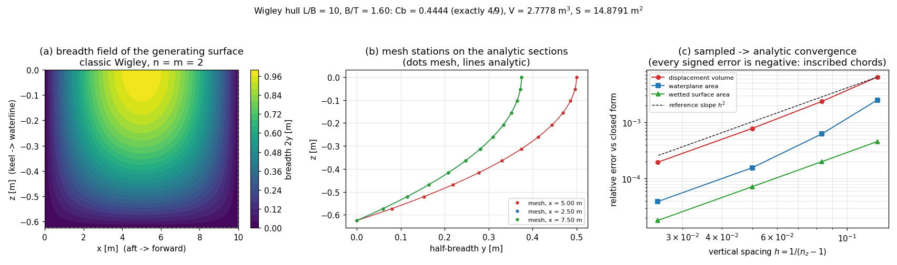

# Wigley hull form: closed forms, sampled convergence, solver exports

This page is written by `python examples/wigley/run_example.py`; every number in it is
read back out of `results.json` from the run that produced `plot.png`.

## 1. Case

* Hull form: `y(x, w) = (B/2)(1 - |2x/L - 1|^n)(1 - (w/T)^m)`, n = 2, m = 2 (classic Wigley).
* L = 10 m, B = 1 m, T = 0.625 m -> L/B = 10.00, B/T = 1.60 (the ITTC reference proportions).
* Water density 1025 kg/m^3; frame: x aft->forward, z = 0 at the design waterline, keel at z = -T.
* Sampling grid 41 stations x 13 levels (1998 triangles).

## 2. Method

The generator lofts one section ring per station (starboard flank down to a shared keel
point, port flank back up) and caps the design waterline, so the surface is a closed solid
whose volume can be integrated from the triangles. Against it stand two independent
references:

* **closed forms**, derived by hand from the separable integrals
  `int_0^L taper dx = L n/(n+1)` and `int_0^T section dw = T m/(m+1)`;
* **a composite Gauss-Legendre quadrature of the analytic flank** for wetted area, the one
  quantity with no elementary primitive, self-converged to the order-to-order difference
  reported below (0.00e+00).

A direct midpoint integral of the generating function re-derives the volume independently:
2.777779514 m^3 vs closed form 2.777777778 m^3 (6.25e-05 %).

## 3. Closed forms

| quantity | closed form | value |
|---|---|---|
| displacement volume | `n m/((n+1)(m+1)) L B T` | 2.777777778 m^3 |
| displacement mass | `rho V` | 2847.222 kg |
| waterplane area | `L B n/(n+1)` | 6.666666667 m^2 |
| midship section area | `B T m/(m+1)` | 0.416666667 m^2 |
| wetted surface | quadrature (no primitive) | 14.879063105 m^2 |
| Cb | `n m/((n+1)(m+1))` | 0.444444444444 (4/9 = 0.444444444444) |
| Cp | `n/(n+1)` | 0.666666666667 |
| Cm | `m/(m+1)` | 0.666666666667 |
| Cwp | `n/(n+1)` | 0.666666666667 |
| VCB above keel | `T - T(m+1)/(2(m+2))` | 0.390625000 m (5T/8 = 0.390625000) |
| LCB / LCF | `L/2` (symmetry) | 5.000000000 m |

## 4. Sampled convergence against the closed forms

| grid | triangles | V [m^3] | e_V [%] | e_Awp [%] | e_S [%] | max abs err [%] |
|---|---|---|---|---|---|---|
| 21 x 9 | 678 | 2.7600098 | -0.63965 | -0.25000 | -0.04570 | 0.63965 |
| 41 x 13 | 1998 | 2.7712221 | -0.23600 | -0.06250 | -0.02009 | 0.23600 |
| 81 x 21 | 6558 | 2.7756079 | -0.07812 | -0.01562 | -0.00720 | 0.07812 |
| 161 x 41 | 25918 | 2.7772353 | -0.01953 | -0.00391 | -0.00180 | 0.01953 |

Observed orders (fitted across the sweep): displacement volume = 2.17, waterplane area = 2.58, wetted surface area = 2.01.
Every error is negative: the loft chords cut inside the analytic surface, so the
discretisation is systematic, not noise -- which is why the closed form is the right thing
to test the integrator against.

## 5. Figures

(a) breadth field of the generating surface -- the quantity every hydrostatic integral
integrates; (b) three sampled stations against their analytic section curves, dots on
lines; (c) log-log convergence of the three extensive quantities with an `h^2` guide.

## 6. Points to watch

* The family has a **finite keel angle** (unlike the `hull` family's `sqrt` taper), which is
  why the default 41x13 grid already lands at 0.236 % on volume against
  0.88 % for the same grid on `sin(pi x/L)^0.7`: second-order convergence of a smooth
  section beats a better-tuned coarse grid.
* Wetted area is a quadrature reference, not a closed form. It is exact to round-off for
  the polynomial integrand of `n = m = 2`, but for non-integer exponents the `|u|^(n-1)`
  term at the ends slows Gauss-Legendre convergence -- re-run `wetted_area_evidence`
  before quoting a wetted area for such a case.
* No appendages, no transom, no parallel middle body: this is a benchmark hull. A real
  design still needs `tensorcad.suboff_appendages` or a fitted offsets table.
* The hull is fore-aft symmetric, so LCB = LCF = L/2 identically: this case does **not**
  exercise the longitudinal moment integrator. `tensorcad.hull` and the SUBOFF case do.

## 7. Error verdict

| claim | measured | threshold | verdict |
|---|---|---|---|
| V = Cb*L*B*T and V = n*m/((n+1)(m+1))*L*B*T are the same number | 1 | 1e-15 | PASS |
| classic Wigley coefficients are the published rationals (Cb 4/9, Cp 2/3, Cm 2/3, Cwp 2/3, VCB 5T/8) | Cb 0.444444, Cp 0.666667, Cm 0.666667, Cwp 0.666667, vcb_over_draft 0.625 | 1e-15 | PASS |
| closed-form volume agrees with a direct midpoint integral of the generating function | 6.25e-07 | 1e-06 | PASS |
| default grid integrates the displacement volume within 1 % of the closed form | -0.00236003 | 0.01 | PASS |
| sampled quantities approach the closed forms monotonically, from below (chords are inscribed) | [-0.006396484374999965, -0.0023600260416665364, -0.0007811523437500157, -0.0001953063964845825], [-0.0025000000000001... | 0 | PASS |
| finest grid is within 0.1 % of the closed forms on every comparable quantity | 0.000195306 | 0.001 | PASS |
| observed convergence order for volume is in [1.8, 3.0] (second-order loft) | 2.1678 | 0 | PASS |
| wetted-area quadrature is self-converged to 1e-9 relative | 0 | 1e-09 | PASS |
| waterline offsets lie on the analytic surface to machine precision | 0 | 1e-12 | PASS |
| default surface is closed, edge-manifold, single-component, Euler-2 and has no zero-area face | watertight 1, edge_manifold 1, euler_characteristic 2, single_component 1, zero_area_faces 0, triangles 1998, vertice... | 0 | PASS |

**Is the key quantity within 3 % of its reference?** Yes, by two orders of magnitude:
the finest grid integrates every comparable quantity to within 0.0195 % of the
closed form, and even the coarsest grid (21 x 9) stays within 0.640 %. The reference is exact algebra, so the
bullet that remains is the *form* (a Wigley is not a ship), not the integrator.
